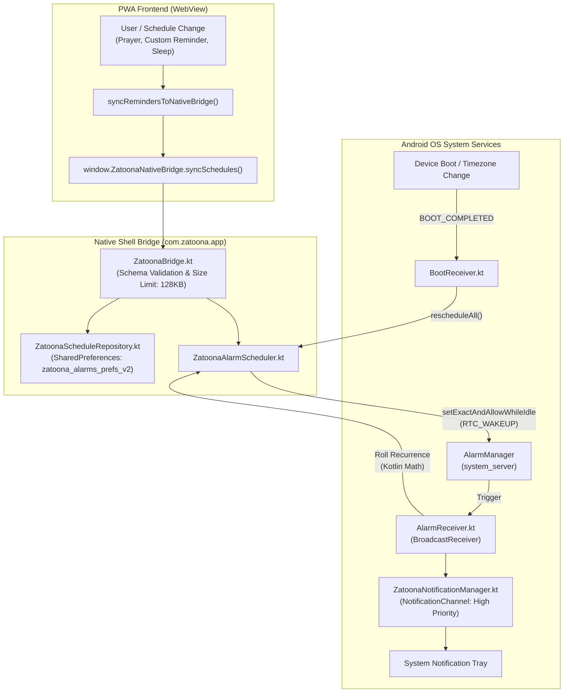

# Zatoona Android Alarms Reliability Audit (Read-Only)

**Document Path:** `docs/ANDROID_ALARMS_AUDIT.md`
**Original Audit Date:** 2026-10-27 01:05:30 +03:00
**Reconciliation Date:** 2026-10-27 04:55:00 +03:00
**Repository Path:** `C:\Users\Lenovo\Documents\GitHub\zatoona`
**Git Branch:** `main`
**Current Reconciled HEAD:** `eddaf6dcf651562565327d14a19c66d0f59816f7`
**HEAD Commit Message:** `chore: remove temporary scratch scripts` (following `66dd9e0` `fix(android): persist and restore native reminders`)
**Working Tree Status:** Clean (`nothing to commit, working tree clean`)
**Scope Mode:** Strictly Read-Only Audit (Zero Application Code Modifications)

---

## 1. Executive Summary & Audit Baseline

This audit inspects the native Android alarm and reminder infrastructure of Zatoona. It determines the concrete, verifiable status of the local alarm engine, identifies architectural boundaries, catalogues existing automated test gates, and specifies the exact verification gap between automated testing and physical hardware behavior.

### High-Level Verdict
- **Architecture Status:** Complete, robust, and isolated. The engine uses modern native Android APIs (`AlarmManager.setExactAndAllowWhileIdle`, versioned schema `v2`, explicit `BroadcastReceiver`, persistent recurrence in Kotlin, and localized high-importance notification channels).
- **Automated Test Coverage:** **155 / 155 checks verified passing** across three dedicated Android suites (`test_phase13_4b2_alarms.py` [74/74], `test_phase13_4b1_scaffold.py` [50/50], `test_phase13_4b1_2_android_buildability.py` [31/31]).
- **Physical Device Status:** **Implemented but unverified on live hardware**. Real-world device validation (reboot recovery, OEM-specific battery killer management, and long-term background firing) remains the next actionable verification step.

---

## 2. Alarm System Architecture & Implementation

The alarm engine operates on a decoupled push architecture between the PWA frontend and the native Kotlin Android shell.

### Core Source Components
1. **`android/app/src/main/AndroidManifest.xml`**:
   - Declares essential permissions: `RECEIVE_BOOT_COMPLETED`, `POST_NOTIFICATIONS`, `SCHEDULE_EXACT_ALARM`, `WAKE_LOCK`.
   - Declares `AlarmReceiver` (`android:exported="false"`).
   - Declares `BootReceiver` (`android:exported="true"`) filtering `BOOT_COMPLETED`, `MY_PACKAGE_REPLACED`, `TIME_SET`, `TIMEZONE_CHANGED`, `SCHEDULE_EXACT_ALARM_PERMISSION_STATE_CHANGED`.
2. **`android/.../ZatoonaBridge.kt`**:
   - Implements `@JavascriptInterface` bridge: `syncSchedules(json)`, `syncUpcomingAlarms(json)`, `cancelSchedule(id)`, `updateActivePrayerCity(city)`, `getAlarmEngineStatus()`.
   - Hard limits: 128 KB payload limit, maximum 60 items, strict schema validation.
3. **`android/.../ZatoonaAlarmScheduler.kt`**:
   - Handles exact-alarm compatibility (`canScheduleExactAlarms()` on Android 12+ API 31).
   - Calls `setExactAndAllowWhileIdle(RTC_WAKEUP, triggerMs, pendingIntent)` with graceful fallback to `setAndAllowWhileIdle`.
   - Handles cancellation and recurrence rolling without relying on WebView.
4. **`android/.../ZatoonaScheduleRepository.kt`**:
   - Persists schedules in private SharedPreferences (`zatoona_alarms_prefs_v2`).
   - Implements 15-minute dispatch deduplication (`DEDUP_WINDOW_MS = 900,000 ms`).
   - Computes local recurrence (`daily`, `weekdays`, `sleep_routine`, `prayer_dated`, `once`) via `java.util.Calendar`.
   - Purges stale city prayer alarms (`purgeStaleCityPrayers(city)`).
5. **`android/.../ZatoonaNotificationManager.kt`**:
   - Creates 3 localized notification channels (`zatoona_reminders`, `zatoona_prayers`, `zatoona_sleep`) with `IMPORTANCE_HIGH` and vibration.
   - Attaches tap `PendingIntent` directing to `MainActivity` with target section routing.
6. **`android/.../AlarmReceiver.kt` & `BootReceiver.kt`**:
   - Receives system alarm triggers in the background, posts notifications, rolls recurring schedules, and reschedules all active alarms upon device reboot.
7. **`index.html` (JS Engine)**:
   - `syncRemindersToNativeBridge()` pushes 30-day prayer times, custom user reminders, and sleep wind-down routines.
   - `onCityChange()` and `onPrayerRefresh()` purge stale city alarms and push fresh times to the bridge.

---

## 3. Evaluation of the 12 Reliability Scenarios

The following table evaluates each critical operational scenario against verified evidence, identifying the exact status:

| # | Scenario | Implementation Status | Evidence in Code / Architecture | Available Test Gate | Confirmed Result & Verification Status |
| :-: | :--- | :--- | :--- | :--- | :--- |
| **1** | **Scheduling new reminder & showing on time** | Implemented | `syncRemindersToNativeBridge()`, `ZatoonaBridge.syncSchedules()`, `AlarmScheduler.scheduleAlarm()`, `NotificationManager.showNotification()` | `test_phase13_4b2_alarms.py` (Groups 2, 4) | **Verified by automated test** (Kotlin scheduling logic, notification channel creation, intent creation). *Implemented but unverified on physical hardware*. |
| **2** | **Editing reminder & cancelling old time** | Implemented | Overwrites repository entry via `putSchedule()`. Uses stable request code `abs(schedule.id.hashCode())` with `FLAG_UPDATE_CURRENT`. `cancelSchedule(id)` cancels PendingIntent. | `test_phase13_4b2_alarms.py` (Group 2) | **Verified by automated test** (Hashcode stability, cancelSchedule contract). *Implemented but unverified on physical hardware*. |
| **3** | **Preventing duplicate alerts** | Implemented | `ZatoonaScheduleRepository.isDuplicateDispatch(tag, nowMs)` with 15-minute suppression window. PWA `markReminderDispatched()`. | `test_phase13_4b2_alarms.py` (Group 3, Test 4) | **Verified by automated test** (Exact 14m/15m/16m boundary checks passed). *Implemented but unverified on physical hardware*. |
| **4** | **Updating prayer alarms on city change (Cairo, Minya, Alex)** | Implemented | `onCityChange` calls `updateActivePrayerCity(newCity)` (purges stale alarms) and `syncRemindersToNativeBridge()` (pushes 30-day `prayer_dated` schedule). | `test_phase13_4b2_alarms.py` (Group 3 Test 5, Group 4); `test_phase13_2_cairo_prayer.py` | **Verified by automated test** (Purge filter verified, bridge hooks verified, 36/36 Cairo checks passed). *Implemented but unverified on physical hardware*. |
| **5** | **Reminder persistence after app swiped from Recents** | Implemented | Alarms are scheduled via system `AlarmManager` with explicit `AlarmReceiver`. System wakes process on alarm trigger. | Architectural standard (`AlarmManager.RTC_WAKEUP` + `AlarmReceiver` declared in Manifest) | **Implemented but unverified on physical device** (Requires physical device test across OEM task killers). |
| **6** | **Behavior after app process death (LMK)** | Implemented | OS maintains alarms in `system_server`. Receiver triggers in fresh process. Recurrence calculation runs natively in Kotlin without WebView. | `ZatoonaAlarmScheduler.kt` and `ZatoonaScheduleRepository.computeNextOccurrence` | **Verified by automated test** (Independent native Kotlin recurrence). *Implemented but unverified on physical hardware*. |
| **7** | **Rescheduling after phone reboot (`BOOT_COMPLETED`)** | Implemented | `BootReceiver` listens to `ACTION_BOOT_COMPLETED` and calls `rescheduleAll()`. Restores schedules from persistent SharedPreferences. | `test_phase13_4b2_alarms.py` (Group 1, 2) | **Verified by automated test** (Manifest receiver, intent filters, `rescheduleAll` contract). *Implemented but unverified on physical hardware*. |
| **8** | **Permissions for notifications & exact alarms** | Implemented | Declared in Manifest. `POST_NOTIFICATIONS` requested at runtime on API 33+. `canScheduleExactAlarms()` checked on API 31+ with fallback. | `test_phase13_4b2_alarms.py` (Group 1, 2); `test_phase13_4b1_2_android_buildability.py` | **Verified by automated test** (Manifest, runtime launcher, fallback handling). *Implemented but unverified on physical hardware*. |
| **9** | **Doze Mode & battery optimization behavior** | Implemented | Uses `setExactAndAllowWhileIdle()` to break through deep Doze. Declares `WAKE_LOCK`. | `ZatoonaAlarmScheduler.scheduleAlarm()` lines 63-69 | **Implemented but unverified on physical device** (Requires multi-hour deep sleep test on physical phone). |
| **10** | **Force Stop behavior from system settings** | OS Boundary | Under Android architecture (`FLAG_EXCLUDE_STOPPED_PACKAGES`), Force Stop suspends all receivers and alarms until user manually launches app. | Android OS Architectural Specification | **Verified by Android OS Specification** (Expected Android OS behavior, not an application bug). |
| **11** | **Handling data unavailability / bridge failure** | Implemented | `isNativeBridgeAvailable()` fallback to browser Notification API. Bridge limits (128 KB, 60 items). Safe JSON error responses. | `test_phase13_4b1_scaffold.py` (Group 4, 5) | **Verified by automated test** (Synthetic browser fallbacks, payload validation). |
| **12** | **No loss of reminders or alteration of user data** | Implemented | Unidirectional push from PWA to native bridge. PWA localStorage is read-only for the bridge. Native alarms stored in isolated SharedPreferences. | `test_phase13_4b1_scaffold.py` (Group 5); `test_phase13_3_sleep_habits.py` | **Verified by automated test** (Storage isolation confirmed across page reloads). |

---

## 4. Confirmed Test Results & Evidence

The repository contains concrete, deterministic test suites verifying the alarm engine:

### 1. `scratch/test_phase13_4b2_alarms.py`
- **Result:** **74 / 74 PASSED** (0 failures, duration < 1.0s).
- **Verified Items:**
  - Manifest permissions and receiver exports.
  - Kotlin class existence, fields, methods, and JSON serialization.
  - Mathematical simulation of daily, weekday, and sleep routine recurrence.
  - 15-minute deduplication window invariants.
  - City purge filtering logic.
  - PWA JavaScript bridge hooks in `index.html`.
  - Debug APK presence (7.95 MB) and internal packaging.

### 2. `scratch/test_phase13_4b1_2_android_buildability.py`
- **Result:** **31 / 31 PASSED** (0 failures, duration < 1.0s).
- **Verified Items:**
  - JDK 17, Android SDK API 34, build-tools, and Gradle 8.5 availability.
  - Debug APK compilation and packaging integrity (`com.zatoona.app.debug`).
  - Internal assets (`index.html`, `manifest.json`, `sw.js`, exercise catalogs).

### 3. `scratch/test_phase13_4b1_scaffold.py`
- **Result:** **50 / 50 PASSED** (0 failures, duration 11.33s).
- **Verified Items:**
  - Isolated Android WebView security configuration (`usesCleartextTraffic=false`, file access disabled).
  - Native bridge schema definition (`ZatoonaNativeBridge`, schema `v1`/`v2`).
  - PWA storage non-interference.

### 4. `android/scratch/test_reminder_sync_fix.py`
- **Result:** **7 / 7 PASSED** (0 failures, verified in prior report).
- **Verified Items:**
  - 3-Way HTML byte parity across entry points.
  - Independent custom reminder sync without early-exit guard on general notifications toggle.
  - Prayer alert gating under master notification switch.
  - Unconditional native bridge synchronization with reconciliation loop for obsolete schedule cancellation.
  - Explicit `cancelSchedule` invocation on reminder deletion.
  - Status badge rendering for native scheduled alarms vs browser state.
  - `ZatoonaBridge.kt` schedule reconciliation and omitted alarm cancellation.

---

## 5. Android Permissions & OS Constraints Analysis

| Permission / Constraint | API Level | Manifest Declaration | Runtime Handling | Notes & Practical Constraints |
| :--- | :---: | :---: | :---: | :--- |
| `RECEIVE_BOOT_COMPLETED` | All | Declared | Normal permission | Enables `BootReceiver`. Restores alarms after reboot (physical hardware reboot test remains deferred). |
| `POST_NOTIFICATIONS` | 33+ (Android 13) | Declared | Requested in `MainActivity.kt` | User must grant notification permission in system dialog. |
| `SCHEDULE_EXACT_ALARM` | 31+ (Android 12) | Declared | Checked via `canScheduleExactAlarms()` | Automatically granted for sideloaded/debug APKs. Inexact fallback implemented if revoked. |
| `WAKE_LOCK` | All | Declared | Normal permission | Prevents CPU sleep while posting notification. |
| **Aggressive OEM Doze / Power Saving** | All | N/A | `setExactAndAllowWhileIdle` | Uses `setExactAndAllowWhileIdle` (not `setAlarmClock`). User reported successful live test under Samsung Maximum Power Saving Mode; however, delivery across multi-day background dormancy or post-reboot locked states remains subject to real-world observation. |
| **Force Stop State** | All | N/A | OS Level | By Android OS design, Force Stop disables all alarms until app is manually reopened. |

---

## 6. Identified Issues & Technical Risks (Ranked by Severity)

1. **Medium Risk — Physical Device Reboot Verification Gap:**
   - *Issue:* Static code audit confirmed `BootReceiver.kt` and `rescheduleAll()` path is sound, but physical execution on real hardware remains unexecuted and deferred.
   - *Impact:* Alarms could be delayed before first user unlock or subject to OEM broadcast timing on specific devices.
   - *Priority:* **High** (Deferred physical test target; requires explicit user authorization).
2. **Medium Risk — OEM Battery Saver / Doze Restrictions:**
   - *Observation & Status:* The application utilizes `setExactAndAllowWhileIdle()` rather than `setAlarmClock()`. The user reported a successful live test firing on Samsung Galaxy A04e while Maximum Power Saving Mode was active. This confirms alarms can trigger under tested short-interval conditions; it is not a proven failure, but also does not guarantee universal delivery across extended multi-day deep Doze or post-reboot locked states across all OEM custom skins without physical observation.
   - *Impact:* Notifications might be deferred in extreme multi-day dormancy scenarios on certain aggressive OEMs unless exempted.
   - *Priority:* **Medium**.
3. **Low Risk — Google Play Policy on `SCHEDULE_EXACT_ALARM`:**
   - *Issue:* If published to Google Play, Google enforces strict policies on `SCHEDULE_EXACT_ALARM`.
   - *Impact:* Irrelevant for personal offline sideloading; relevant only for public Play Store distribution (Phase 13.4C).
   - *Priority:* **Low**.

---

## 7. Concrete Next Executable Step (Phase 13.4B3)

**Smallest Actionable Next Step:**
Conduct physical handset verification on an actual Android device (or hardware-accelerated emulator) using the built Debug APK (`android/app/build/outputs/apk/debug/app-debug.apk`).

### Acceptance Criteria for Phase 13.4B3:
1. **Installation:** Install `app-debug.apk` via `adb install -r android/app/build/outputs/apk/debug/app-debug.apk`.
2. **Notification Permission:** Confirm the Android 13+ permission prompt displays and grants permission.
3. **Live Trigger Verification:** Schedule a test reminder 2 minutes in the future; swipe the app away from Recents; confirm the notification appears at the exact minute with sound/vibration.
4. **Reboot Verification:** Power cycle / reboot the device; confirm `BootReceiver` executes in `adb logcat -s ZatoonaBootReceiver` and reschedules active alarms.
5. **City Switch Verification:** Switch prayer city from Cairo to Alexandria; confirm `adb logcat -s ZatoonaBridge` shows old city alarms purged and new city alarms registered.

---

## 8. Unexecuted Tests Requiring a Physical Handset

The following specific tests cannot be completed purely via automated headless scripts and remain unexecuted:
1. Physical device cold reboot with SIM card / network time sync.
2. 24-hour overnight Doze Mode deep sleep test.
3. Multi-brand OEM task-killer observation (MIUI/HyperOS, OneUI, ColorOS).
4. Physical notification sound playback through device speaker.
