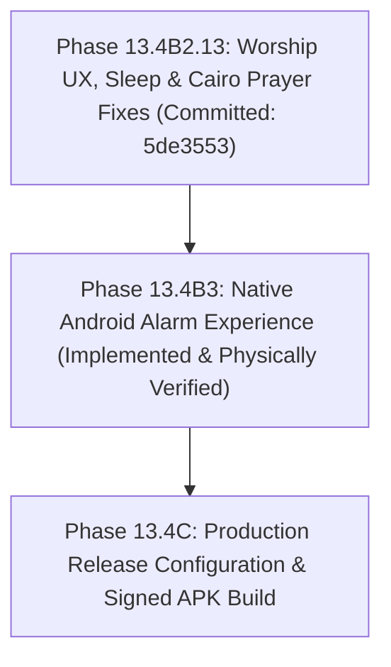

# Zatoona Project Status & Development Baseline

**Document Path:** `docs/PROJECT_STATUS.md`  
**Last Updated:** 2026-10-28 15:25:00 +03:00<br>
**Repository:** `C:\Users\Lenovo\Documents\GitHub\zatoona`<br>
**Remote Origin:** `https://github.com/medodem36-sudo/zatoona.git`<br>
**Active Branch:** `main`<br>
**Current HEAD:** `6646bb7`<br>
**Head Commit Message:** `Widget`<br>
**Working Tree Status:** Clean baseline (`c382a50`); Phase A3 Worship Badges, Phase 13.3B Habit Streaks, Phase 13.5B Battery Guide, Phase 10 Encrypted Backup, Phase 13.6B Fasting Tracker, Phase 13.7B Worship Adherence, Phase 13.8B Qibla Compass, Phase 13.9 Habits/Share Card, Phase 13.10 Smart Notification Grouping, Phase 14 Release Signing Template & Phase 13.5 Quick Access & Next Prayer Widgets implemented; signing protection added to `.gitignore`; `docs/MASTER_ROADMAP.md` established.

---

## 1. Executive Summary & Active Phase

Zatoona is an offline-first Personal Wellness & Productivity Progressive Web Application (PWA) with an integrated native Android WebView shell (`com.zatoona.app`).

### Active Phase: Phase 13.5 — Native Android Home-Screen Widgets (Proposals #7 & #8) (Completed & Verified)
This phase introduces a complete suite of native Android home-screen widgets providing instant awareness and one-tap deep navigation directly from the phone's launcher:
1. **Quick Access Widget (`QuickAccessWidgetProvider.kt` & `widget_quick_access.xml`):** Provides 4 direct one-tap shortcut buttons to core app modules (🕌 الصلوات `prayer`, 🏋️ التمارين `gym`, 🥗 التغذية `meal`, 📅 الجدول `schedule`) and header dashboard navigation (`home`).
2. **Next Prayer Widget (`NextPrayerWidgetProvider.kt` & `widget_next_prayer.xml`):** Displays upcoming prayer name, scheduled time in Arabic 12-hour format (`ص` / `م`), active city badge (`القاهرة` / `الإسكندرية` / `المنيا`), and live natural Arabic countdown grammar (`⏳ باقي ساعة و 25 دقيقة` / `⏳ باقي 45 دقيقة` / `حان وقت الصلاة الآن`).
3. **Dynamic Bridge Resynchronization (`ZatoonaBridge.kt`):** Automatically updates all active Next Prayer widgets via `NextPrayerWidgetProvider.updateAllWidgets(context)` whenever prayer times are synchronized (`syncSchedules`) or the prayer city is changed (`updateActivePrayerCity`) from the PWA.
4. **Pure RemoteViews & Dark Theme RTL Layouts:** Strict adherence to Android `RemoteViews` constraints (`LinearLayout`, `TextView`, `ImageView`), rounded cards (`#1A202C`), and high-contrast typography.
5. **Security, ProGuard & APK Packaging:** Protected by ProGuard rules, registered in `AndroidManifest.xml`, and verified inside compiled APK (`app-debug.apk`, 8,964,453 bytes) with both providers in `classes.dex` and all XML resources packaged.
6. **Automated Verification:** Verified via `scratch/test_phase13_5_widgets.py` (57 / 57 passed), `scratch/test_phase13_5_next_prayer_widget.py` (53 / 53 passed), and full master regression gate (28 / 28 suites, 1231 / 1231 checks, 198.75s).

### Prior Phase: Phase 14 — Release Signing Configuration Template (Completed & Verified)
This phase establishes a secure, modular Android release signing architecture adhering strictly to credential isolation and zero-secret repository principles:
1. **Conditional Gradle Release Signing Architecture (`android/app/build.gradle.kts`):** Wires `signingConfigs.create("release")` to dynamically read signing keys from `android/keystore.properties` only when the file is present on the local machine (`hasReleaseSigningConfig = keystorePropertiesFile.exists()`), preventing build failures in environments without release credentials.
2. **Standardized Keystore Properties Template (`android/keystore.properties.example`):** Provides a comprehensive developer template with explicit instructions for `keytool` keystore generation, parameters (`storeFile`, `storePassword`, `keyAlias`, `keyPassword`), and prominent security warnings.
3. **Repository Secret Guardrail Integrity:** Enforces absolute exclusion of `keystore.properties`, `signing.properties`, `*.keystore`, `*.jks`, and `*.p12` via `.gitignore`. Automated scanner confirms zero keystore files in the repository.
4. **ProGuard & R8 Optimization Rules (`android/app/proguard-rules.pro`):** Validates that R8 code shrinking and optimization keep all `@android.webkit.JavascriptInterface` methods and the native `ZatoonaBridge` contract without obfuscation or symbol stripping.
5. **Debug APK Buildability Invariance:** Confirms debug APK compilation and packaging (`app-debug.apk`, 8,964,453 bytes) remains 100% operational and healthy.
6. **Automated Verification:** Verified via `scratch/test_phase14_release_signing.py` (40 / 40 passed) and full master regression gate (26 / 26 suites, 1121 / 1121 checks, 196.99s).

### Prior Phase: Phase 13.10 — Smart Notification Grouping (Proposal #14) (Completed & Verified)
This phase introduces intelligent batching of concurrent notifications into unified digest cards to reduce alert fatigue:
1. **Smart Grouping Engine in `checkAndDispatchDueReminders`:** When multiple reminders fire within the same 15-minute window, they are consolidated into a single grouped notification with itemized list, total count, and mode-priority routing (prayer > schedule > sleep > others).
2. **User-Configurable Toggle (`smartGrouping` in `NOTIF_SETTINGS_DEFAULT`):** Users can enable/disable grouping via a dedicated checkbox in the notification settings UI, with the setting persisted in `notification-settings` storage.
3. **Unified In-App Modal for Grouped Alerts:** The `showInAppReminderModal` seamlessly renders grouped notifications with individual task breakdowns and a single action button.
4. **Android Native Notification Grouping:** `ZatoonaNotificationManager.kt` enhanced with `GROUP_ZATOONA_REMINDERS` and `setGroupSummary(true)` for Android notification shade stacking, plus automatic summary cleanup when all group members are dismissed.
5. **Backward Compatibility:** Single reminders continue dispatching individually (zero regression). Disabling `smartGrouping` falls back to legacy per-notification behavior.
6. **Automated Verification:** Verified via `scratch/test_phase13_smart_notification_grouping.py` (37 / 37 passed).

### Prior Phase: Phase 13.9 — Custom Habits & Skills Learning Tracker + Social Accountability Card (Completed & Verified)
This phase introduces a dedicated daily habit acquisition and skill learning tracker along with an offline social accountability progress card:
1. **Dedicated Custom Habit & Skill Acquisition Engine (`loadCustomHabitsList` / `addCustomHabit` / `deleteCustomHabit`):** Empowers users to define arbitrary daily habits (`🎯 عادة يومية`) and learning goals (`📚 تعلّم مهارة`), with customizable daily targets (e.g. 30 دقيقة، 15 صفحة، 1 درس).
2. **Individual Consecutive Streaks & Total Days Counter (`computeCustomHabitStreak(id, refIso)`):** Computes daily consecutive streaks (🔥) and total historical days completed on-the-fly with leap-year and timezone-safe date math.
3. **Interactive UI in Schedule View (`#customHabitsContainer` in `#scheduleView`):** Features an accordion form for adding new habits, a dynamic completion badge (`#badge-customHabits`), animated checkbox toggles for selected dates, and habit removal.
4. **Daily Progress Summary & Social Accountability Card (`#dailyShareCard` in `#overviewView`):** Formatted live markdown summary of today's achievements across all life pillars (5 Fard prayers, Sunnah, Qiyam, Quran, Fasting, Habits & Skills, Sleep, Water) with 1-tap clipboard copy (`#btnCopyDailySummary`) and Web Share API (`#btnShareDailySummary`).
5. **Zero Schema Migration & Encrypted Backup Integration:** Storage keys `custom-habits-list` and `customhabits:YYYY-MM-DD` registered into `KNOWN_KEY_PATTERNS` in `validateBackupData()`.
6. **Automated Verification:** Verified via `scratch/test_phase13_habits_and_share.py` (29 / 29 passed) and full master regression gate (24 / 24 suites, 1044 / 1044 checks, 188.64s).

### Prior Phase: Phase 13.8B — Prayer Qibla Compass Engine & Dial (Proposal #10) (Completed & Verified)
This phase introduces a comprehensive, offline-first Qibla direction finder and interactive compass dial embedded directly within the Worship & Prayer module:
1. **Accurate Spherical Trigonometry Engine (`calculateQibla(lat, lon)`):** Calculates exact great-circle bearing and distance to the Kaaba (`21.4225° N, 39.8262° E`) using spherical trigonometry and Haversine distance formula with cardinal compass direction mapping.
2. **100% Offline Predefined Egyptian Cities (`getCityQibla(cityKey)`):** Preloaded astronomical coordinates for Cairo (`30.0444°N, 31.2357°E` -> 136.1°, 1287 km), Alexandria (`31.2001°N, 29.9187°E` -> 135.4°, 1467 km), and Minya (`28.1099°N, 30.7503°E` -> 127.1°, 1179 km).
3. **Interactive Vector Compass Card (`#qiblaCard`):** Features a 200x200 SVG compass dial (`#qiblaSvgDial`) with cardinal directions (شمال، شرق، جنوب، غرب), degree ticks, and rotating needle with Kaaba emblem (`🕋`).
4. **Real-time Device Orientation & Alignment Detection:** Supports live compass mode (`startLiveCompass` / `updateCompassRotation`) reading device magnetometer sensors via `DeviceOrientationEvent` (`webkitCompassHeading` on iOS, `alpha` on Android/Chrome) with visual emerald glow, alignment banner, and subtle haptic feedback (`navigator.vibrate(50)`) when heading aligns within $\pm 4^\circ$ of Qibla.
5. **High-Accuracy Geolocation Fallback (`requestGpsQibla`):** One-tap GPS button querying device GNSS coordinates via `navigator.geolocation` for accurate calculation anywhere in Egypt or worldwide.
6. **Automated Verification:** Verified via `scratch/test_phase13_qibla_compass.py` (23 / 23 passed) and full master regression gate (23 / 23 suites, 1015 / 1015 checks, 182.87s).

### Prior Phase: Phase 13.7B — Weekly & Monthly Worship Adherence Report (Proposal #11) (Completed & Verified)
This phase introduces a multi-domain, visual worship consistency and adherence analytics engine across Worship and Overview views:
1. **Interactive Adherence Container (`#worshipAdherenceContainer`):** Integrated in `#prayerView` with 7-day (`٧ أيام`) and 28-day (`٢٨ يومًا`) range toggles for historical trend analysis.
2. **Comprehensive Multi-Pillar Tracking:** Computes live statistics across all spiritual pillars: 5 Fard prayers, Sunnah Ratibah, Qiyam & Witr (Night prayer), Morning/Evening Azkar, Quran Wird, and Voluntary/Sunnah Fasting.
3. **Per-Prayer Performance Breakdown:** Dedicated progress bars for each of the five daily prayers (Fajr, Dhuhr, Asr, Maghrib, Isha) indicating exact completion count, total days, and individual consistency percentage.
4. **Overview Analytics Hub Synchronization (`#domainWorship`):** Upgraded Overview domain card with live Fard consistency percentage pill (`score-pill`), visual progress bar (`scoreBar`), and one-tap deep navigation button (`#btnGoWorshipAdherence`) routing directly to prayer view.
5. **Zero Schema Migration & Non-Destructive Storage:** Calculates all metrics on-the-fly from existing `localStorage` keys (`prayer:{iso}`, `qiyam:{iso}`, `nawafil:{iso}`, `azkar:{iso}`, `quran:{iso}`, `fasting:{iso}`) with 100% offline reliability.
6. **Automated Verification:** Verified via `scratch/test_phase13_worship_adherence.py` (22 / 22 passed) and full master regression gate (22 / 22 suites, 992 / 992 checks, 171.59s).

### Prior Phase: Phase 13.6B — Fasting Tracker & Sunnah Days (صيام التطوع والسنن والقضاء) (Completed & Verified)
This phase introduces a dedicated voluntary and Sunnah fasting tracker embedded directly within the Worship & Prayer module:
1. **Interactive Fasting Card (`#fastingCard`):** Directly integrated in the Worship section with responsive RTL toggle `#btnToggleFasting` and category selector (`#fastingTypeSelect`).
2. **Dedicated Fasting Categories:** Covers Sunnah fasts (سنة), make-up fasts (قضاء), expiation fasts (كفارة), and general voluntary fasts (تطوع عام), with an optional personal reflection note.
3. **Automated Sunnah Fasting Day Detection:** Evaluates active dates dynamically via `isSunnahFastingDay(iso)` — automatically recognizing Mondays and Thursdays (صيام الإثنين والخميس) and Hijri White Days (الأيام البيض 13، 14، 15) with an emerald advisory banner.
4. **Monospace Monthly Fasting Badge (`#badge-fasting`):** Computes total fasting days completed in the currently viewed month (`countMonthlyFasts(yearMonth)`) updating live with zero page reloads.
5. **Zero Data Migration & Non-Destructive Storage:** Persists seamlessly to `fasting:YYYY-MM-DD` with verified backward-compatibility and encrypted backup integration.
6. **Automated Verification:** Verified via `scratch/test_phase13_fasting_tracker.py` (18 / 18 passed) and full master regression gate (21 / 21 suites, 970 / 970 checks).

### Prior Phase: Phase 10 — Encrypted Backup Export & Import (AES-GCM) (Completed & Verified)
This phase introduces secure, password-protected backup export and import using standard browser cryptography:
1. **Hardware-Accelerated Web Crypto API:** Utilizes standard `window.crypto.subtle` with PBKDF2 (100,000 iterations of SHA-256) for key derivation from user password, and 256-bit AES-GCM with cryptographic random 12-byte IV for authenticated encryption.
2. **Standard Payload Format (`v1-encrypted`):** Exports structured JSON with Base64-encoded salt, IV, and ciphertext (`tracker-backup-YYYY-MM-DD-encrypted.json`).
3. **Seamless Backward Compatibility:** Unencrypted backups continue to import directly with zero password prompts. Encrypted backups prompt via an accessible RTL modal (`#decryptBackupModal`) or programmatic option.
4. **Tamper Resistance & Error Handling:** Authentication tag verification natively detects wrong passwords or tampered payload bytes and gracefully aborts without affecting existing `localStorage` or `IndexedDB`.
5. **Interactive UI in Section 10:** Added toggle `#chkEncryptBackup` in Section 10 with modal dialogs `#encryptBackupModal` and `#decryptBackupModal`.
6. **Automated Verification:** Verified via `scratch/test_phase10_encrypted_backup.py` (21 / 21 passed) and full master regression gate (20 / 20 suites, 952 / 952 checks).

### Prior Phase: Phase 13.5B — Per-Manufacturer Battery Optimization Guide (Completed & Verified)
This phase addresses Android background kills and aggressive OEM battery management across user devices:
1. **Interactive Multi-OEM Guide Modal (`#batteryGuideModal`):** Accessible directly from the Reminders & Notification settings card (`#notifStatusCard`) via `#btnBatteryGuide`, and globally via `window.openBatteryGuide(brand)`.
2. **Dedicated Step-by-Step Instructions across 5 Major OEM Categories:** Samsung (One UI), Xiaomi/Redmi/POCO (MIUI & HyperOS), Huawei/Honor (EMUI & MagicOS), Oppo/Realme/OnePlus (ColorOS), Stock Android/Pixel.
3. **Environment-Aware Diagnostic Reassurance Badge:** Detects native Android WebView shell vs PWA browser context.
4. **Automated Verification:** Verified via `scratch/test_phase13_battery_guide.py` (26 / 26 passed).

### Prior Phase: Phase 13.3B — Habit Streaks Engine & Motivation Tracker (Completed & Verified)
This phase introduces a robust, multi-domain habit streak calculation engine and motivation dashboard:
1. **Multi-Domain Habit Consistency Tracking:** Computes daily consecutive streaks, personal best streaks, and total active days across 6 key pillars (Prayers, Quran Wird, Azkar, Sleep Habits, Water, Schedule tasks).
2. **Leap-Year & Calendar-Safe Date Math:** Implemented `shiftIsoDay(iso, offsetDays)` ensuring full date arithmetic accuracy across month boundaries, leap years, and year rollover without UTC/local timezone skew.
3. **Home Dashboard Streak Card (`#homeStreaksCard`):** Touch-friendly summary on the Home view with interactive navigation pills directly routing the user to the corresponding module.
4. **Overview Analytics Hub (`#domainStreaks`):** Comprehensive breakdown in the Overview tab displaying individual streak counts, personal best records with trophy badges (`🏆`), and motivation progress bars.
5. **Zero Data Migration & Non-Destructive Storage:** Dynamically calculates streaks on-the-fly from existing `localStorage` keys with zero schema mutations.
6. **Automated Verification:** Verified via `scratch/test_phase13_habit_streaks.py` (26 / 26 passed).

### Prior Phase: Phase A3 — Worship Checklist Visual UX & Section Badges (Completed & Verified)
This phase addresses user confusion from identical-looking checklist controls across worship categories:
1. **Pill-Shape Counter Badges:** Each section header (الفروض والسنن، قيام الليل والوتر، باقي النوافل، أذكار الصباح والمساء، ورد القرآن) features a monospace count badge (e.g. `0/2`, `1/3`) that turns green with `✓` upon full section completion.
2. **Category Thematic Border Accents:** Each worship category features a distinct leading border and background tint when checked (Moon purple `#818cf8` for Qiyam, Sun amber `#f59e0b` for Nawafil, Emerald `#10b981` for Azkar, Cyan `#06b6d4` for Quran, Primary green for Fard).
3. **Comprehensive 6-Metric Prayer Summary:** Expanded `prayerSummary` from 3 to 6 live metric cards (Fard, Sunnah, Qiyam & Witr, Nawafil, Azkar, Quran) with reactive updates on every toggle without page reload.
4. **Automated Verification:** Verified across static code analysis and live Headless Chrome runtime interactions via `scratch/test_phase13_worship_ux_badges.py` (31 / 31 passed).

### Prior Completed Phase: Phase 13.4B3 — Native Android Alarm Experience & Reminder Sync (Completed & Verified)
This phase transformed the reminder system into a true native Android alarm experience compliant with Android 14 (API 34) platform requirements:
1. **Official Foreground Service (`specialUse`):** Implemented `AlarmService.kt` with `android:foregroundServiceType="specialUse"` and `PROPERTY_SPECIAL_USE_FGS_SUBTYPE` per Google's official alarm/timer policy.
2. **Continuous Audio & Vibration Lifecycle:** Continuous looping `MediaPlayer` utilizing `AudioAttributes.USAGE_ALARM`, transient exclusive `AudioFocus` management, looping `VibrationEffect` pattern, and a 10-minute auto-silence safety timeout to protect battery.
3. **Full-Screen Interactive Lock-Screen UI (`AlarmActivity.kt`):** Native activity running over the lock screen (`setShowWhenLocked`, `setTurnScreenOn`, `FLAG_KEEP_SCREEN_ON`) with custom Arabic RTL layout, large clock, reminder details, interactive swipe-to-dismiss track (>= 70% drag threshold with haptic feedback & smooth spring-back), and secondary accessible dismiss button.
4. **Unified Dismissal & Deduplication:** Immediate teardown of audio, vibration, wakelock, and notification upon swipe, button tap, or notification action; strict suppression of rapid duplicate dispatches; automatic rolling of recurring schedules (prayer dated timings, daily, weekdays, sleep routines) without re-triggering dismissed instances.
5. **Decoupled Custom Reminders & AlarmManager Reconciliation:** Custom enabled reminders sync to native `AlarmManager` independently of the general notifications master toggle; empty syncs purge obsolete native alarms; deleting a reminder immediately cancels its matching native schedule and service.
6. **Hardware Verification:** Built fresh Debug APK (`7,957,733` bytes), installed on physical Samsung Galaxy A04e (`SM-A042F`, Android 14), and verified live lockscreen swipe dismissal, spring-back, audio focus, notification removal, and dynamic cancellation.

---

## 2. Source Integrity & 3-Way Byte Parity Verification

The application maintains a strict multi-copy synchronization policy across its entry points:
- `index.html` (Root PWA entrypoint)
- `zatoona.html` (Standalone offline distribution entrypoint)
- `android/app/src/main/assets/index.html` (Native Android WebView asset)

### Verification Metrics
- **Exact File Size:** **1,357,317 bytes** across all three files.
- **SHA-256 Hash:** `04fd5dcfd0417b9170d57d508a3e14329c5aff644db1a3389f029cb6d7ac2dfc` across all three files.
- **Byte-by-Byte Memory Comparison:** `100% Identical` (verified via SHA-256 equality).
- **Whitespace / Syntax Check (`git diff --check`):** **CLEAN** (0 errors, 0 trailing whitespaces).
- **Net Line Changes (`git diff --stat`):**
  ```text
  android/app/src/main/assets/index.html | 870 ++++++++++++++++++++++++++++++++-
  index.html                             | 870 ++++++++++++++++++++++++++++++++-
  zatoona.html                           | 870 ++++++++++++++++++++++++++++++++-
  3 files changed, 2607 insertions(+), 3 deletions(-)
  ```

---

## 3. Evidence-Backed Test Execution Results

All assertions and test gates are recorded in deterministic test execution logs on disk. No results are assumed or fabricated.

### Master Regression Gate (`scratch/test_master_regression_gate.py`)
- **Evidence Log:** `scratch/test-results/test_master_report.json` & `scratch/test-results/test_master_report.md`
- **Execution Timestamp:** 2026-10-28 15:21:50
- **Gate Status:** **PASS ✅**
- **Suites Passed:** **28 / 28** (100%)
- **Total Checks Passed:** **1231 / 1231** (0 failures)
- **Total Duration:** 198.75s

#### Detailed Suite Breakdown
| Suite ID | Suite Name | Category | Passed Checks | Duration | Status |
| :--- | :--- | :--- | :---: | :---: | :---: |
| `phase5b1_1` | Phase 5B.1.1 Image Policy & Males-Only Compliance | Images & Policy | 92 / 92 | 6.13s | PASS ✅ |
| `phase5b1_2` | Phase 5B.1.2 Legacy A/B Exercise Images Compliance | Images & Exercises | 94 / 94 | 10.23s | PASS ✅ |
| `phase6c` | Phase 6C Workout Analytics & Progression | Gym & Analytics | 36 / 36 | 8.20s | PASS ✅ |
| `phase8b` | Phase 8B Notification Routing & Security | Notifications & Routing | 37 / 37 | 8.97s | PASS ✅ |
| `phase9b_notes` | Phase 9B Unified Notes Hub Core Engine | Notes Hub | 51 / 51 | 8.98s | PASS ✅ |
| `phase9b1_2_gate` | Phase 9B.1.2 Unified Notes Hub Acceptance Gate | Notes Hub | 31 / 31 | 6.68s | PASS ✅ |
| `phase9c1` | Phase 9C.1 Stretch & Mobility Encyclopedia | Stretches & Mobility | 46 / 46 | 0.34s | PASS ✅ |
| `phase9c2` | Phase 9C.2 Interactive Pre-Workout Warm-up | Warm-up & Flow | 54 / 54 | 12.07s | PASS ✅ |
| `phase9c3` | Phase 9C.3 Interactive Post-Workout Cool-down & Stretch | Cool-down & Flow | 56 / 56 | 13.40s | PASS ✅ |
| `phase12_1b` | Phase 12.1B Curated Exercise Catalog Images | Images & Exercises | 43 / 43 | 0.22s | PASS ✅ |
| `phase13_1` | Phase 13.1 Checklist & Worship Labels Repair | UX & Checklists | 47 / 47 | 11.82s | PASS ✅ |
| `phase13_worship_ux` | Phase 13.1B Worship Checklist Visual Badges & Summary | UX & Worship | 31 / 31 | 9.47s | PASS ✅ |
| `phase13_2` | Phase 13.2 Cairo Prayer Times Support | Prayer & Schedule | 36 / 36 | 14.82s | PASS ✅ |
| `phase13_3` | Phase 13.3 Healthy Sleep Habits & Bedtime Routine | Sleep & Recovery | 70 / 70 | 13.37s | PASS ✅ |
| `phase13_habit_streaks` | Phase 13.3B Habit Streaks Engine & Motivation Tracker | Habits & Motivation | 26 / 26 | 8.81s | PASS ✅ |
| `phase13_battery_guide` | Phase 13.5B Per-Manufacturer Battery Optimization Guide | Settings & Guidance | 26 / 26 | 9.19s | PASS ✅ |
| `phase10_encrypted_backup` | Phase 10 Encrypted Backup Export & Import (AES-GCM) | Backup & Security | 21 / 21 | 6.60s | PASS ✅ |
| `phase13_fasting_tracker` | Phase 13.6B Fasting Tracker & Sunnah Days | Worship & Fasting | 18 / 18 | 6.10s | PASS ✅ |
| `phase13_worship_adherence` | Phase 13.7B Weekly & Monthly Worship Adherence Report | Worship & Analytics | 22 / 22 | 6.44s | PASS ✅ |
| `phase13_qibla_compass` | Phase 13.8B Prayer Qibla Compass Engine & Dial | Worship & Compass | 23 / 23 | 8.10s | PASS ✅ |
| `phase13_habits_and_share` | Phase 13.9 Custom Habits/Learning & Share Card | Habits & Productivity | 29 / 29 | 6.38s | PASS ✅ |
| `phase13_smart_notification_grouping` | Phase 13.10 Smart Notification Grouping (Proposal #14) | Notifications & UX | 37 / 37 | 5.95s | PASS ✅ |
| `phase13_4b1` | Phase 13.4B1 Isolated Native Android Shell Foundation | Native Android & Bridge | 50 / 50 | 6.61s | PASS ✅ |
| `phase13_4b1_2` | Phase 13.4B1.2 Android Toolchain & Buildability Verification | Native Android & Build | 31 / 31 | 0.28s | PASS ✅ |
| `phase13_4b2` | Phase 13.4B2 Native Android Local Alarm Engine | Native Android & Alarms | 74 / 74 | 0.22s | PASS ✅ |
| `phase14_release_signing` | Phase 14 Release Signing Configuration Template | Build & Release Security | 40 / 40 | 0.09s | PASS ✅ |
| `phase13_5_widgets` | Phase 13.5 Native Android Quick Access Widget (Proposal #7) | Native Android & Widgets | 57 / 57 | 0.27s | PASS ✅ |
| `phase13_5_next_prayer_widget` | Phase 13.5 Next Prayer Home-Screen Widget (Proposal #8) | Native Android & Widgets | 53 / 53 | 0.29s | PASS ✅ |

### Targeted Test Suites
- **Next Prayer Home-Screen Widget (`scratch/test_phase13_5_next_prayer_widget.py`):** **53 / 53 PASSED**
- **Native Android Quick Access Widget (`scratch/test_phase13_5_widgets.py`):** **57 / 57 PASSED**
- **Release Signing Configuration Template (`scratch/test_phase14_release_signing.py`):** **40 / 40 PASSED**
- **Smart Notification Grouping (`scratch/test_phase13_smart_notification_grouping.py`):** **37 / 37 PASSED**
- **Custom Habits/Learning & Share Card (`scratch/test_phase13_habits_and_share.py`):** **29 / 29 PASSED**
- **Prayer Qibla Compass Engine & Dial (`scratch/test_phase13_qibla_compass.py`):** **23 / 23 PASSED**
- **Worship Adherence Report (`scratch/test_phase13_worship_adherence.py`):** **22 / 22 PASSED**
- **Fasting Tracker & Sunnah Days (`scratch/test_phase13_fasting_tracker.py`):** **18 / 18 PASSED**
- **Fasting Tracker & Sunnah Days (`scratch/test_phase13_fasting_tracker.py`):** **18 / 18 PASSED**
- **Encrypted Backup Export & Import (`scratch/test_phase10_encrypted_backup.py`):** **21 / 21 PASSED**
- **Battery Optimization Guide (`scratch/test_phase13_battery_guide.py`):** **26 / 26 PASSED**
- **Habit Streaks Engine & Motivation Tracker (`scratch/test_phase13_habit_streaks.py`):** **26 / 26 PASSED**
- **Worship Badges & Summary UX (`scratch/test_phase13_worship_ux_badges.py`):** **31 / 31 PASSED**
- **Checklist & Worship Labels (`scratch/test_phase13_1_checklist_labels.py`):** **47 / 47 PASSED**
- **Cairo Prayer Times (`scratch/test_phase13_2_cairo_prayer.py`):** **36 / 36 PASSED**
- **Healthy Sleep Habits & Routine (`scratch/test_phase13_3_sleep_habits.py`):** **70 / 70 PASSED**
- **Native Android Local Alarm Engine (`scratch/test_phase13_4b2_alarms.py`):** **74 / 74 PASSED**
- **Reminder Sync & Bridge Reconciliation (`android/scratch/test_reminder_sync_fix.py`):** **7 / 7 PASSED**

---

## 4. Feature Implementation & Current Baseline

### A. Worship & Daily Checklist UX
- **Dynamic Checkbox Glyphs:** Toggle buttons in `renderSimpleChecklist`, `renderScheduleChecklist`, and `renderWindDownChecklist` render `${on ? '✓' : ''}`, preventing the misleading gray checkmark artifact on uncompleted items.
- **Accessibility & Semantics:** All toggle controls include `role="checkbox"`, `aria-checked="${on}"`, and contextual `title` attributes.
- **Categorized Wird & Adhkar:**
  - `QIYAM_WITR`: Includes Night Prayer (`قيام الليل`) and Witr (`الوتر`) with distinct descriptions.
  - `NAWAFIL_EXTRA`: Duha, Tahiyyat al-Masjid, Sunnat al-Wudu with time windows and descriptions.
  - `QURAN_WIRD`: Listening, Reading, Memorizing 2 new verses, and Reviewing previous memorization clearly distinguished with icons and subtitles.
  - `AZKAR`: Morning and Evening Adhkar with clear timing guidance.
- **Fard & Sunnah Toggles:** `renderPrayerFard` explicitly renders `${st.fard ? '✓ فرض' : 'فرض'}` and `${st.sunnah ? '✓ سنة' : 'سنة'}`.

### B. Healthy Sleep Habits & Bedtime Routine
- **5 Core Sleep Hygiene Habits (`SLEEP_HABITS`):** Consistent wake time, screen blackout, caffeine cutoff, physical activity, and sleep-friendly bedroom environment.
- **5-Step Evening Wind-Down Routine (`DEFAULT_WIND_DOWN_STEPS`):** Screen shutdown, bedroom prep, day wrap-up, sleep adhkar, and relaxing reading.
- **Actual vs Target Comparison Card:** Visual feedback on bedtime target compliance, overnight duration math (accounting for midnight crossing), and non-medical health disclaimers.
- **Adherence Tracking:** 7-day and 28-day historical completion breakdown.

### C. Prayer Times & City Calculation
- **Supported Cities:** Cairo (`cairo`), Minya (`minya`), Alexandria (`alex`).
- **Persistence:** Stored in `localStorage['prayer-city']`.
- **Native Bridge Resynchronization:** When the city changes or prayer schedule refreshes, `syncRemindersToNativeBridge()` immediately pushes updated alarm timestamps to the Android Kotlin `AlarmManager` bridge without requiring an app reload.

---

## 5. Storage Schema & Backward Compatibility

All existing user data keys remain intact with zero schema migrations required:
- `qiyam:YYYY-MM-DD`
- `nawafil:YYYY-MM-DD`
- `azkar:YYYY-MM-DD`
- `quran:YYYY-MM-DD`
- `schedcheck:YYYY-MM-DD`
- `sleephabits:YYYY-MM-DD`
- `winddown:YYYY-MM-DD`
- `sleep-routine-settings`
- `prayer-city`
- `fasting:YYYY-MM-DD`
- `custom-habits-list`
- `customhabits:YYYY-MM-DD`
- `notif-dispatched:YYYY-MM-DD`
- `fasting:YYYY-MM-DD`

---

## 6. Known Validation Items & Testing Limitations

While automated headless and static code suites have passed completely, the following items remain open for physical device verification:
1. **Device Reboot Persistence (`BOOT_COMPLETED`):**
   - Static code audit confirmed `BootReceiver.kt` and `ZatoonaAlarmScheduler.rescheduleAll()` path is sound.
   - Live hardware verification (physical device reboot test) is explicitly deferred.
2. **Aggressive OEM Battery Optimization (Doze Mode & Samsung Power Saving):**
   - The scheduling mechanism relies on `AlarmManager.setExactAndAllowWhileIdle()` (with inexact fallback). The application does not use `setAlarmClock()`.
   - The user reported a successful live test on the physical Samsung Galaxy A04e where the alarm fired while Samsung Maximum Power Saving Mode was enabled.
   - This reported success indicates alarms can trigger under tested short-interval conditions, but does not conclusively prove delivery across all deep Doze states, multi-day background dormancy, or post-reboot locked states on diverse OEM skins. Real-world long-term observation remains open.
3. **Android Release Build & Production Signing:**
   - Debug APK currently exists at `android/app/build/outputs/apk/debug/app-debug.apk` (built in Phase 13.4B1).
   - Release signing configuration (`keystore`, `keyAlias`, `storePassword`) is intentionally unconfigured to prevent committing secrets to source control.

---

## 7. Scope Boundaries (Strictly Out of Scope)

The following components are outside the current phase scope and must not be modified:
- **Exercise GIF Replacement / Upload:** Out of scope.
- **AI Assistant Integration / LLM Endpoints:** Out of scope.
- **Android Home-Screen Launcher Widgets:** Out of scope.
- **Automated Git Commits / Pushes:** Strictly disabled without prior explicit user confirmation.

---

## 8. Master Plan Roadmap & Next Steps



### Immediate Next Actions
1. **User Review Gate:** Await user inspection of the completed Native Android Alarm Experience implementation and physical test logcat evidence.
2. **Phase 13.4C Production Packaging:** Configure release keystore signing, Proguard rules, and build finalized release APK (`app-release.apk`).
