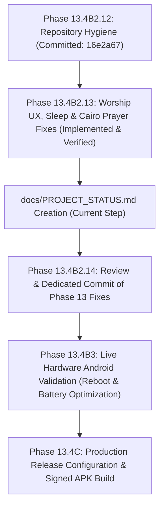

# Zatoona Project Status & Development Baseline

**Document Path:** `docs/PROJECT_STATUS.md`  
**Last Updated:** 2026-10-27 00:54:31 +03:00  
**Repository:** `C:\Users\Lenovo\Documents\GitHub\zatoona`  
**Remote Origin:** `https://github.com/medodem36-sudo/zatoona.git`  
**Active Branch:** `main`  
**Current HEAD:** `16e2a675fcd97bf7c8abe1103e70182463000f06`  
**Head Commit Message:** `chore(repo): untrack accidental scratch tooling and add canonical audit`  
**Working Tree Status:** 3 modified production files (unstaged), 1 newly created status document.

---

## 1. Executive Summary & Active Phase

Zatoona is an offline-first Personal Wellness & Productivity Progressive Web Application (PWA) with an integrated native Android WebView shell (`com.zatoona.app`).

### Active Phase: Phase 13.4B2.13 — Worship Checklist UX, Sleep Habits & Cairo Prayer Acceptance Fixes
This phase resolved verified usability and synchronization issues identified during the acceptance audit:
1. **Worship Checklist Clarity:** Elimination of ambiguous "already-checked" gray marks, dynamic checkbox state rendering (`✓` vs ` `), ARIA accessibility roles, and Arabic subtitles for distinct Quranic and Adhkar practices.
2. **Healthy Sleep Habits Visibility:** Immediate re-rendering on mode switch (`applyMode('sleep')`), active adherence tracking (7-day and 28-day views), and 5-step evening wind-down routine checklist.
3. **Cairo Prayer City Resync:** Correct geographic calculation for Cairo (`30.0444° N, 31.2357° E`), persistent city storage, and immediate native Android AlarmManager synchronization via `syncRemindersToNativeBridge()`.

---

## 2. Source Integrity & 3-Way Byte Parity Verification

The application maintains a strict multi-copy synchronization policy across its entry points:
- `index.html` (Root PWA entrypoint)
- `zatoona.html` (Standalone offline distribution entrypoint)
- `android/app/src/main/assets/index.html` (Native Android WebView asset)

### Verification Metrics
- **Exact File Size:** **1,262,601 bytes** across all three files.
- **SHA-256 Hash:** `79DCAF574CF76155A50AFED4752CDA89A4BAD007E0A90979425B3DD71D909490` across all three files.
- **Byte-by-Byte Memory Comparison:** `100% Identical` (verified via `[System.IO.File]::ReadAllBytes`).
- **Whitespace / Syntax Check (`git diff --check`):** **CLEAN** (0 errors, 0 trailing whitespaces).
- **Net Line Changes (`git diff --stat`):**
  ```text
  android/app/src/main/assets/index.html | 80 +++++++++++++++++++++++-----------
  index.html                             | 80 +++++++++++++++++++++++-----------
  zatoona.html                           | 80 +++++++++++++++++++++++-----------
  3 files changed, 162 insertions(+), 78 deletions(-)
  ```

---

## 3. Evidence-Backed Test Execution Results

All assertions and test gates are recorded in deterministic test execution logs on disk. No results are assumed or fabricated.

### Master Regression Gate (`scratch/test_master_regression_gate.py`)
- **Evidence Log:** `scratch/test-results/test_master_report.json` & `scratch/test-results/test_master_report.md`
- **Execution Timestamp:** 2026-10-27 00:43:14
- **Gate Status:** **PASS ✅**
- **Suites Passed:** **16 / 16** (100%)
- **Total Checks Passed:** **848 / 848** (0 failures)
- **Total Duration:** 178.71s

#### Detailed Suite Breakdown
| Suite ID | Suite Name | Category | Passed Checks | Duration | Status |
| :--- | :--- | :--- | :---: | :---: | :---: |
| `phase5b1_1` | Phase 5B.1.1 Image Policy & Males-Only Compliance | Images & Policy | 92 / 92 | 10.53s | PASS ✅ |
| `phase5b1_2` | Phase 5B.1.2 Legacy A/B Exercise Images Compliance | Images & Exercises | 94 / 94 | 27.89s | PASS ✅ |
| `phase6c` | Phase 6C Workout Analytics & Progression | Gym & Analytics | 36 / 36 | 12.75s | PASS ✅ |
| `phase8b` | Phase 8B Notification Routing & Security | Notifications & Routing | 37 / 37 | 13.65s | PASS ✅ |
| `phase9b_notes` | Phase 9B Unified Notes Hub Core Engine | Notes Hub | 51 / 51 | 11.58s | PASS ✅ |
| `phase9b1_2_gate` | Phase 9B.1.2 Unified Notes Hub Acceptance Gate | Notes Hub | 31 / 31 | 9.71s | PASS ✅ |
| `phase9c1` | Phase 9C.1 Stretch & Mobility Encyclopedia | Stretches & Mobility | 46 / 46 | 0.57s | PASS ✅ |
| `phase9c2` | Phase 9C.2 Interactive Pre-Workout Warm-up | Warm-up & Flow | 54 / 54 | 16.96s | PASS ✅ |
| `phase9c3` | Phase 9C.3 Interactive Post-Workout Cool-down & Stretch | Cool-down & Flow | 56 / 56 | 13.67s | PASS ✅ |
| `phase12_1b` | Phase 12.1B Curated Exercise Catalog Images | Images & Exercises | 43 / 43 | 0.21s | PASS ✅ |
| `phase13_1` | Phase 13.1 Checklist & Worship Labels Repair | UX & Checklists | 47 / 47 | 13.12s | PASS ✅ |
| `phase13_2` | Phase 13.2 Cairo Prayer Times Support | Prayer & Schedule | 36 / 36 | 17.86s | PASS ✅ |
| `phase13_3` | Phase 13.3 Healthy Sleep Habits & Bedtime Routine | Sleep & Recovery | 70 / 70 | 17.48s | PASS ✅ |
| `phase13_4b1` | Phase 13.4B1 Isolated Native Android Shell Foundation | Native Android & Bridge | 50 / 50 | 11.33s | PASS ✅ |
| `phase13_4b1_2` | Phase 13.4B1.2 Android Toolchain & Buildability Verification | Native Android & Build | 31 / 31 | 0.54s | PASS ✅ |
| `phase13_4b2` | Phase 13.4B2 Native Android Local Alarm Engine | Native Android & Alarms | 74 / 74 | 0.81s | PASS ✅ |

### Targeted Phase 13 Test Suites
- **Checklist & Worship Labels (`scratch/test_phase13_1_checklist_labels.py`):** **47 / 47 PASSED**
- **Cairo Prayer Times (`scratch/test_phase13_2_cairo_prayer.py`):** **36 / 36 PASSED**
- **Healthy Sleep Habits & Routine (`scratch/test_phase13_3_sleep_habits.py`):** **70 / 70 PASSED**

---

## 4. Feature Implementation & Current Baseline

### A. Worship & Daily Checklist UX
- **Dynamic Checkbox Glyphs:** Toggle buttons in `renderSimpleChecklist`, `renderScheduleChecklist`, and `renderWindDownChecklist` render `${on ? '✓' : ''}`, preventing the misleading gray checkmark artifact on uncompleted items.
- **Accessibility & Semantics:** All toggle controls include `role="checkbox"`, `aria-checked="${on}"`, and contextual `title` attributes.
- **Categorized Wird & Adhkar:**
  - `QIYAM_WITR`: Includes Night Prayer (`قيام الليل`) and Witr (`الوتر`) with distinct descriptions.
  - `NAWAFIL_EXTRA`: Duha, Tahiyyat al-Masjid, Sunnat al-Wudu with time windows and descriptions.
  - `QURAN_WIRD`: Listening, Reading, Memorizing 2 new verses, and Reviewing previous memorization clearly distinguished with icons and subtitles.
  - `AZKAR`: Morning and Evening Adhkar with clear timing guidance.
- **Fard & Sunnah Toggles:** `renderPrayerFard` explicitly renders `${st.fard ? '✓ فرض' : 'فرض'}` and `${st.sunnah ? '✓ سنة' : 'سنة'}`.

### B. Healthy Sleep Habits & Bedtime Routine
- **5 Core Sleep Hygiene Habits (`SLEEP_HABITS`):** Consistent wake time, screen blackout, caffeine cutoff, physical activity, and sleep-friendly bedroom environment.
- **5-Step Evening Wind-Down Routine (`DEFAULT_WIND_DOWN_STEPS`):** Screen shutdown, bedroom prep, day wrap-up, sleep adhkar, and relaxing reading.
- **Actual vs Target Comparison Card:** Visual feedback on bedtime target compliance, overnight duration math (accounting for midnight crossing), and non-medical health disclaimers.
- **Adherence Tracking:** 7-day and 28-day historical completion breakdown.

### C. Prayer Times & City Calculation
- **Supported Cities:** Cairo (`cairo`), Minya (`minya`), Alexandria (`alex`).
- **Persistence:** Stored in `localStorage['prayer-city']`.
- **Native Bridge Resynchronization:** When the city changes or prayer schedule refreshes, `syncRemindersToNativeBridge()` immediately pushes updated alarm timestamps to the Android Kotlin `AlarmManager` bridge without requiring an app reload.

---

## 5. Storage Schema & Backward Compatibility

All existing user data keys remain intact with zero schema migrations required:
- `qiyam:YYYY-MM-DD`
- `nawafil:YYYY-MM-DD`
- `azkar:YYYY-MM-DD`
- `quran:YYYY-MM-DD`
- `schedcheck:YYYY-MM-DD`
- `sleephabits:YYYY-MM-DD`
- `winddown:YYYY-MM-DD`
- `sleep-routine-settings`
- `prayer-city`

---

## 6. Known Validation Items & Testing Limitations

While automated headless and static code suites have passed completely, the following items remain open for physical device verification:
1. **Device Reboot Persistence (`BOOT_COMPLETED`):**
   - Headless unit tests verify `BootReceiver.kt` schedules alarms upon boot.
   - Live hardware verification on an actual physical Android handset (power cycling the phone and verifying alarm firing) is pending user availability.
2. **Aggressive OEM Battery Optimization (Doze Mode):**
   - `AlarmManager.setExactAndAllowWhileIdle()` is implemented.
   - Long-term background delivery across multi-day sleep cycles on OEM-specific forks (MIUI/HyperOS, OneUI, ColorOS) requires real-world physical observation.
3. **Android Release Build & Production Signing:**
   - Debug APK currently exists at `android/app/build/outputs/apk/debug/app-debug.apk` (built in Phase 13.4B1).
   - Release signing configuration (`keystore`, `keyAlias`, `storePassword`) is intentionally unconfigured to prevent committing secrets to source control.

---

## 7. Scope Boundaries (Strictly Out of Scope)

The following components are outside the current phase scope and must not be modified:
- **Exercise GIF Replacement / Upload:** Out of scope.
- **AI Assistant Integration / LLM Endpoints:** Out of scope.
- **Android Home-Screen Launcher Widgets:** Out of scope.
- **Automated Git Commits / Pushes:** Strictly disabled without prior explicit user confirmation.

---

## 8. Master Plan Roadmap & Next Steps



### Immediate Next Actions
1. **Review Documentation:** Verify `docs/PROJECT_STATUS.md` and check `git diff --check`.
2. **User Authorization Gate:** Await user approval before staging or committing changes.
3. **Stage & Commit:**
   - Commit files: `index.html`, `zatoona.html`, `android/app/src/main/assets/index.html`, and `docs/PROJECT_STATUS.md`.
   - Recommended commit message: `fix(ux): clarify worship checklist controls, sleep habits visibility, and cairo prayer resync`
