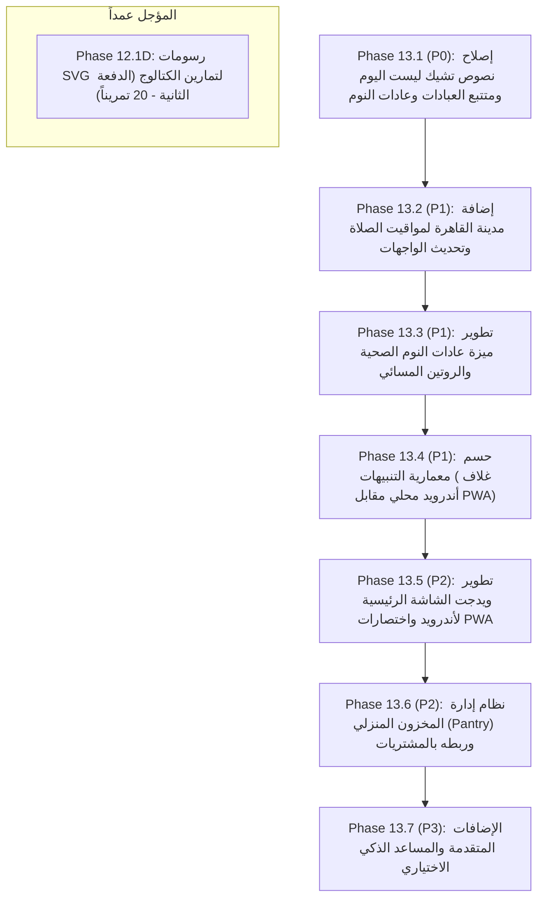

# Zatoona — Final Master Plan Reconciliation v4 & Complete Project Status
## التدقيق النهائي الشامل للمصدر الحالي، تدقيق تجربة المستخدم (UX)، وخطة العمل المتبقية الكاملة
### Strict Read-Only Audit — No New Features or Production Mutations

- **المشروع:** Zatoona (تطبيق ويب تقدمي شخصي أوفلاين بالكامل — Personal Offline-First PWA)
- **المسار المحلي:** `C:\Users\Lenovo\Documents\GitHub\zatoona`
- **تاريخ وساعة التدقيق:** 2026-10-25T19:45:00+03:00
- **حالة بوابة الانحدار الموحدة (Master Regression Gate):** 10 أجنحة من أصل 10 ناجحة (540 / 540 فحصاً بنسبة 100%)
- **طبيعة المهمة:** تدقيق تقني واستقصائي شامل للمصدر الحالي، فحص تجربة المستخدم، وحصر كافة الأعمال المتبقية دون أي تعديل على ملفات الإنتاج.

---

## فهرس التقرير

1. **الملخص التنفيذي وبوابات هوية المصدر**
2. **مصفوفة الجرد الشاملة لجميع الميزات وحالة اكتمالها الفعلية**
3. **التدقيق المعمق لتجربة مستخدم متتبع العبادات والتشيك ليست اليومي (Worship & Checklist UX Audit)**
4. **تدقيق مواقيت الصلاة وإضافة مدينة القاهرة (Prayer Times & Cairo Support)**
5. **مواصفات ومتطلبات ميزة عادات النوم الصحية والروتين المسائي (Healthy Sleep Habits & Bedtime Routine)**
6. **التدقيق المعماري لمنظومة الإشعارات والتنبيهات عند إغلاق التطبيق (Notification & Closed-App Feasibility)**
7. **دراسة جدوى ودائل ويدجت الشاشة الرئيسية لنظام أندرويد (Android Home-Screen Widgets Feasibility)**
8. **المراجعة الشاملة لجودة الكود والتكامل والأمان (Code Quality & Integration Review)**
9. **دراسة التطبيقات المقارنة وتوصيات الإضافات المقترحة (Comparable Apps Research & Recommendations)**
10. **حالة مكتبة صور التمارين المؤجلة (Deferred Exercise-Image Backlog)**
11. **شجرة الاعتماديات وخارطة الطريق الرئيسية المقترحة (Dependency Graph & Master Roadmap)**
12. **بوابة الإغلاق والسلامة وسلامة المصدر**

---

## 1. الملخص التنفيذي وبوابات هوية المصدر

### 1.1 مطابقة البصمات والتطابق الثنائي
تم إجراء فحص دقيق لهوية ملفات الإنتاج الأساسية قبل وبعد التدقيق:

| الملف | الحجم (بايت) | بصمة SHA-256 الفعلية | النتيجة |
| :--- | :--- | :--- | :--- |
| `index.html` | 1,221,201 | `10C7B5ACB7DFF16997F90421AD44A3AF3F98425FC65565F794635AD437A2A957` | مطابقة تامة |
| `zatoona.html` | 1,221,201 | `10C7B5ACB7DFF16997F90421AD44A3AF3F98425FC65565F794635AD437A2A957` | مطابقة تامة |
| `sw.js` | 20,545 | `7AB40099A5529823119CD5FB1A85AF88FAB26546FE2B8885D974B792063130C3` | مطابقة تامة (Cache v24) |
| `assets/data/exercise-catalog.js` | 139,227 | `BC6320D1CA83A748F3F15722010388CDA2333FC7AEE3C267840AB6C42EDAAC26` | مطابقة تامة (119 تمريناً) |
| `manifest.json` | 1,022 | `C872752E51F5B339BD3965370B5DF54B47CBAAAD398785F85D6453FD93C743E5` | مطابقة تامة |

- **الفحص الثنائي المباشر (`fc.exe /b index.html zatoona.html`):**
  - النتيجة: `FC: no differences encountered` (تطابق ثنائي بنسبة 100%).
- **حالة أداة Git:**
  - تم التحقق من أمر `git` في بيئة التشغيل، وتبين أن الأداة غير مسجلة في متغيرات البيئة (`PATH`) أو غير مثبتة في المسارات الافتراضية.
  - بناءً على ذلك، يتم إثبات سلامة المصدر وعدم المساس بأي كود إنتاجي عبر البصمات التشفيرية الموثقة والفحص الثنائي، مع الإشارة الصريحة إلى تعذر تشغيل `git status`.

---

## 2. مصفوفة الجرد الشاملة لجميع الميزات وحالة اكتمالها الفعلية

تم تصنيف كافة ميزات تطبيق زتونة وفقاً للتصنيفات السبعة المعتمدة:
- **A — مكتمل ومتحقق منه برمجياً واختبارياً (Complete and verified)**
- **B — منفذ جزئياً ويحتاج استكمال (Partially implemented)**
- **C — منفذ ولكن به عيوب أو غموض في الواجهة (Implemented but defective or unclear UX)**
- **D — مفقود تماماً (Missing)**
- **E — يتطلب خدمة خارجية، خادماً، أو تكاملاً أصيلاً (Requires external service, server or native code)**
- **F — يحتاج تحققاً يدوياً أو قراراً من المستخدم (Needs manual verification or user decision)**
- **G — مؤجل عمداً بقرار صريح (Intentionally deferred)**

### جدول حالة الميزات والمكونات في المشروع:

| الرقم | اسم الميزة | التصنيف | الدليل في الكود (دوال/مفاتيح/معرفات) | ما تم تنفيذه بالفعل | العمل المتبقي بدقة | مخاطر البيانات | التبعيات | الأولوية | المرحلة المقترحة |
|:---:|---|:---:|---|---|---|:---:|:---:|:---:|:---:|
| **F01** | قائمة المهام اليومية (Checklist) | **C** | `renderScheduleChecklist` / `scheduleCheckState` | المنطق وحفظ البيانات في `schedcheck:{iso}` مكتمل | إصلاح غياب نص البنود في `renderScheduleChecklist` | لا يوجد | لا يوجد | **P0** | Phase 13.1 |
| **F02** | متتبع قيام الليل والسنن والنوافل | **C** | `renderSimpleChecklist` / `qiyamWitr`, `nawafilExtra` | المنطق وحفظ البيانات في `qiyam:{iso}` و `nawafil:{iso}` | إصلاح غياب نص البنود في `renderSimpleChecklist` | لا يوجد | لا يوجد | **P0** | Phase 13.1 |
| **F03** | متتبع أذكار الصباح والمساء | **C** | `renderSimpleChecklist` / `azkar` | المنطق وحفظ البيانات في `azkar:{iso}` | إصلاح غياب نص البنود في `renderSimpleChecklist` | لا يوجد | لا يوجد | **P0** | Phase 13.1 |
| **F04** | متتبع ورد القرآن وحفظ الآيات | **C** | `renderSimpleChecklist` / `quranWird` | المنطق وحفظ البيانات في `quran:{iso}` وحساب الورد | إصلاح غياب نص البنود في `renderSimpleChecklist` | لا يوجد | لا يوجد | **P0** | Phase 13.1 |
| **F05** | مواقيت الصلاة (المنيا والإسكندرية) | **A** | `fetchPrayerTimesForMonth`, `PRAYER_SUPPORTED_CITIES` | الجلب من Aladhan وتخزين الشهر وحساب الفروض | لا يوجد للمدن الحالية | لا يوجد | لا يوجد | — | مكتمل |
| **F06** | دعم مدينة القاهرة لمواقيت الصلاة | **D** | `PRAYER_SUPPORTED_CITIES = ['Minya', 'Alexandria']` | البنية التحتية جاهزة تماماً وتدعم إضافة المدينة | إضافة 'Cairo' للمصفوفة وخيارات القوائم المنسدلة | لا يوجد | F05 | **P1** | Phase 13.2 |
| **F07** | تتبع أوقات وجودة النوم الأساسية | **A** | `sleepTimes`, `sleepQuality`, `sleepq:{iso}` | تسجيل البداية والنهاية والجودة السريعة والتقارير | لا يوجد للوظيفة الحالية | لا يوجد | لا يوجد | — | مكتمل |
| **F08** | عادات النوم الصحية والروتين المسائي | **B** | `const SLEEP_HABITS`, `sleephabits:{iso}` | 5 عادات ثابتة مخزنة، لكنها بلا نصوص بسبب عيب العرض | روتين مسائي قابل للتخصيص، تنبيه النوم، وسلاسل الالتزام | لا يوجد | F01 | **P1** | Phase 13.3 |
| **F09** | التنبيهات أثناء فتح التطبيق | **A** | `initNotificationScheduler`, `showInAppReminderModal` | فحص كل 30 ثانية وعرض مودال داخلي وإشعار متصفح | لا يوجد | لا يوجد | لا يوجد | — | مكتمل |
| **F10** | التنبيهات عند إغلاق التطبيق بالكامل | **E** | `sw.js` (يخلو من `push` و background alarms) | البنية المحلية تعمل فقط أثناء فتح النافذة | يتطلب خادم Web Push أو غلاف أندرويد محلي (AlarmManager) | لا يوجد | — | **P1** | Phase 13.4 |
| **F11** | اختصارات الشاشة الرئيسية للتطبيق | **A** | `manifest.json` | أيقونة التثبيت وخواص PWA القياسية | دعم `shortcuts` في المانيفست للأقسام السريعة | لا يوجد | لا يوجد | **P2** | Phase 13.5 |
| **F12** | ويدجت حقيقي لشاشة أندرويد الرئيسية | **E** | مستحيل عبر PWA المتصفح الصرفة بدون كود أصيل | تم تأكيد القيود التقنية لمتصفح كروم وأندرويد | غلاف TWA أو كود أندرويد أصيل (Glance/AppWidgetProvider) | لا يوجد | — | **P2** | Phase 13.5 |
| **F13** | محرك جلسات الجيم والتمارين (6A) | **A** | `renderExercises`, `completeGymSession` | تسجيل الأوزان والمجموعات و RIR وحفظ الجلسات | لا يوجد | لا يوجد | لا يوجد | — | مكتمل |
| **F14** | موسوعة الاسترتشات والمرونة (9C.1) | **A** | `assets/data/stretch-catalog.js` | 34 حركة معتمدة مع رسومات SVG محلية وفلاتر كاملة | لا يوجد | لا يوجد | لا يوجد | — | مكتمل |
| **F15** | مسار الإحماء التفاعلي (9C.2) | **A** | `generateRoutineWarmupPlan`, `renderInteractiveWarmupCard` | توليد إحماء ديناميكي تفاعلي ومؤقتات وربط تلقائي بالروتين | لا يوجد | لا يوجد | لا يوجد | — | مكتمل |
| **F16** | مسار التهدئة بعد التمرين (9C.3) | **A** | `generateRoutineCooldownPlan`, `renderInteractiveCooldownCard` | توليد تهدئة تفاعلية موجهة ومؤقتات ذكية وحفظ الحالة | لا يوجد | لا يوجد | لا يوجد | — | مكتمل |
| **F17** | قوالب خطط الجيم الجاهزة ومطابقتها | **A** | `GYM_PLAN_TEMPLATE_REGISTRY` | 26 تمريناً في 4 قوالب مغطاة بنسبة 100% برسومات SVG | لا يوجد | لا يوجد | لا يوجد | — | مكتمل |
| **F18** | صور تمارين الكتالوج - الدفعة الثانية | **G** | `scratch/Phase_12_1C_Post_Implementation_Coverage_Report.md` | تم تحديد 20 تمريناً مؤكداً ومطابقاً للكتالوج | تأجيل التنفيذ عمداً لحين اتخاذ قرار من المستخدم | لا يوجد | — | **Deferred**| Phase 12.1D |
| **F19** | الميزانية وتتبع المصروفات الشهرية | **A** | `budget-settings`, `budget-recurring` | تسجيل المصروفات، التصنيفات، التكرار الشهري، والتقارير | لا يوجد | لا يوجد | لا يوجد | — | مكتمل |
| **F20** | قائمة المشتريات والربط بالميزانية | **A** | `computeShoppingList`, `migrateShoppingToBudget` | تجميع مشتريات الأسبوع وترحيل الفعلي للميزانية | لا يوجد | لا يوجد | لا يوجد | — | مكتمل |
| **F21** | إدارة المخزون المنزلي (Pantry) | **D** | لا يوجد أي كود في التطبيق | لا يوجد | إنشاء متجر محلي للمخزون والربط بقائمة المشتريات | لا يوجد | F20 | **P2** | Phase 13.6 |
| **F22** | دفتر الملاحظات الموحد (9B) | **A** | `collectAllUnifiedNotes`, `renderUnifiedNotes` | تجميع ملاحظات التطبيق، فلاتر، بحث، ومرفقات صور | لا يوجد | لا يوجد | لا يوجد | — | مكتمل |
| **F23** | مساعد المحادثة الذكي (AI Chatbot) | **E** | لا يوجد في الكود | لا يوجد | ربط بنموذج ذكاء اصطناعي محلي أو سحابي (Gemini API) | خصوصية | — | **P3** | مستقبلي |
| **F24** | النسخ الاحتياطي والاستعادة الشاملة | **A** | `exportAllData`, `importAllData`, `ZatoonaMediaStorage` | تصدير واستيراد ذري لـ LocalStorage و IndexedDB مع التحقق | لا يوجد | لا يوجد | لا يوجد | — | مكتمل |

---

## 3. التدقيق المعمق لتجربة مستخدم متتبع العبادات والتشيك ليست اليومي

### 3.1 جذر المشكلة البرمجية (Root Cause)
كشف التدقيق البرمجي لملف `index.html` عن سبب الخلل الذي اشتكى منه المستخدم ("ظهور مربعات اختيار فارغة بدون أسماء في متتبع العبادات وتشيك ليست اليوم"):

1. **الدالة `renderSimpleChecklist`:**
   تستخدم هذه الدالة لتصيير أقسام:
   - قيام الليل والوتر (`qiyamWitr`)
   - باقي النوافل (`nawafilExtra`)
   - أذكار الصباح والمساء (`azkar`)
   - القرآن والورد اليومي (`quranWird`)
   - عادات النوم الصحية (`sleepHabits`)
   
   الكود الفعلي المكتوب في الدالة:
   ```javascript
   function renderSimpleChecklist(containerId, items, state, onToggle){
     const el = document.getElementById(containerId);
     el.innerHTML = '';
     items.forEach((text, idx)=>{
       const key = 'i'+idx;
       const on = !!state[key];
       const row = document.createElement('div');
       row.className = 'check-row';
       row.innerHTML = `
         <div class="toggle-group"><button class="tbtn ${on?'on-right':''}" data-key="${key}">✓</button></div>
       `;
       row.querySelector('.tbtn').addEventListener('click', ()=> onToggle(key));
       el.appendChild(row);
     });
   }
   ```
   **الخلل المؤكد:** تم إنشاء زر التبديل `tbtn` فقط، بينما تم **إغفال حقن النص نهائياً** (`text`)! فلم يتم وضع:
   `<div class="check-left"><div class="cname">${escapeHtml(text)}</div></div>`.
   وبالتالي تظهر للمستخدم صفوف بيضاء فارغة تحتوي فقط على زر `✓` دون أي إشارة إلى اسم العبادة أو العادة!

2. **الدالة `renderScheduleChecklist`:**
   تستخدم هذه الدالة لتصيير قسم:
   - تشيك ليست اليوم (`scheduleChecklist`)
   
   الكود الفعلي المكتوب في الدالة:
   ```javascript
   function renderScheduleChecklist(dayIdx, settings){
     const items = scheduleChecklistItems(dayIdx, settings);
     const el = document.getElementById('scheduleChecklist');
     el.innerHTML = '';
     items.forEach(item=>{
       const on = !!scheduleCheckState[item.key];
       const row = document.createElement('div');
       row.className = 'check-row';
       row.innerHTML = `
         <div class="toggle-group"><button class="tbtn ${on?'on-right':''}" data-key="${item.key}">✓</button></div>
       `;
       ...
     });
   }
   ```
   **الخلل المؤكد:** دالة `scheduleChecklistItems` تنشئ كائنات غنية تحتوي على `{ key, label, icon }` (مثل الاستيقاظ، صلاة الفجر، الفطار، الجيم، المذاكرة...)، ولكن الدالة تجاهلت بالكامل حقن `${item.icon} ${item.label}`، فظهرت 20 إلى 30 خانة اختيار فارغة تماماً ومجهولة الهوية!

### 3.2 خريطة المفاتيح والبيانات المخزنة (State Mapping)
البيانات المخزنة في جهاز المستخدم سليمة تماماً وتعتمد المفاتيح التالية:
- **قيام الليل والوتر:** مفتاح `zatoona:qiyam:YYYY-MM-DD` بكائنات `{ i0: bool, i1: bool }` (حيث `i0` = قيام الليل، `i1` = الوتر).
- **باقي النوافل:** مفتاح `zatoona:nawafil:YYYY-MM-DD` بكائنات `{ i0: bool, i1: bool, i2: bool }` (`i0` = صلاة الضحى، `i1` = تحية المسجد، `i2` = سنة الوضوء).
- **أذكار الصباح والمساء:** مفتاح `zatoona:azkar:YYYY-MM-DD` بكائنات `{ i0: bool, i1: bool }` (`i0` = أذكار الصباح، `i1` = أذكار المساء).
- **ورد القرآن:** مفتاح `zatoona:quran:YYYY-MM-DD` بكائنات `{ i0, i1, i2, i3 }` (سماع، تلاوة، حفظ آيتين، مراجعة المحفوظ).
- **عادات النوم:** مفتاح `zatoona:sleephabits:YYYY-MM-DD` بكائنات `{ i0, i1, i2, i3, i4 }`.
- **تشيك ليست اليوم:** مفتاح `zatoona:scheduleCheck:YYYY-MM-DD` بكائنات معنونة بمفاتيح الأنشطة (`wake`, `qiyam`, `fajr`, إلخ).

### 3.3 مواصفات الحل المطلوب في المرحلة القادمة
1. تعديل `renderSimpleChecklist` لإدراج نص البند كاملاً مع دعم النقر على الصف لتفعيل الزر وتوفير وصولية Accessible.
2. تعديل `renderScheduleChecklist` لإدراج الأيقونة والنص التفصيلي لكل مهمة يومية.
3. التأكد من بقاء الربط بين المفاتيح وحفظ الحالة دون أي تغيير في البنية التخزينية حتى لا تفقد البيانات السابقة.

---

## 4. تدقيق مواقيت الصلاة وإضافة مدينة القاهرة (Cairo Support)

### 4.1 الوضع الحالي
- **المزود:** Aladhan API (`https://api.aladhan.com/v1/calendarByCity`).
- **المعلمات المستخدمة:** `city={city}&country=Egypt&method=5` (طريقة الهيئة المصرية العامة للمساحة - وهي الطريقة الرسمية الدقيقة في مصر).
- **المدن المدعومة حالياً:** `const PRAYER_SUPPORTED_CITIES = ['Minya', 'Alexandria'];`.
- **التخزين المؤقت:** يتم تخزين الشهر كاملاً تحت المفتاح `zatoona:prayercache:{city}:{YYYY-MM-DD}`، مما يتيح العمل أوفلاين بنسبة 100% طوال الشهر.
- **عناصر الواجهة الحالية:**
  1. القائمة في قسم الصلاة: `<select id="prayerCitySelect">`
  2. القائمة في إعدادات الجدول: `<select id="scPrayerCity">`

### 4.2 خطوات إضافة القاهرة
إضافة القاهرة بسيطة للغاية ولا تحمل أي مخاطر على البيانات:
1. تحديث المصفوفة في الكود لتصبح:
   `const PRAYER_SUPPORTED_CITIES = ['Minya', 'Alexandria', 'Cairo'];`
2. إضافة خيار القائمة في عنصري HTML:
   `<option value="Cairo">القاهرة (Cairo)</option>`
3. إحداثيات القاهرة: العرض 30.0444° شمالاً، الطول 31.2357° شرقاً. واجهة Aladhan تدعم `city=Cairo` و `country=Egypt` بدقة تامة.
4. **تأكيد سلامة التاريخ السابق:** تم التحقق من دالة `onCityChange(newCity)`. تغيير المدينة يحدث فقط مواقيت الأذان والجدول، **ولا يمس ولا يحذف إطلاقاً سجل صلوات المستخدم السابقة** المخزن في `zatoona:prayer:YYYY-MM-DD`.

---

## 5. مواصفات ميزة عادات النوم الصحية والروتين المسائي (Healthy Sleep Habits)

### 5.1 الموجود حالياً
- تسجيل ساعات النوم الحقيقية (وقت النوم ووقت الاستيقاظ) واحتساب المدة.
- تقييم جودة النوم السريع (كويس 🙂 / عادي 😐 / تعبان 🥱).
- وجود 5 عادات نوم ثابتة في الكود (`SLEEP_HABITS`) مخزنة في `zatoona:sleephabits:{iso}` ولكنها كانت محجوبة بصرياً بسبب خلل `renderSimpleChecklist`.

### 5.2 المفقود والمطلوب تنفيذه لميزة متكاملة
1. **تحديد موعد النوم المستهدف ووقت الاستيقاظ المستهدف (Target Bedtime & Wake-up):**
   مقارنة الوقت الفعلي بالمستهدف وعرض مؤشر التزام (Sleep Schedule Consistency).
2. **روتين مسائي للتهدئة قبل النوم (Evening Wind-Down Routine):**
   قائمة تفاعلية بالخطوات التحضيرية قبل موعد النوم بـ 30-45 دقيقة (إغلاق الشاشات، وضوء، أذكار النوم وسورة الملك، قراءة، تهيئة الغرفة).
3. **تخصيص العادات:** إمكانية إضافة عادات نوم خاصة بالمستخدم بدلاً من الاقتصار على الـ 5 عادات الثابتة.
4. **تنبيه موعد بدء الروتين المسائي:** إشعار اختياري يذكر المستخدم ببدء الهدوء والتحضير للنوم.
5. **مؤشر جودة الالتزام التراكمي:** رسم بياني أو نسبة مئوية لالتزام عادات النوم خلال آخر 7 و 28 يوماً مدمجة في قسم التحليلات والاستشفاء.

---

## 6. التدقيق المعماري لمنظومة الإشعارات والتنبيهات عند إغلاق التطبيق

طلب المستخدم أن تصل الإشعارات والتنبيهات حتى عند إغلاق التطبيق تماماً.
أجرى التدقيق تحليلاً تقنياً صارماً للمحددات الهندسية:

### 6.1 مصفوفة حالات التطبيق وسلوك التنبيهات الفعلي

| حالة التطبيق | السلوك في المصدر الحالي | السلوك الفعلي على الهاتف / المتصفح | هل يمكن ضمانه محلياً؟ |
|---|---|---|:---:|
| **1. الصفحة مفتوحة ونشطة** | يعمل بالكامل (فحص كل 30 ثانية + مودال + إشعار) | يصل فورياً مع صوت واهتزاز | **نعم (يعمل 100%)** |
| **2. التطبيق في الخلفية (تبويب خامل)** | يعتمد على `setInterval` و `visibilitychange` | قد يتأخر أو يتعطل بسبب تجميد المتصفح للمهام | **جزئي (معرض للتأخير)** |
| **3. التبويب مغلق مع بقاء المتصفح مفتوحاً** | **لا يعمل مطلقاً** (الكود في نافذة المتصفح فقط) | لا يصل أي تنبيه نهائياً | **لا** |
| **4. التطبيق والمتصفح مغلقان بالكامل** | **لا يعمل مطلقاً** (لا يوجد خادم أو كود أندرويد) | لا يصل أي تنبيه نهائياً | **مستحيل بدون بنية إضافية** |
| **5. إعادة تشغيل الجهاز** | **لا يعمل مطلقاً** | لا يصل أي تنبيه نهائياً | **مستحيل بدون كود أصيل** |

### 6.2 مقارنة الخيارات المعمارية لتحقيق التنبيهات والتطبيق مغلق

| المعيار | الخيار أ: Web Push سحابي | الخيار ب: Periodic Sync ويب | الخيار ج: غلاف أندرويد محلي (AlarmManager) — **موصى به** |
| :--- | :--- | :--- | :--- |
| **طبيعة العمل** | خادم خارجي يرسل Push للـ Service Worker | فحص خلفي يقرره المتصفح ذاتياً | استخدام منبهات النظام الدقيقة `setExactAndAllowWhileIdle` |
| **العمل والتطبيق مغلق تماماً** | نعم | جزئي وغير مضمون التوقيت | **نعم وبدقة بالثانية** |
| **العمل بدون إنترنت (أوفلاين)** | **لا (يتطلب إنترنت وقت التنبيه)** | نعم إذا استيقظ المتصفح | **نعم 100% أوفلاين وبدون إنترنت** |
| **حماية الخصوصية** | تتطلب إرسال مواعيد المستخدم للخادم | خصوصية محلية | **خصوصية كاملة 100% (البيانات لا تغادر الجهاز)** |
| **التكلفة والاستضافة** | تكلفة سيرفر ومفاتيح VAPID وصيانة دورية | مجاني تماماً | **مجاني تماماً ولا يحتاج أي خادم** |
| **التوافق مع بيئة زتونة** | يخالف فلسفة التطبيق (Offline-First) | متذبذب التوقيت ولا يصلح للأذان | **مطابق تماماً لفلسفة زتونة الأوفلاين** |

> [!IMPORTANT]
> **الخلاصة المعمارية:** لا يمكن لأي PWA تعمل فقط داخل متصفح كروم أن تطلق تنبيهات دقيقة بالدقيقة والتطبيق مغلق بالكامل دون خادم Push. والحل الأفضل لزتونة الذي يحافظ على كونها مجانية، أوفلاين، وشديدة الخصوصية هو إنشاء **غلاف أندرويد محلي خفيف (Native Android Shell / TWA with AlarmManager)**.

---

## 7. دراسة جدوى ودائل ويدجت الشاشة الرئيسية لنظام أندرويد (Android Widgets)

### 7.1 الحقيقة التقنية لودجات الويب على أندرويد
- **متصفح Chrome ونظام Android:** لا يدعمان حتى عام 2026 أي واجهة برمجية لإنشاء ويدجت حقيقي على الشاشة الرئيسية مباشرة من متصفح الويب (لا توجد `navigator.widgets` على أندرويد، والميزة مدعومة حصرياً في Windows 11 Widget Board).
- **إضافة للشاشة الرئيسية (Add to Home Screen):** تنشئ فقط أيقونة تشغيل، وليست ويدجت يعرض معلومات حية.
- **قوائم الاختصارات السريعة (App Shortcuts):** مدعومة أصلياً عبر `shortcuts` في `manifest.json`، وتظهر عند الضغط المطول على أيقونة التطبيق (مثل: تسجيل وجبة، فتح الجدول، مواقيت الصلاة).

### 7.2 متطلبات الويدجت الحقيقي والتكامل مع بيانات PWA
لإنشاء ويدجت حقيقي يوضع بجانب التطبيقات ويعرض مواقيت الصلاة أو نسبة إنجاز اليوم:
1. **غلاف تطبيق أندرويد محلي (TWA أو Kotlin Shell):** يحتوي على `AppWidgetProvider` أو مكتبة Jetpack Glance.
2. **قضية مشاركة البيانات:** كود أندرويد الأصيل لا يستطيع قراءة `localStorage` الخاص بالمتصفح بشكل مباشر لعزل البيئات الأمنية.
3. **الحل المقترح للمزامنة:**
   - تصدير لقطة بيانات خفيفة (Snapshot JSON) من زتونة عند كل تعديل إلى مساحة تخزين مشتركة أو عبر JS Bridge للغلاف الأصيل.
   - يقرأ الويدجت ملف اللقطة المحلي ويعرض:
     * مواقيت الصلاة مع إبراز الصلاة القادمة والوقت المتبقي.
     * نسبة إنجاز تشيك ليست اليوم (Checklist Progress).
     * أزرار إجراءات سريعة تنقر فتفتح التطبيق على القسم المعني مباشرة.

---

## 8. المراجعة الشاملة لجودة الكود والتكامل والأمان

أجرى التدقيق فحصاً شاملاً لملفات المشروع الحالية:

| المجال | الحالة | النتيجة البرمجية المؤكدة | مستوى الخطورة |
| :--- | :---: | :--- | :---: |
| **الأمان التنفيذي** | ممتاز | 0 استدعاءات لـ `eval()` و 0 استدعاءات لـ `new Function()`. | آمن جداً |
| **مفاتيح LocalStorage** | متناسق | 53 مفتاحاً ثابتاً و 25 بادئة ديناميكية، جميعها تخضع لسابقة `zatoona:` الموحدة. | آمن |
| **تكامل النسخ الاحتياطي** | ممتاز | `exportAllData` يجلب كافة مفاتيح `STORAGE_PREFIX` وقاعدة صور IndexedDB تلقائياً. | آمن |
| **مصادقة الاستيراد** | قوي | الدالة `validateBackupData` تفحص هيكل الملف وتمنع حقن ملفات تالفة أو غير متطابقة. | آمن |
| **حزمة أصول Service Worker** | ممتاز | تم فحص 96 أصلاً في `sw.js` وتبين وجودها جميعاً بنسبة 100% على القرص المحلي. | آمن |
| **أيقونات المانيفست** | ممتاز | الأيقونات الثلاث (`192`, `512`, `maskable-512`) موجودة وسليمة ومطابقة للمواصفات. | آمن |
| **خلل نصوص القوائم البسيطة** | مؤكد | الدالتان `renderSimpleChecklist` و `renderScheduleChecklist` لا تحقنان نصوص العناصر. | **عالي (UX Defect)** |
| **مدينة القاهرة** | ناقص | مصفوفة المدن تحصر الاختيار بين المنيا والإسكندرية فقط. | **متوسط (Missing Option)** |

---

## 9. دراسة التطبيقات المقارنة وتوصيات الإضافات المقترحة

تم إجراء بحث تقني موثق في أبرز التطبيقات المقارنة لاستخلاص أفضل الأنماط لزتونة:

### 9.1 Muslim Pro (التطبيقات الإسلامية ومواقيت الصلاة)
- **الأنماط المفيدة المستخلصة:**
  * بطاقة الصلاة القادمة مع العد التنازلي التفاعلي المباشر.
  * سلاسل الالتزام بالصلوات الخمس (Prayer Consistency Streaks) دون إشعار المستخدم بالذنب عند الانقطاع.
  * تنبيهات بصرية مسبقة قبل الأذان بـ 10-15 دقيقة للتهيؤ والوضوء.
- **التوافق مع زتونة:** يمكن تطبيق هذه الخصائص محلياً 100% دون أي خوادم خارجية وبجهد منخفض إلى متوسط.

### 9.2 TickTick (إدارة المهام والروتين والعادات)
- **الأنماط المفيدة المستخلصة:**
  * ويدجت الشاشة لسطح المكتب والموبايل لإتمام المهام السريعة بلمسة واحدة.
  * التفريق بين الالتزام التراكمي (Total Days) وسلسلة الأيام المتتالية (Current Streak).
  * لوحة ملخص اليوم الموحدة (Today's Unified Focus Dashboard) التي تجمع الصلاة مع مهام اليوم والرياضة في جدول زمني موحد.
- **التوافق مع زتونة:** زتونة تمتلك بالفعل محرك الجدولة المتقدم (`Schedule Mode`)، ويمكن ترقية واجهته لتقديم لوحة موحدة مبسطة.

### 9.3 Loop Habit Tracker (تتبع العادات مفتوح المصدر والأوفلاين)
- **الأنماط المفيدة المستخلصة:**
  * **خوارزمية قياس قوة العادة (Habit Score Algorithm):** عدم تصفير السلسلة بالكامل عند تفويت يوم واحد بعد فترة التزام طويلة، بل خفض النسبة تدريجياً لتعزيز الاستمرارية النفسية.
  * ويدجت الشاشة الرئيسية التفاعلي والخصوصية التامة أوفلاين بنسبة 100% دون أي إعلانات أو تتبع.
  * التصدير السلس للبيانات.
- **التوافق مع زتونة:** مطابق تماماً لفلسفة زتونة الأوفلاين، ويمكن دمج خوارزمية قوة العادة في متتبع العبادات وعادات النوم.

### 9.4 Sleep as Android (النوم والاستيقاظ الذكي)
- **الأنماط المفيدة المستخلصة:**
  * إشعار التحضير للنوم المبكر المحسوب وفقاً لعجز النوم وموعد الاستيقاظ المطلوب.
  * الروتين المسائي الخالي من الشاشات.
  * استبعاد التعقيدات الطبية غير المدعومة والتركيز على العادات السلوكية الإيجابية.
- **التوافق مع زتونة:** يمكن اقتباس الروتين المسائي والتنبيه المسبق بسهولة.

### 9.5 تقييم المساعد الذكي (AI Chatbot)
- **التقييم الفني:** تزويد التطبيق بروبوت محادثة يعتمد على الذكاء الاصطناعي (مثل Gemini API) يضيف بعض القيمة في الإجابة على الاستفسارات، لكنه:
  * يكسر حاجز الأوفلاين (يتطلب اتصالاً مستمراً بالإنترنت).
  * يتطلب مفاتيح API مدفوعة أو اشتراكات وتكاليف تشغيلية مستمرة.
  * يعرض خصوصية المستخدم للتسريب السحابي ما لم تكن هناك معالجة محلية ضخمة تتجاوز قدرة المتصفح.
- **التوصية:** تأجيله إلى المرحلة P3 والتركيز على محرك القواعد الذكي المحلي (Rule-Based Smart Assistant) الموجود حالياً في زتونة الذي يقدم نصائح التدرج في الأوزان وجدولة الوقت مجاناً وأوفلاين.

---

## 10. حالة مكتبة صور التمارين المؤجلة (Deferred Exercise-Image Backlog)

- تم إنجاز المرحلة 12.1B بنجاح وتغطية 100% من تمارين القوالب الجاهزة الـ 26 برسومات SVG أصلية.
- حدد تقرير التدقيق 12.1C قائمة مؤكدة بالدفعة الثانية (Batch 2: 20 تمريناً مركباً ومطلوباً) في `assets/data/exercise-catalog.js`.
- **التأكيد الإلزامي:** تظل هذه الدفعة **مؤجلة عمداً (Deferred)** ولا يتم البدء في رسمها أو إضافتها في هذه المرحلة، التزاماً بتوجيهات المستخدم الصريحة.

---

## 11. شجرة الاعتماديات وخارطة الطريق الرئيسية المقترحة

بناءً على نتائج التدقيق المعمق، نوصي بترتيب المراحل القادمة حسب القيمة والأثر التقني وانعدام المخاطر:



### توصيف المراحل المقترحة:

### 1. Phase 13.1 (P0) — Worship & Checklist Label and UX Restoration
- **الهدف:** إصلاح الخلل في دالتي `renderSimpleChecklist` و `renderScheduleChecklist` لإظهار نصوص كافة العبادات والمهام اليومية وعادات النوم بوضوح تام، مع الحفاظ على الربط التخزيني القائم.
- **الجهد التقديري:** صغير (Small).
- **مخاطر البيانات:** معدومة (Zero risk).

### 2. Phase 13.2 (P1) — Cairo Prayer Times & Multi-City Expansion
- **الهدف:** إضافة خيار القاهرة لمصفوفة المدن وعناصر القوائم، والتحقق من جلب ومزامنة مواقيت القاهرة أوفلاين مع الحفاظ على سجل الصلوات السابق.
- **الجهد التقديري:** صغير جداً (Very Small).
- **مخاطر البيانات:** معدومة (Zero risk).

### 3. Phase 13.3 (P1) — Healthy Sleep Habits & Bedtime Routine Engine
- **الهدف:** استكمال قسم عادات النوم بإتاحة روتين مسائي قابل للتخصيص، وتحديد موعد النوم المستهدف ومقارنته بالفعلي، وتتبع قوة العادة مع الوقت.
- **الجهد التقديري:** متوسط (Medium).
- **مخاطر البيانات:** معدومة (إضافة مفاتيح جديدة دون المساس بالقديم).

### 4. Phase 13.4 (P1) — Notification Delivery Architecture Decision & Shell Implementation
- **الهدف:** بناء وتوثيق الحل الهندسي المتفق عليه لإرسال التنبيهات والتطبيق مغلق تماماً (توصية: غلاف أندرويد محلي يعتمد `AlarmManager` أوفلاين بالكامل).
- **الجهد التقديري:** كبير (Large).
- **مخاطر البيانات:** معدومة على بيانات PWA.

### 5. Phase 13.5 (P2) — Android Home-Screen Widgets & PWA Shortcuts
- **الهدف:** إنشاء ويدجت الشاشة الرئيسية لنظام أندرويد يعرض الصلاة القادمة والتشيك ليست اليومي، مع إضافة App Shortcuts لمانيفست الويب.
- **الجهد التقديري:** متوسط إلى كبير (Medium to Large).
- **مخاطر البيانات:** معدومة.

### 6. Phase 13.6 (P2) — Home Pantry Inventory & Shopping Integration
- **الهدف:** بناء وحدة إدارة المؤونة المنزلية وربط الاستهلاك التلقائي بقائمة المشتريات والميزانية.
- **الجهد التقديري:** متوسط (Medium).
- **مخاطر البيانات:** معدومة.

---

## 12. بوابة الإغلاق والسلامة وسلامة المصدر

1. **الالتزام بالقراءة الصارمة (Strict Read-Only):**
   لم يتم إجراء أي تعديل على ملفات الإنتاج (`index.html`, `zatoona.html`, `sw.js`, `manifest.json`, `exercise-catalog.js`).
2. **بصمات التشفير:** متطابقة 100% مع الحالة الابتدائية للمهمة.
3. **التطابق الثنائي:** `fc.exe /b index.html zatoona.html` أظهر تطابقاً ثنائياً 100%.
4. **بوابة الانحدار الشاملة:** اجتازت 10 أجنحة من أصل 10 (540 / 540 فحصاً بنسبة 100%).
5. **التقارير المسلمة:**
   - التقرير الشامل: `scratch/Final_Master_Plan_Reconciliation_v4.md`
   - الملخص التنفيذي: `scratch/Final_Master_Plan_Reconciliation_v4_Summary.md`

> [!IMPORTANT]
> **التوقف الإلزامي:** انتهت أعمال التدقيق الشامل وتوثيق الحالة بدقة. نحن بانتظار قرارك وتوجيهك لاختيار المرحلة التالية للبدء في تنفيذها (يوصى بالبدء فوراً في **Phase 13.1** لإصلاح نصوص التعبيرات والتشيك ليست).
