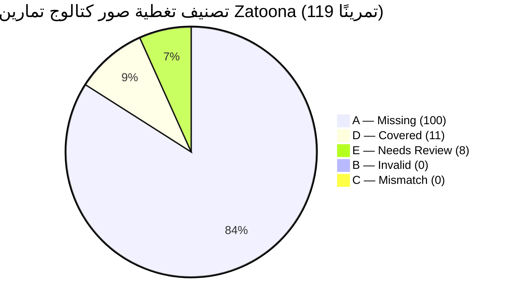

# تقرير التدقيق الفني الشامل لصور كتالوج التمارين الرياضية (Phase 12.1A)
## Curated Exercise Catalog Image Gap Audit — Strict Read-Only Report

- **المشروع:** Zatoona (تطبيق ويب تقدمي شخصي Offline-First PWA)
- **المسار المحلي:** `<REPOSITORY_ROOT>`
- **تاريخ وساعة التدقيق:** 2026-10-25T16:40:00+03:00
- **نوع المهمة:** تدقيق فني صارم للقراءة فقط (Read-Only Audit — No Code / Asset Mutations)
- **الحالة السابقة:** Phase 12.6.1 معتمدة بنجاح (497 / 497 فحصًا ناجحًا في بوابة الانحدار الموحدة)

---

## 1. فحص ما قبل التدقيق وسلامة بيئة العمل

تم إجراء الفحوصات الإلزامية قبل الشروع في فحص الكتالوج لضمان عدم حدوث أي انحراف في ملفات الإنتاج:

1. **حالة مستودع Git (`git status --short`):**
   - ملفات الإنتاج (`index.html`, `zatoona.html`, `sw.js`, `manifest.json`, `assets/*`) نظيفة تمامًا وتطابق الالتزام الأخير.
   - الملفات المعدلة الوحيدة في مسار العمل هي ملفا اختبار الانحدار المعدلان deterministically في Phase 12.6.1:
     - `scratch/test_phase5b1_2_legacy_images.py`
     - `scratch/test_phase9c3_cooldown.py`
   - كلاهما يعمل بكفاءة واجتاز 94/94 و56/56 فحصًا على التوالي.
2. **التطابق الثنائي لملفات الإنتاج (`fc.exe /b`):**
   - المقارنة الثنائية: `fc.exe /b index.html zatoona.html`
   - النتيجة: `FC: no differences encountered` (تطابق بايت لبايت 100%).
3. **بصمات التشفير SHA-256 للملفات الأساسية:**
   - `index.html`: `4ABBF1F9ACB83023C53444489F078D54D654E13003FBD183921DBF46EF1A324F` (1,219,912 bytes)
   - `zatoona.html`: `4ABBF1F9ACB83023C53444489F078D54D654E13003FBD183921DBF46EF1A324F` (1,219,912 bytes)
   - `sw.js`: `6EF96D68CD838FC3F99D69993338760A23AB1D6C399DC974A23E5FEFF15378A9` (19,152 bytes)
   - `manifest.json`: `C872752E51F5B339BD3965370B5DF54B47CBAAAD398785F85D6453FD93C743E5` (1,022 bytes)
4. **النسخ الاحتياطية الخارجية الموثقة:**
   - `<BACKUP_DIR>\phase12_6_preflight_20261025`
   - `<BACKUP_DIR>\phase12_6_1_preflight_20261025`

---

## 2. منهجية الفحص ومصادر بيانات التمارين الفعلية

تم الفحص بالاعتماد الحصري على الشفرات والملفات الثابتة الموجودة على القرص دون فرض أرقام مسبقة:

1. **كتالوج التمارين الشامل (`assets/data/exercise-catalog.js`):**
   - تم التحقق من الكائن العام `window.EXERCISE_CATALOG`.
   - **العدد الفعلي المثبت بالأدلة:** **119 تمرينًا** بالضبط.
   - البنية البيانية لكل تمرين تتضمن:
     `['id', 'name', 'nameAr', 'aliases', 'primaryMuscles', 'secondaryMuscles', 'equipment', 'level', 'category', 'mechanic', 'instructions', 'images', 'source', 'license']`
   - حالة حقل الصور الافتراضية داخل الكتالوج: **جميع التمارين الـ 119 تحتوي على مصفوفة صور فارغة (`"images": []`)**.
2. **سجل قوالب خطط الجيم (`GYM_PLAN_TEMPLATE_REGISTRY` في `index.html`):**
   - يحتوي التطبيق على 4 قوالب رئيسية للتمارين:
     * Full Body (`full_body`)
     * Push / Pull / Legs (`ppl`)
     * Upper / Lower (`upper_lower`)
     * Bro Split (`bro_split`)
   - تتوزع على 12 روتينًا تدريبيًا تضم 59 فتحة تمرين (exercise slots).
   - تشير هذه الفتحات إلى **26 معرّف كتالوج فريد** (`catalogExerciseId`).
3. **التمارين الافتراضية الكلاسيكية (`EX_A_DEFAULTS` و `EX_B_DEFAULTS`):**
   - الروتين الكلاسيكي A و B يحتوي على 12 تمرينًا ثابتًا (6 في كل روتين).
   - كل تمرين منها مربوط برسم SVG محلي عبر المسار `./assets/images/exercises/ex-[ab]0[1-6]-*.svg`.
4. **أصول الصور المحلية على القرص (`assets/images/`):**
   - `assets/images/exercises/`: تضم **12 ملف SVG محلي** فقط.
   - `assets/images/stretches/`: تضم **34 ملف SVG محلي** (خاصة بموسوعة الاستطالات Phase 9C.1).
   - `assets/images/warmup/`: تضم **6 ملفات SVG محلية** (خاصة بمسار الإحماء Phase 9C.2).
   - `assets/images/cooldown/`: تضم **6 ملفات SVG محلية** (خاصة بمسار التهدئة Phase 9C.3).
5. **معمارية معالجة وعرض الصور في واجهة التطبيق (`index.html`):**
   - في دالة `transformTemplateExerciseToRuntime(ex, routineId, templateId)`:
     ```javascript
     const img = (cat && Array.isArray(cat.images) && cat.images.length > 0) ? cat.images[0] : ((cat && cat.img) ? cat.img : '');
     ```
   - في دالة `renderExercises()` لعرض بطاقات التمارين:
     * **الأولوية القصوى (1):** صورة مخصصة رفعها المستخدم مخزنة في خريطة `exercise-image-map-v1` (مخزنة كـ Media ID في قاعدة بيانات IndexedDB `zatoona-media-db`).
     * **الأولوية البديلة (2):** مسار الصورة الافتراضية `ex.img`.
     * **الغياب التام (3):** إذا لم توجد صورة مخصصة ولا مسار افتراضي، يتم عرض المربع المتقطع الافتراضي `.ex-photo.no-photo` بمقاس 46×46 بكسل مع زر `📷 إضافة صورة`.
   - **النتيجة العملية الحالية:** نظرًا لأن `cat.images` فارغة لجميع التمارين الـ 119، فإن أي مستخدم ينشئ خطة جديدة من القوالب الأربعة تظهر لديه **19 تمرينًا من أصل 26 بدون صور نهائيًا** بصندوق رمادي متقطع!

---

## 3. التمييز بين أنواع الصور ومصادرها

يميز التطبيق بدقة بين أربعة تصنيفات للصور:

| نوع الصورة | مكان التخزين / المصدر | هل متاحة لمستخدم جديد فور التثبيت؟ | التأثير في التدقيق |
|---|---|:---:|---|
| **الصور الافتراضية المرفقة (Bundled Default)** | ملفات SVG محلية في مجلد `assets/images/exercises/` ومسجلة في كاش الخدمة `SHELL_ASSETS` (`sw.js`). | **نعم** | هي محور التدقيق؛ يوجد حاليًا 12 ملفًا فقط للروتين الكلاسيكي. |
| **رسومات الاسترتشات والتسخين والتهدئة** | مجلدات `assets/images/stretches/`, `warmup/`, `cooldown/` (46 ملف SVG). | **نعم** | **لا تُحتسب صورًا لتمارين المقاومة** طبقًا للتعليمات الصارمة، لأنها رسومات حركية واستطالات ولا تمثل تمارين حديد وأجهزة. |
| **صور المستخدم المخصصة (Custom User Media)** | مفتاح LocalStorage `exercise-image-map-v1` والبيانات الثنائية (Blobs) في IndexedDB `zatoona-media-db`. | **لا** | مخصصة لكل جهاز شخصي ولا تُعتبر أصلاً افتراضيًا للمشروع. |
| **روابط الصور الخارجية (External URLs)** | روابط شبكية تبدأ بـ `http://` أو `https://`. | **غير موجودة** | تم فحص الشفرة والتأكد من خلو المشروع تمامًا من أي روابط صور خارجية لتمارين الكتالوج، وهو ما يحافظ على معيار Offline-First الصارم. |

---

## 4. إحصاءات وتصنيف مصفوفة التمارين الـ 119

تم تصنيف جميع تمارين الكتالوج الـ 119 وفق الفئات الخمس الصارمة المحددة:

- **`A — Missing` (مفقود):** 100 تمرين (لا توجد صورة افتراضية ولا رسم محلي مطابق).
- **`B — Invalid` (غير صالح أو مكسور):** 0 تمارين (لا توجد روابط مكسورة أو ملفات مفقودة المشار إليها).
- **`C — Mismatch` (غير مطابق):** 0 تمارين (لا توجد صور منسوبة بالخطأ لتمرين آخر داخل الكتالوج).
- **`D — Covered` (مغطى برسم محلي مطابق):** 11 تمرينًا (تمتلك رسوم SVG محلية مطابقة تمامًا على القرص).
- **`E — Needs Review` (يحتاج مراجعة وحسم):** 8 تمارين (متغيرات حركية أو قبضات تتقاطع جزئيًا مع رسومات قائمة).

### التوزيع التفصيلي للتصنيف:



### التوزيع بحسب القوالب الجاهزة (`GYM_PLAN_TEMPLATE_REGISTRY`):

| الفئة | تمارين داخل القوالب (Templates) | تمارين خارج القوالب (General) | المجموع الكلي |
|:---:|:---:|:---:|:---:|
| **D — Covered** | 7 | 4 | **11** |
| **E — Needs Review** | 1 (`seated_dumbbell_shoulder_press`) | 7 | **8** |
| **A — Missing** | 18 | 82 | **100** |
| **المجموع** | **26** | **93** | **119** |

---

## 5. الأصول المحلية الحالية الواجب الحفاظ عليها وإعادة استخدامها

يحتوي مجلد `assets/images/exercises/` على 12 رسم SVG أصلي ممتاز وعالي الجودة، تم رسمها باليد ومخصصة للذكور البالغين وفق سياسة المشروع. يتم الحفاظ عليها بالكامل وربطها بالكتالوج:

| ملف الرسم المحلي (SVG) | التمرين المطابق في الكتالوج (ID) | اسم التمرين | نوع التمرين والمعدات |
|---|---|---|---|
| `ex-a01-goblet-squat.svg` | `goblet_squat` | سكوات جوبلت بالدمبل | مركب (Compound) · دمبل |
| `ex-a02-bench-press.svg` | `barbell_bench_press` | بنش برس بالبار مستوي | مركب (Compound) · بار |
| `ex-a03-lat-pulldown.svg` | `lat_pulldown_wide_grip` | سحب عالي بالماكينة قبضة واسعة | مركب (Compound) · ماكينة |
| `ex-a04-overhead-press.svg` | `standing_overhead_barbell_press` | ضغط أوفرهيد بالبار واقف (عسكري) | مركب (Compound) · بار |
| `ex-a05-plank.svg` | `plank` | تمرين البلانك الثابت (لوح الخشب) | عزل / ثبات (Core) · وزن الجسم |
| `ex-a06-face-pull.svg` | `face_pull_cable` | فيس بول بالحبل على الكابل | مركب (Compound) · كابل |
| `ex-b01-romanian-deadlift.svg` | `romanian_deadlift_barbell` | ديدليفت روماني بالبار (RDL) | مركب (Compound) · بار |
| `ex-b02-barbell-row.svg` | `barbell_bent_over_row` | تجديف بالبار مائل (سحب ظهر) | مركب (Compound) · بار |
| `ex-b03-push-up.svg` | `push_up` | تمرين الضغط الكلاسيكي | مركب (Compound) · وزن الجسم |
| `ex-b04-pull-up.svg` | `pull_up` | تمرين العقلة قبضة علوية واسعة | مركب (Compound) · وزن الجسم |
| `ex-b05-abdominal-crunch.svg` | *غير موجود بالكتالوج* | كرانش للبطن على الأرض (Classic B) | عزل (Core) · وزن الجسم |
| `ex-b06-lunges.svg` | `walking_lunges_dumbbell` | طعنات مشي بالدمبل (لانجز) | مركب (Compound) · دمبل |

> [!NOTE]
> الرسم `ex-b05-abdominal-crunch.svg` مستخدم في الروتين الافتراضي B (`EX_B_DEFAULTS`)، ولكن كتالوج التمارين الحالي يفتقر إلى تمرين كرانش أرضي قياسي بوزن الجسم (يحتوي فقط على كرانش كابل `cable_kneeling_crunch` وكرانش دراجة `bicycle_crunch`). يوصى بالحفاظ على هذا الأصل وربطه أو إضافته في تحسينات الكتالوج.

---

## 6. فئة المراجعة والحسم (Category E — Needs Review)

تم حصر 8 تمارين ذات تشابه جزئي مع رسوم قائمة، والقرار الفني المقترح لكل منها:

1. `seated_dumbbell_shoulder_press` (شولدر برس بالدمبل جالس):
   - *الرسم الحالي:* `ex-a04-overhead-press.svg` (ضغط بار وقوفًا).
   - *التقييم:* **مختلف جوهريًا** في المعدات (دمبل مقابل بار) والوضعية (جلوس على بنش بمسند مقابل وقوف حر). مستخدم في قوالب PPL و Upper/Lower.
   - *التوصية:* اعتباره **A — Missing** وإنشاء رسم SVG مخصص له.
2. `kettlebell_goblet_squat` (جوبلت سكوات بالكيتل بيل):
   - *الرسم الحالي:* `ex-a01-goblet-squat.svg` (سكوات جوبلت بدمبل).
   - *التوصية:* يمكن إعادة استخدام الرسم مؤقتًا، أو توفير رسم كيتل بيل لاحقًا.
3. `chin_up` (عقلة قبضة سفلية معكوسة):
   - *الرسم الحالي:* `ex-b04-pull-up.svg` (عقلة قبضة علوية).
   - *التوصية:* الحركة تتطابق في الماكينة والتعليق ولكن تختلف في توجيه الكف وعضلات البايسبس.
4. `diamond_push_up` (ضغط ماسي):
   - *الرسم الحالي:* `ex-b03-push-up.svg` (ضغط عادي).
   - *التوصية:* تباين واضح في وضع اليدين تحت الصدر لتركيز الترايسبس.
5. `decline_push_up` (ضغط بقدمين مرتفعتين):
   - *الرسم الحالي:* `ex-b03-push-up.svg`.
   - *التوصية:* تباين في زاوية الجسم لاستهداف الصدر العلوي.
6. `incline_push_up` (ضغط بيدين مرتفعتين):
   - *الرسم الحالي:* `ex-b03-push-up.svg`.
7. `lat_pulldown_close_grip` (سحب عالي قبضة ضيقة V-bar):
   - *الرسم الحالي:* `ex-a03-lat-pulldown.svg` (قبضة واسعة).
8. `single_arm_cable_lat_pulldown` (سحب فردي كابل):
   - *الرسم الحالي:* `ex-a03-lat-pulldown.svg`.

---

## 7. قائمة الأولويات للتمارين المركبة والأساسية الناقصة

تم ترتيب التمارين الناقصة في الكتالوج وفق الأثر الفعلي على تجربة المستخدم، مقسمة إلى ثلاث طبقات أولوية صارمة:

### المستوى الأول (Priority Tier 1): التمارين المركبة الأساسية في القوالب الجاهزة (9 تمارين)
هذه التمارين هي العصب الأساسي للخطط التدريبية في Zatoona، وتظهر حاليًا بدون صور:
1. `barbell_back_squat` — **سكوات خلفي بالبار (القرفصاء بالبار)**: التمرين الملكي للأرجل والكتلة العضلية، غيابه البصري هو الفجوة الأكبر في التطبيق.
2. `conventional_deadlift` — **الرفعة الميتة كلاسيكي بالبار (ديدليفت)**: التمرين الأساسي للسلسلة الخلفية والظهر والأرجل.
3. `incline_barbell_bench_press` — **بنش مائل عالي بالبار**: تمرين الصدر العلوي الأساسي في برامج PPL وUpper/Lower.
4. `dumbbell_bench_press` — **بنش برس بالدمبل مستوي**: تمرين الصدر المستوي بالدمبل لتحسين التوازن العضلي والمدى الحركي.
5. `incline_dumbbell_press` — **بنش مائل عالي بالدمبل**: تمرين الصدر العلوي بالدمبل الأكثر شيوعًا.
6. `seated_cable_row` — **تجديف كابل جالس (سحب أرضي)**: الحركة الأفقية الأساسية لعضلات الظهر والكثافة العضلية.
7. `leg_press` — **مكبس الأرجل بزاوية 45 درجة (ليج برس)**: تمرين مركب ضخم لأرجل الأجهزة.
8. `seated_dumbbell_shoulder_press` — **شولدر برس بالدمبل جالس**: التمرين الأساسي للكتف الأمامي والجانبي في القوالب.
9. `hanging_leg_raise` — **رفع الأرجل في وضع التعليق على العقلة**: التمرين المركب الأساسي للبطن والحوض.

### المستوى الثاني (Priority Tier 2): تمارين العزل المكملة للقوالب الجاهزة (10 تمارين)
لتكتمل تغطية القوالب الجاهزة بنسبة 100% دون أي صندوق فارغ:
10. `standing_dumbbell_lateral_raise` — رفرفة كتف جانبي بالدمبل واقف.
11. `barbell_curl` — كيرل بايسبس بالبار مستقيم واقف.
12. `hammer_curl` — كيرل شاكوش بالدمبل (هامر كيرل).
13. `triceps_rope_pushdown` — ترايسبس كابل دفع لأسفل بالحبل.
14. `skull_crushers` — فرنساوي بار EZ نائم على البنش (سكل كراشر).
15. `dumbbell_chest_flyes` — تجميع دمبل مستوي (تفتيح صدر).
16. `lying_leg_curl_machine` — ثني أرجل خلفي نائم بالماكينة.
17. `seated_leg_curl_machine` — ثني أرجل خلفي جالس بالماكينة.
18. `standing_calf_raise_machine` — رفع سمانة واقف بالماكينة.
19. `seated_palms_up_wrist_curl` — ثني رسغ بالبار جالس كف لأعلى.

### المستوى الثالث (Priority Tier 3): حركات مركبة مهمة خارج القوالب (12 تمرينًا)
تمارين شائعة جدًا في الكتالوج يضيفها المستخدمون بانتظام:
20. `barbell_front_squat` — سكوات أمامي بالبار (فرونت سكوات).
21. `chest_dips` / `parallel_bar_triceps_dips` — متوازي (Dips).
22. `one_arm_dumbbell_row` — تجديف دمبل فردي (منشار).
23. `t_bar_row` — تجديف تي بار.
24. `barbell_hip_thrust` — هيب ثرست بالبار.
25. `bulgarian_split_squat` — بلغاريان سبليت سكوات بالدمبل.
26. `sumo_deadlift` — سومو ديدليفت بالبار.
27. `hack_squat_machine` — هاك سكوات بالماكينة.
28. `pendlay_row` — بيندلاي رو بالبار.
29. `close_grip_bench_press` — بنش برس قبضة ضيقة للترايسبس.
30. `arnold_press` — أرنولد برس بالدمبل جالس.
31. `kettlebell_swing` — سوينج كيتل بيل.

---

## 8. السياسة الفنية المعتمدة لرسومات التمارين في المرحلة اللاحقة (Phase 12.1B)

لتطبيق Phase 12.1B بنجاح، يجب الالتزام التام بالقواعد التالية:

1. **الرجال البالغون فقط (Adult Males Only):**
   - جميع الشخصيات المرسومة في رسومات التمارين يجب أن تكون لرجال بالغين فقط، التزامًا بسياسة التطبيق الصارمة.
   - يُمنع إدراج صور لنساء أو صور مختلطة منعًا باتًا.
2. **صيغة الرسوم والمتجهات (Pure Local SVG):**
   - استخدام صيغة SVG نقية محلية مكتوبة مباشرة بدون صور نقطية Base64 مضمنة (No raster/bitmap embedding).
   - حجم الملف المستهدف: من 2 إلى 4 كيلوبايت لكل رسم SVG لضمان خفة التحميل والأداء الفائق.
   - أبعاد العرض الموحدة: `viewBox="0 0 320 240"` أو مماثلة لرسومات التمارين الحالية (`ex-a01` إلى `ex-b06`).
   - استخدام لوحة الألوان المعتمدة في النظام (خطوط داكنة واضحة، تفاصيل عضلية دقيقة، تمييز واضح للبار/الدمبل/الجهاز بلون مميز).
3. **العمل دون إنترنت بنسبة 100% (Offline-First):**
   - حفظ جميع ملفات الـ SVG في المجلد المحلي `assets/images/exercises/`.
   - تسجيل مسارات الملفات الجديدة في مصفوفة `SHELL_ASSETS` في ملف `sw.js` ورفع رقم إصدار الكاش (مثلاً `CACHE_NAME = 'zatoona-v24'`).
   - عدم استخدام أي روابط خارجية أو شبكات توزيع محتوى (No CDN, No HTTP/HTTPS URLs).
4. **دقة ووضوح الحركة والمعدات:**
   - توضيح المسار الحركي والوضعية الصحيحة للظهر والمفاصل والمعدات المستخدمة بدقة تشريحية واضحة.
   - عدم استخدام أيقونات رمزية عامة مبهمة؛ يجب أن يُظهر الرسم الشخص وهو يؤدي التمرين بوضوح.
5. **احترام أسبقية صور المستخدم المخصصة:**
   - الحفاظ على منطق `displayImgSrc = userCustomImage || catalogDefaultImage` دون أي مساس بحق المستخدم في تغيير أو رفع صوره الخاصة وتخزينها في IndexedDB.

---

## 9. خطة الاختبار والتحقق الآلي للمرحلة القادمة (Phase 12.1B)

تم تصميم استراتيجية فحص آلي للمرحلة القادمة لضمان تكامل الأصول الجديدة دون انحدار:

1. **سكربت فحص مخصص للأصول (`scratch/test_phase12_1b_exercise_images.py`):**
   - التحقق من وجود كل ملف SVG محلي على القرص والتأكد من حجمه (> 0 بايت).
   - التحقق من صلاحية شفرة SVG (وجود وسوم `<svg>`, `viewBox`, `</svg>`).
   - فحص خلو مسارات الصور من أي بروتوكول خارجي (`http://`, `https://`).
   - التأكد من إدراج جميع الملفات الجديدة داخل `SHELL_ASSETS` في `sw.js`.
   - التأكد من أن جميع تمارين القوالب الـ 26 تحل مسار صورة محلي صالح (`ex.img !== ''`).
   - التأكد من أن صور المستخدم المخصصة لا تزال تطغى على الصور الافتراضية.
2. **دمج الاختبار في البوابة الموحدة (`scratch/test_master_regression_gate.py`):**
   - إضافة السكربت الجديد كجناح عاشر (Suite 10) ليتم تشغيله تلقائيًا ضمن بوابة الانحدار، مع بقاء نسبة النجاح المستهدفة 100%.

---

## 10. التوصية التنفيذية النهائية لدفعة التنفيذ الأولى (Batch 1 Scope)

بدلاً من محاولة رسم 100 تمرين دفعة واحدة مما قد يؤدي إلى انخفاض جودة الرسوم، يوصى بالتركيز في **Phase 12.1B** على:

> [!IMPORTANT]
> **نطاق الدفعة الأولى الموصى به (20 رسم SVG جديد):**
> 1. تغطية **التمارين المركبة الـ 9 الناقصة في القوالب الجاهزة** (Tier 1: Squat, Deadlift, Incline Barbell, DB Bench, Incline DB, Seated Cable Row, Leg Press, Seated DB Press, Hanging Leg Raise).
> 2. تغطية **تمارين العزل الـ 10 الناقصة في القوالب الجاهزة** (Tier 2: Lateral Raise, Barbell Curl, Hammer Curl, Rope Pushdown, Skull Crushers, DB Flyes, Lying Leg Curl, Seated Leg Curl, Standing Calf Raise, Wrist Curl).
> 3. توفير رسم محلي لتمرين `barbell_front_squat` أو تمرين الكرانش الأرضي.
>
> **الأثر المباشر لهذا النطاق:** تحقيق **تغطية بصرية 100% لجميع الخطط والقوالب الجاهزة في Zatoona** (`full_body`, `ppl`, `upper_lower`, `bro_split`)، مما يلغي تمامًا الصناديق الرمادية المتقطعة لدى أي مستخدم جديد للتطبيق.

---

## 11. مصفوفة تدقيق كتالوج التمارين الـ 119 الكاملة

تحتوي المصفوفة التالية على جميع التمارين الـ 119 المثبتة في `assets/data/exercise-catalog.js` مع حالتها وتصنيفها التفصيلي:

| # | معرّف التمرين (ID) | الاسم بالعربية | الاسم بالإنجليزية | العضلة الأساسية | النوع | المعدات | القالب | الفئة | حالة الصورة / الملاحظة |
|---|---|---|---|---|---|---|:---:|:---:|---|
| 1 | `barbell_bench_press` | بنش برس بالبار مستوي | Barbell Bench Press | chest | compound | barbell | ✓ | **D** | مغطى برسم محلي مطابق (`assets/images/exercises/ex-a02-bench-press.svg`) |
| 2 | `incline_barbell_bench_press` | بنش مائل عالي بالبار | Incline Barbell Bench Press | chest | compound | barbell | ✓ | **A** | مفقود — لا يوجد رسم SVG محلي وقائمة images فارغة |
| 3 | `decline_barbell_bench_press` | بنش هابط بالبار | Decline Barbell Bench Press | chest | compound | barbell | — | **A** | مفقود — لا يوجد رسم SVG محلي وقائمة images فارغة |
| 4 | `dumbbell_bench_press` | بنش برس بالدمبل مستوي | Dumbbell Bench Press | chest | compound | dumbbell | ✓ | **A** | مفقود — لا يوجد رسم SVG محلي وقائمة images فارغة |
| 5 | `incline_dumbbell_press` | بنش مائل عالي بالدمبل | Incline Dumbbell Press | chest | compound | dumbbell | ✓ | **A** | مفقود — لا يوجد رسم SVG محلي وقائمة images فارغة |
| 6 | `decline_dumbbell_press` | بنش هابط بالدمبل | Decline Dumbbell Press | chest | compound | dumbbell | — | **A** | مفقود — لا يوجد رسم SVG محلي وقائمة images فارغة |
| 7 | `dumbbell_chest_flyes` | تجميع دمبل مستوي (تفتيح صدر) | Dumbbell Chest Flyes | chest | isolation | dumbbell | ✓ | **A** | مفقود — لا يوجد رسم SVG محلي وقائمة images فارغة |
| 8 | `incline_dumbbell_flyes` | تجميع دمبل على بنش مائل عالي | Incline Dumbbell Flyes | chest | isolation | dumbbell | — | **A** | مفقود — لا يوجد رسم SVG محلي وقائمة images فارغة |
| 9 | `cable_crossover_high_to_low` | تجميع كابل من أعلى لأسفل | Cable Crossover (High to Low) | chest | isolation | cable | — | **A** | مفقود — لا يوجد رسم SVG محلي وقائمة images فارغة |
| 10 | `cable_crossover_low_to_high` | تجميع كابل من أسفل لأعلى | Low Cable Crossover | chest | isolation | cable | — | **A** | مفقود — لا يوجد رسم SVG محلي وقائمة images فارغة |
| 11 | `chest_dips` | متوازي للصدر (Dips) | Chest Dips | chest | compound | bodyweight | — | **A** | مفقود — لا يوجد رسم SVG محلي وقائمة images فارغة |
| 12 | `push_up` | تمرين الضغط الكلاسيكي | Standard Push-Up | chest | compound | bodyweight | — | **D** | مغطى برسم محلي مطابق (`assets/images/exercises/ex-b03-push-up.svg`) |
| 13 | `diamond_push_up` | تمرين الضغط الماسي | Diamond Push-Up | chest, triceps | compound | bodyweight | — | **E** | تشابه جزئي مع `ex-b03-push-up.svg` (قبضة ماسية ضيقة مقابل ضغط قياسي)؛ يحتاج حسم |
| 14 | `machine_chest_press` | دفع الصدر بالماكينة جالس | Machine Chest Press | chest | compound | machine | — | **A** | مفقود — لا يوجد رسم SVG محلي وقائمة images فارغة |
| 15 | `pec_deck_fly` | تجميع الصدر بالماكينة (بيليفاي / بيك ديك) | Pec Deck Machine Fly | chest | isolation | machine | — | **A** | مفقود — لا يوجد رسم SVG محلي وقائمة images فارغة |
| 16 | `conventional_deadlift` | الرفعة الميتة كلاسيكي بالبار (ديدليفت) | Barbell Conventional Deadlift | lower_back, hamstrings, glutes | compound | barbell | ✓ | **A** | مفقود — لا يوجد رسم SVG محلي وقائمة images فارغة |
| 17 | `barbell_bent_over_row` | تجديف بالبار مائل (بار سحب ظهر) | Barbell Bent-Over Row | lats, back | compound | barbell | ✓ | **D** | مغطى برسم محلي مطابق (`assets/images/exercises/ex-b02-barbell-row.svg`) |
| 18 | `pendlay_row` | بيندلاي رو بالبار (تجديف من الأرض) | Pendlay Row | back, lats | compound | barbell | — | **A** | مفقود — لا يوجد رسم SVG محلي وقائمة images فارغة |
| 19 | `t_bar_row` | تجديف تي بار (T-Bar Row) | T-Bar Row | back, lats | compound | barbell | — | **A** | مفقود — لا يوجد رسم SVG محلي وقائمة images فارغة |
| 20 | `one_arm_dumbbell_row` | تجديف دمبل فردي (منشار دمبل) | One-Arm Dumbbell Row | lats, back | compound | dumbbell | — | **A** | مفقود — لا يوجد رسم SVG محلي وقائمة images فارغة |
| 21 | `lat_pulldown_wide_grip` | سحب عالي بالماكينة قبضة واسعة | Lat Pulldown (Wide Grip) | lats | compound | machine | ✓ | **D** | مغطى برسم محلي مطابق (`assets/images/exercises/ex-a03-lat-pulldown.svg`) |
| 22 | `lat_pulldown_close_grip` | سحب عالي قبضة ضيقة محايدة (V-Bar) | Close-Grip Lat Pulldown | lats | compound | machine | — | **E** | تشابه جزئي مع `ex-a03-lat-pulldown.svg` (قبضة ضيقة V-bar مقابل قبضة واسعة)؛ يحتاج حسم |
| 23 | `seated_cable_row` | تجديف كابل جالس (سحب أرضي) | Seated Cable Row | back, lats | compound | cable | ✓ | **A** | مفقود — لا يوجد رسم SVG محلي وقائمة images فارغة |
| 24 | `straight_arm_cable_pulldown` | سحب كابل بذراعين مفرودتين (عزل لاتس) | Straight-Arm Cable Pulldown | lats | isolation | cable | — | **A** | مفقود — لا يوجد رسم SVG محلي وقائمة images فارغة |
| 25 | `pull_up` | تمرين العقلة قبضة علوية واسعة | Pull-Up | lats, back | compound | bodyweight | — | **D** | مغطى برسم محلي مطابق (`assets/images/exercises/ex-b04-pull-up.svg`) |
| 26 | `chin_up` | تمرين العقلة قبضة سفلية معكوسة | Chin-Up | lats, biceps | compound | bodyweight | — | **E** | تشابه جزئي مع `ex-b04-pull-up.svg` (قبضة مقلوبة سفلية مقابل قبضة علوية في العقلة)؛ يحتاج حسم |
| 27 | `inverted_row` | تجديف عكسي بوزن الجسم (أستراليان رو) | Inverted Row (Bodyweight) | back, lats | compound | bodyweight | — | **A** | مفقود — لا يوجد رسم SVG محلي وقائمة images فارغة |
| 28 | `dumbbell_pullover` | بول أوفر بالدمبل نائم | Dumbbell Pullover | lats, chest | compound | dumbbell | — | **A** | مفقود — لا يوجد رسم SVG محلي وقائمة images فارغة |
| 29 | `back_extensions` | فرد الظهر على المقعد الروماني (هايبر اكستنشن) | Hyperextensions (Back Extension) | lower_back | isolation | bodyweight | — | **A** | مفقود — لا يوجد رسم SVG محلي وقائمة images فارغة |
| 30 | `machine_seated_row` | تجديف ظهر جالس بالماكينة | Machine Seated Row | back, lats | compound | machine | — | **A** | مفقود — لا يوجد رسم SVG محلي وقائمة images فارغة |
| 31 | `standing_overhead_barbell_press` | ضغط أوفرهيد بالبار واقف (الضغط العسكري) | Standing Overhead Barbell Press | shoulders | compound | barbell | ✓ | **D** | مغطى برسم محلي مطابق (`assets/images/exercises/ex-a04-overhead-press.svg`) |
| 32 | `seated_dumbbell_shoulder_press` | شولدر برس بالدمبل جالس | Seated Dumbbell Shoulder Press | shoulders | compound | dumbbell | ✓ | **E** | تشابه جزئي مع `ex-a04-overhead-press.svg` (دمبل جالس مقابل بار واقف في شولدر برس)؛ يحتاج حسم |
| 33 | `arnold_press` | أرنولد برس بالدمبل جالس | Arnold Press | shoulders | compound | dumbbell | — | **A** | مفقود — لا يوجد رسم SVG محلي وقائمة images فارغة |
| 34 | `standing_dumbbell_lateral_raise` | رفرفة كتف جانبي بالدمبل واقف | Standing Dumbbell Lateral Raise | shoulders | isolation | dumbbell | ✓ | **A** | مفقود — لا يوجد رسم SVG محلي وقائمة images فارغة |
| 35 | `seated_dumbbell_lateral_raise` | رفرفة كتف جانبي بالدمبل جالس | Seated Dumbbell Lateral Raise | shoulders | isolation | dumbbell | — | **A** | مفقود — لا يوجد رسم SVG محلي وقائمة images فارغة |
| 36 | `cable_lateral_raise` | رفرفة كتف جانبي بالكابل فردي | Cable Lateral Raise | shoulders | isolation | cable | — | **A** | مفقود — لا يوجد رسم SVG محلي وقائمة images فارغة |
| 37 | `front_dumbbell_raise` | رفرفة كتف أمامي بالدمبل | Front Dumbbell Raise | shoulders | isolation | dumbbell | — | **A** | مفقود — لا يوجد رسم SVG محلي وقائمة images فارغة |
| 38 | `face_pull_cable` | فيس بول بالحبل على الكابل (سحب للوجه) | Face Pull with Rope | shoulders, traps | compound | cable | ✓ | **D** | مغطى برسم محلي مطابق (`assets/images/exercises/ex-a06-face-pull.svg`) |
| 39 | `rear_delt_dumbbell_fly` | رفرفة كتف خلفي بالدمبل مائل | Rear Delt Dumbbell Fly (Bent-Over) | shoulders | isolation | dumbbell | — | **A** | مفقود — لا يوجد رسم SVG محلي وقائمة images فارغة |
| 40 | `reverse_pec_deck` | كتف خلفي بالماكينة (فراشة مقلوبة) | Reverse Pec Deck Fly | shoulders | isolation | machine | — | **A** | مفقود — لا يوجد رسم SVG محلي وقائمة images فارغة |
| 41 | `barbell_upright_row` | سحب بار للأعلى للكتف والترابيس (أب رايت رو) | Barbell Upright Row | shoulders, traps | compound | barbell | — | **A** | مفقود — لا يوجد رسم SVG محلي وقائمة images فارغة |
| 42 | `barbell_shrugs` | رفع الكتفين بالبار (ترابيس بالبار) | Barbell Shrugs | traps | isolation | barbell | — | **A** | مفقود — لا يوجد رسم SVG محلي وقائمة images فارغة |
| 43 | `dumbbell_shrugs` | رفع الكتفين بالدمبل (ترابيس بالدمبل) | Dumbbell Shrugs | traps | isolation | dumbbell | — | **A** | مفقود — لا يوجد رسم SVG محلي وقائمة images فارغة |
| 44 | `barbell_curl` | كيرل بايسبس بالبار مستقيم واقف | Standing Barbell Bicep Curl | biceps | isolation | barbell | ✓ | **A** | مفقود — لا يوجد رسم SVG محلي وقائمة images فارغة |
| 45 | `ez_bar_bicep_curl` | كيرل بايسبس بالبار المتعرج (EZ-Bar) | EZ-Bar Bicep Curl | biceps | isolation | barbell | — | **A** | مفقود — لا يوجد رسم SVG محلي وقائمة images فارغة |
| 46 | `alternating_dumbbell_curl` | كيرل دمبل تبادلي واقف (تبادل دمبل باي) | Alternating Dumbbell Bicep Curl | biceps | isolation | dumbbell | — | **A** | مفقود — لا يوجد رسم SVG محلي وقائمة images فارغة |
| 47 | `incline_dumbbell_curl` | كيرل دمبل على بنش مائل (إطالة الرأس الطويل) | Incline Dumbbell Bicep Curl | biceps | isolation | dumbbell | — | **A** | مفقود — لا يوجد رسم SVG محلي وقائمة images فارغة |
| 48 | `hammer_curl` | كيرل شاكوش بالدمبل (هامر كيرل) | Dumbbell Hammer Curl | biceps, forearms | isolation | dumbbell | ✓ | **A** | مفقود — لا يوجد رسم SVG محلي وقائمة images فارغة |
| 49 | `cable_rope_hammer_curl` | كيرل هامر بالحبل على الكابل | Cable Rope Hammer Curl | biceps, forearms | isolation | cable | — | **A** | مفقود — لا يوجد رسم SVG محلي وقائمة images فارغة |
| 50 | `preacher_curl` | كيرل بار بريتشر على مسند الواعظ (لاري سكوت) | Preacher Curl (EZ-Bar) | biceps | isolation | barbell | — | **A** | مفقود — لا يوجد رسم SVG محلي وقائمة images فارغة |
| 51 | `concentration_curl` | كيرل تركيز بالدمبل جالس (كونسنتريشن) | Concentration Curl | biceps | isolation | dumbbell | — | **A** | مفقود — لا يوجد رسم SVG محلي وقائمة images فارغة |
| 52 | `standing_cable_curl` | كيرل بايسبس بالكابل واقف بالمسطرة | Standing Cable Bicep Curl | biceps | isolation | cable | — | **A** | مفقود — لا يوجد رسم SVG محلي وقائمة images فارغة |
| 53 | `triceps_rope_pushdown` | ترايسبس كابل دفع لأسفل بالحبل | Cable Rope Triceps Pushdown | triceps | isolation | cable | ✓ | **A** | مفقود — لا يوجد رسم SVG محلي وقائمة images فارغة |
| 54 | `triceps_bar_pushdown` | ترايسبس كابل دفع لأسفل بالمسطرة (أو بار V) | Cable Bar Triceps Pushdown | triceps | isolation | cable | — | **A** | مفقود — لا يوجد رسم SVG محلي وقائمة images فارغة |
| 55 | `skull_crushers` | فرنساوي بار EZ نائم على البنش (سكل كراشر) | EZ-Bar Skull Crushers (Lying Triceps Extension) | triceps | isolation | barbell | ✓ | **A** | مفقود — لا يوجد رسم SVG محلي وقائمة images فارغة |
| 56 | `overhead_dumbbell_triceps_extension` | فرنساوي دمبل خلف الرأس جالس (أوفرهيد) | Overhead Dumbbell Triceps Extension | triceps | isolation | dumbbell | — | **A** | مفقود — لا يوجد رسم SVG محلي وقائمة images فارغة |
| 57 | `overhead_cable_triceps_extension` | ترايسبس كابل علوي فوق الرأس بالحبل | Overhead Cable Triceps Extension | triceps | isolation | cable | — | **A** | مفقود — لا يوجد رسم SVG محلي وقائمة images فارغة |
| 58 | `close_grip_bench_press` | بنش برس قبضة ضيقة بالبار (تركيز ترايسبس) | Close-Grip Barbell Bench Press | triceps, chest | compound | barbell | — | **A** | مفقود — لا يوجد رسم SVG محلي وقائمة images فارغة |
| 59 | `parallel_bar_triceps_dips` | غطس متوازي للترايسبس (Dips عمودي) | Triceps Dips on Parallel Bars | triceps | compound | bodyweight | — | **A** | مفقود — لا يوجد رسم SVG محلي وقائمة images فارغة |
| 60 | `bench_dips` | غطس الترايسبس على حافة البنش | Bench Dips | triceps | compound | bodyweight | — | **A** | مفقود — لا يوجد رسم SVG محلي وقائمة images فارغة |
| 61 | `dumbbell_kickback` | كيك باك بالدمبل للترايسبس | Dumbbell Triceps Kickback | triceps | isolation | dumbbell | — | **A** | مفقود — لا يوجد رسم SVG محلي وقائمة images فارغة |
| 62 | `barbell_back_squat` | سكوات خلفي بالبار (القرفصاء بالبار) | Barbell Back Squat | quads | compound | barbell | ✓ | **A** | مفقود — لا يوجد رسم SVG محلي وقائمة images فارغة |
| 63 | `barbell_front_squat` | سكوات أمامي بالبار (فرونت سكوات) | Barbell Front Squat | quads | compound | barbell | — | **A** | مفقود — لا يوجد رسم SVG محلي وقائمة images فارغة |
| 64 | `goblet_squat` | سكوات جوبلت بالدمبل (Goblet Squat) | Goblet Squat with Dumbbell | quads | compound | dumbbell | — | **D** | مغطى برسم محلي مطابق (`assets/images/exercises/ex-a01-goblet-squat.svg`) |
| 65 | `leg_press` | مكبس الأرجل بزاوية 45 درجة (ليج برس) | 45-Degree Leg Press Machine | quads | compound | machine | ✓ | **A** | مفقود — لا يوجد رسم SVG محلي وقائمة images فارغة |
| 66 | `hack_squat_machine` | هاك سكوات بالماكينة | Hack Squat Machine | quads | compound | machine | — | **A** | مفقود — لا يوجد رسم SVG محلي وقائمة images فارغة |
| 67 | `bulgarian_split_squat` | بلغاريان سبليت سكوات بالدمبل (سكوات بلغاري) | Bulgarian Split Squat with Dumbbells | quads, glutes | compound | dumbbell | — | **A** | مفقود — لا يوجد رسم SVG محلي وقائمة images فارغة |
| 68 | `walking_lunges_dumbbell` | طعنات مشي بالدمبل (لانجز مشي) | Dumbbell Walking Lunges | quads, glutes | compound | dumbbell | — | **D** | مغطى برسم محلي مطابق (`assets/images/exercises/ex-b06-lunges.svg`) |
| 69 | `leg_extension_machine` | فرد أرجل أمامي بالماكينة (ليج اكستنشن) | Leg Extension Machine | quads | isolation | machine | — | **A** | مفقود — لا يوجد رسم SVG محلي وقائمة images فارغة |
| 70 | `step_ups_dumbbell` | صعود المنصة بالدمبل (ستيب أب) | Dumbbell Step-Ups | quads, glutes | compound | dumbbell | — | **A** | مفقود — لا يوجد رسم SVG محلي وقائمة images فارغة |
| 71 | `romanian_deadlift_barbell` | ديدليفت روماني بالبار (RDL) | Barbell Romanian Deadlift (RDL) | hamstrings, glutes | compound | barbell | ✓ | **D** | مغطى برسم محلي مطابق (`assets/images/exercises/ex-b01-romanian-deadlift.svg`) |
| 72 | `romanian_deadlift_dumbbell` | ديدليفت روماني بالدمبل (RDL دمبل) | Dumbbell Romanian Deadlift | hamstrings, glutes | compound | dumbbell | — | **A** | مفقود — لا يوجد رسم SVG محلي وقائمة images فارغة |
| 73 | `lying_leg_curl_machine` | ثني أرجل خلفي نائم بالماكينة (ليج كيرل نائم) | Lying Leg Curl Machine | hamstrings | isolation | machine | ✓ | **A** | مفقود — لا يوجد رسم SVG محلي وقائمة images فارغة |
| 74 | `seated_leg_curl_machine` | ثني أرجل خلفي جالس بالماكينة (ليج كيرل جالس) | Seated Leg Curl Machine | hamstrings | isolation | machine | ✓ | **A** | مفقود — لا يوجد رسم SVG محلي وقائمة images فارغة |
| 75 | `barbell_hip_thrust` | هيب ثرست بالبار (Hip Thrust) | Barbell Hip Thrust | glutes | compound | barbell | — | **A** | مفقود — لا يوجد رسم SVG محلي وقائمة images فارغة |
| 76 | `cable_glute_kickback` | كيك باك للمؤخرة بالكابل (Glute Kickback) | Cable Glute Kickback | glutes | isolation | cable | — | **A** | مفقود — لا يوجد رسم SVG محلي وقائمة images فارغة |
| 77 | `kettlebell_swing` | سوينج كيتل بيل (مرجحة الكيتل بيل) | Kettlebell Swing | glutes, hamstrings | compound | kettlebell | — | **A** | مفقود — لا يوجد رسم SVG محلي وقائمة images فارغة |
| 78 | `sumo_deadlift` | سومو ديدليفت بالبار (وقفة واسعة) | Barbell Sumo Deadlift | glutes, hamstrings, quads | compound | barbell | — | **A** | مفقود — لا يوجد رسم SVG محلي وقائمة images فارغة |
| 79 | `standing_calf_raise_machine` | رفع سمانة واقف بالماكينة | Standing Calf Raise Machine | calves | isolation | machine | ✓ | **A** | مفقود — لا يوجد رسم SVG محلي وقائمة images فارغة |
| 80 | `seated_calf_raise_machine` | رفع سمانة جالس بالماكينة (تركيز العضلة النعلية) | Seated Calf Raise Machine | calves | isolation | machine | — | **A** | مفقود — لا يوجد رسم SVG محلي وقائمة images فارغة |
| 81 | `single_leg_dumbbell_calf_raise` | رفع سمانة رجل واحدة بالدمبل | Single-Leg Dumbbell Calf Raise | calves | isolation | dumbbell | — | **A** | مفقود — لا يوجد رسم SVG محلي وقائمة images فارغة |
| 82 | `leg_press_calf_raise` | رفع سمانة على جهاز مكبس الأرجل | Leg Press Calf Raise (Calf Press) | calves | isolation | machine | — | **A** | مفقود — لا يوجد رسم SVG محلي وقائمة images فارغة |
| 83 | `plank` | تمرين البلانك الثابت (لوح الخشب) | Front Plank | abs | isolation | bodyweight | ✓ | **D** | مغطى برسم محلي مطابق (`assets/images/exercises/ex-a05-plank.svg`) |
| 84 | `side_plank` | البلانك الجانبي (ثبات لعضلات الخصر) | Side Plank | abs | isolation | bodyweight | — | **A** | مفقود — لا يوجد رسم SVG محلي وقائمة images فارغة |
| 85 | `hanging_leg_raise` | رفع الأرجل في وضع التعليق على العقلة | Hanging Leg Raise | abs | compound | bodyweight | ✓ | **A** | مفقود — لا يوجد رسم SVG محلي وقائمة images فارغة |
| 86 | `hanging_knee_raise` | رفع الركبتين تعليقاً على العقلة | Hanging Knee Raise | abs | compound | bodyweight | — | **A** | مفقود — لا يوجد رسم SVG محلي وقائمة images فارغة |
| 87 | `cable_kneeling_crunch` | كرانش البطن بالكابل راكعاً (سجود بالكابل) | Kneeling Cable Crunch | abs | isolation | cable | — | **A** | مفقود — لا يوجد رسم SVG محلي وقائمة images فارغة |
| 88 | `ab_wheel_rollout` | دحرجة عجلة البطن (آب رول آوت) | Ab Wheel Rollout | abs | compound | other | — | **A** | مفقود — لا يوجد رسم SVG محلي وقائمة images فارغة |
| 89 | `russian_twists` | التدوير الروسي لعضلات الخصر (Russian Twist) | Russian Twist | abs | isolation | bodyweight | — | **A** | مفقود — لا يوجد رسم SVG محلي وقائمة images فارغة |
| 90 | `seated_palms_up_wrist_curl` | ثني رسغ بالبار جالس كف لأعلى (ساعد داخلي) | Seated Palms-Up Barbell Wrist Curl | forearms | isolation | barbell | ✓ | **A** | مفقود — لا يوجد رسم SVG محلي وقائمة images فارغة |
| 91 | `seated_palms_down_wrist_curl` | مد رسغ بالبار جالس كف لأسفل (ساعد خارجي) | Seated Palms-Down Barbell Wrist Curl | forearms | isolation | barbell | — | **A** | مفقود — لا يوجد رسم SVG محلي وقائمة images فارغة |
| 92 | `farmers_walk` | مشي المزارع بالدمبل (فارمرز ووك) | Dumbbell Farmer's Walk | forearms, traps | compound | dumbbell | — | **A** | مفقود — لا يوجد رسم SVG محلي وقائمة images فارغة |
| 93 | `dead_hang` | التعلق الميت على عقلة (ديد هانج لقوة القبضة والكتف) | Dead Hang on Pull-Up Bar | forearms | isolation | bodyweight | — | **A** | مفقود — لا يوجد رسم SVG محلي وقائمة images فارغة |
| 94 | `band_pull_apart` | سحب شريط المقاومة أفقي (باند بول أبارت) | Resistance Band Pull-Apart | shoulders, traps | isolation | bands | — | **A** | مفقود — لا يوجد رسم SVG محلي وقائمة images فارغة |
| 95 | `band_bicep_curl` | كيرل بايسبس بشريط المقاومة | Resistance Band Bicep Curl | biceps | isolation | bands | — | **A** | مفقود — لا يوجد رسم SVG محلي وقائمة images فارغة |
| 96 | `band_triceps_pushdown` | دفع ترايسبس بشريط المقاومة | Resistance Band Triceps Pushdown | triceps | isolation | bands | — | **A** | مفقود — لا يوجد رسم SVG محلي وقائمة images فارغة |
| 97 | `band_monster_walk` | مشي جانبي بشريط المقاومة للمؤخرة (مونستر ووك) | Band Monster Walk (Lateral Walk) | glutes | isolation | bands | — | **A** | مفقود — لا يوجد رسم SVG محلي وقائمة images فارغة |
| 98 | `band_face_pull` | فيس بول بشريط المقاومة (سحب للوجه بالباند) | Resistance Band Face Pull | shoulders, traps | compound | bands | — | **A** | مفقود — لا يوجد رسم SVG محلي وقائمة images فارغة |
| 99 | `kettlebell_goblet_squat` | جوبلت سكوات بالكيتل بيل | Kettlebell Goblet Squat | quads | compound | kettlebell | — | **E** | تشابه جزئي مع `ex-a01-goblet-squat.svg` (كيتل بيل مقابل دمبل في جوبلت سكوات)؛ يحتاج حسم |
| 100 | `kettlebell_deadlift` | الرفعة الميتة بالكيتل بيل (ديدليفت) | Kettlebell Deadlift | glutes, hamstrings, lower_back | compound | kettlebell | — | **A** | مفقود — لا يوجد رسم SVG محلي وقائمة images فارغة |
| 101 | `kettlebell_overhead_press` | ضغط كتف فردي بالكيتل بيل | Single-Arm Kettlebell Overhead Press | shoulders | compound | kettlebell | — | **A** | مفقود — لا يوجد رسم SVG محلي وقائمة images فارغة |
| 102 | `kettlebell_turkish_get_up` | النهوض التركي بالكيتل بيل (تركيش جيت أب) | Turkish Get-Up with Kettlebell | abs, shoulders | compound | kettlebell | — | **A** | مفقود — لا يوجد رسم SVG محلي وقائمة images فارغة |
| 103 | `decline_push_up` | تمرين الضغط بقدمين مرتفعتين (استهداف الصدر العلوي) | Decline Push-Up (Feet Elevated) | chest, shoulders | compound | bodyweight | — | **E** | تشابه جزئي مع `ex-b03-push-up.svg` (قدمان مرتفعتان مقابل ضغط قياسي)؛ يحتاج حسم |
| 104 | `incline_push_up` | تمرين الضغط بيدين مرتفعتين (مبتدئ / صدر سفلي) | Incline Push-Up (Hands Elevated) | chest | compound | bodyweight | — | **E** | تشابه جزئي مع `ex-b03-push-up.svg` (يدان مرتفعتان مقابل ضغط قياسي)؛ يحتاج حسم |
| 105 | `barbell_good_morning` | جود مورنينجز بالبار (انحناء صباح الخير للظهر والخلفيات) | Barbell Good Mornings | lower_back, hamstrings | compound | barbell | — | **A** | مفقود — لا يوجد رسم SVG محلي وقائمة images فارغة |
| 106 | `single_arm_cable_lat_pulldown` | سحب عالي كابل فردي بذراع واحدة | Single-Arm Cable Lat Pulldown | lats | compound | cable | — | **E** | تشابه جزئي مع `ex-a03-lat-pulldown.svg` (سحب فردي بالكابل مقابل سحب بالماكينة)؛ يحتاج حسم |
| 107 | `chest_supported_dumbbell_row` | تجديف بالدمبل مسنود الصدر على بنش مائل (سيل رو) | Chest-Supported Dumbbell Row (Incline) | back, lats | compound | dumbbell | — | **A** | مفقود — لا يوجد رسم SVG محلي وقائمة images فارغة |
| 108 | `spider_curl` | سبايدر كيرل بالدمبل على بنش مائل (عزل البايسبس) | Spider Curl (Incline Bench Bicep Curl) | biceps | isolation | dumbbell | — | **A** | مفقود — لا يوجد رسم SVG محلي وقائمة images فارغة |
| 109 | `zottman_curl` | زوتمان كيرل بالدمبل (للبايسبس والساعد معاً) | Zottman Bicep Curl | biceps, forearms | isolation | dumbbell | — | **A** | مفقود — لا يوجد رسم SVG محلي وقائمة images فارغة |
| 110 | `cable_single_arm_pushdown` | دفع ترايسبس كابل بذراع واحدة | Single-Arm Cable Triceps Pushdown | triceps | isolation | cable | — | **A** | مفقود — لا يوجد رسم SVG محلي وقائمة images فارغة |
| 111 | `sissy_squat_bodyweight` | سيسي سكوات بوزن الجسم (عزل عضلات الفخذ الأمامية) | Bodyweight Sissy Squat | quads | isolation | bodyweight | — | **A** | مفقود — لا يوجد رسم SVG محلي وقائمة images فارغة |
| 112 | `box_jump` | القفز على الصندوق (بوكس جمب بليومترك) | Plyometric Box Jump | quads, glutes, calves | compound | bodyweight | — | **A** | مفقود — لا يوجد رسم SVG محلي وقائمة images فارغة |
| 113 | `bodyweight_glute_bridge` | جلوت بريدج بوزن الجسم على الأرض (جسر الحوض) | Bodyweight Glute Bridge | glutes | compound | bodyweight | — | **A** | مفقود — لا يوجد رسم SVG محلي وقائمة images فارغة |
| 114 | `single_leg_dumbbell_rdl` | ديدليفت روماني ساق واحدة بالدمبل (توازن وخلفيات) | Single-Leg Dumbbell Romanian Deadlift | hamstrings, glutes | compound | dumbbell | — | **A** | مفقود — لا يوجد رسم SVG محلي وقائمة images فارغة |
| 115 | `bodyweight_calf_raise` | رفع سمانة واقف بوزن الجسم | Standing Bodyweight Calf Raise | calves | isolation | bodyweight | — | **A** | مفقود — لا يوجد رسم SVG محلي وقائمة images فارغة |
| 116 | `bicycle_crunch` | كرانشز الدراجة الهوائية للبطن والجوانب | Bicycle Crunch | abs | compound | bodyweight | — | **A** | مفقود — لا يوجد رسم SVG محلي وقائمة images فارغة |
| 117 | `dead_bug` | تمرين الحشرة الميتة (ديد باج لثبات الكور) | Dead Bug Exercise | abs | isolation | bodyweight | — | **A** | مفقود — لا يوجد رسم SVG محلي وقائمة images فارغة |
| 118 | `bird_dog` | تمرين بيرد دوج (Bird Dog لتوازن العمود الفقري والكور) | Bird Dog Exercise | abs, lower_back | isolation | bodyweight | — | **A** | مفقود — لا يوجد رسم SVG محلي وقائمة images فارغة |
| 119 | `mountain_climbers` | تمرين تسلق الجبال (ماونتن كلايمبرز) | Mountain Climbers | abs | compound | bodyweight | — | **A** | مفقود — لا يوجد رسم SVG محلي وقائمة images فارغة |

---
*نهاية تقرير التدقيق الفني Phase 12.1A — Zatoona Exercise Catalog Image Gap Audit*
