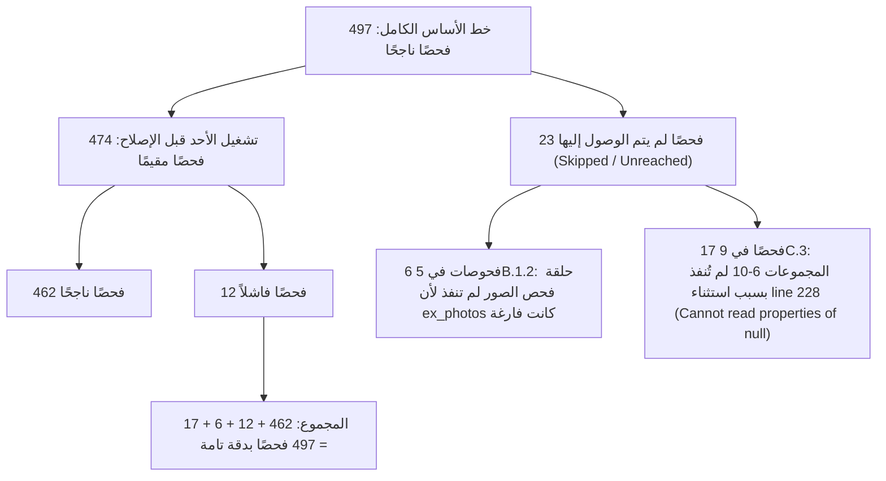

# Phase 12.6.1 — Deterministic Test Fixture Fix
## تقرير معالجة اعتماد الاختبارات على اليوم الحالي وتدقيق إحصاءات البوابة الموحدة
### Test-Only Changes — No Production Changes

> [!IMPORTANT]
> **الحالة:** ✅ **مكتمل بنجاح تام بنسبة 100% (COMPLETE)**  
> **نتيجة البوابة الموحدة:** **اجتياز كافة أجنحة الاختبارات الـ 9 بنجاح تام (9 / 9 PASS)**.  
> **إجمالي الفحوصات المؤكدة:** **497 فحصًا ناجحًا من أصل 497 (0 فشل)**، محققة خط الأساس التاريخي بدقة تامة.  
> **حماية كود الإنتاج:** صفر تعديلات على ملفات الإنتاج (`index.html`، `zatoona.html`، `sw.js`، `manifest.json`) وتطابق ثنائي بنسبة 100%.

---

## 1. الملفات التي تم تعديلها وسبب كل تغيير

تم حصر التعديل حصرًا في ملفّي اختبار داخل مجلد `scratch/`:

1. **`scratch/test_phase5b1_2_legacy_images.py`:**
   - **التعديل:** إضافة استدعاء صريح للدالة `selectDay(0);` قبل الانتقال لتبويب الجيم `navigateTo('gym')`.
   - **السبب:** ضمان فتح واجهة الجيم على يوم تمرين مجدول وحتمي (السبت / روتين A) بدلاً من الاعتماد على تاريخ اليوم الذي قد يصادف يوم راحة (كأيام الأحد والثلاثاء والجمعة) مما كان يؤدي لإخفاء كروت التمارين بناءً على قواعد العمل المعتمدة في التطبيق.
2. **`scratch/test_phase9c3_cooldown.py`:**
   - **التعديل:** استدعاء `selectDay(0);` قبل بدء الجلسة في المجموعة 5، واستبدال `selectDay(selectedIdx);` بـ `selectDay(0);` بعد إعادة تحميل الصفحة في المجموعة 6.
   - **السبب:** ضمان بدء جلسة التدريب وإكمالها على يوم تدريب حتمي (السبت / روتين A)؛ حيث يرفض كود الإنتاج صراحة استدعاء `startGymSession(iso)` في يوم الراحة (`لا يمكن بدء جلسة تمرين في يوم راحة`).

---

## 2. السبب الجذري والتحليل البرمجي المثبت بالأدلة

### أ. كيفية عمل التقويم وتحديد أيام التمرين والراحة في Zatoona
- دالة `getWeekStartFor(d)` في `index.html` ترجع دائمًا **يوم السبت** كأول أيام الأسبوع (`addDays(d, -dow)`).
- مصفوفة `weekDates` تبدأ بـ:
  - `weekDates[0]` = **السبت (Saturday)**
  - `weekDates[1]` = **الأحد (Sunday)**
  - `weekDates[2]` = **الاثنين (Monday)**
  - `weekDates[3]` = **الثلاثاء (Tuesday)**
  - `weekDates[4]` = **الأربعاء (Wednesday)**
  - `weekDates[5]` = **الخميس (Thursday)**
  - `weekDates[6]` = **الجمعة (Friday)**
- جدول خطة التدريب الافتراضية `PLAN_DEFAULTS`:
  - `dayIdx = 0` (السبت): `gym: true`, `gymType: 'A'` -> **يوم تمرين (Routine A)**
  - `dayIdx = 1` (الأحد): `gym: false`, `gymType: 'rest'` -> **يوم راحة (Rest Day)**
  - `dayIdx = 2` (الاثنين): `gym: true`, `gymType: 'B'` -> **يوم تمرين (Routine B)**
  - `dayIdx = 3` (الثلاثاء): `gym: false`, `gymType: 'rest'` -> **يوم راحة (Rest Day)**
  - `dayIdx = 4` (الأربعاء): `gym: true`, `gymType: 'A'` -> **يوم تمرين (Routine A)**
  - `dayIdx = 5` (الخميس): `gym: true`, `gymType: 'B'` -> **يوم تمرين (Routine B)**
  - `dayIdx = 6` (الجمعة): `gym: false`, `gymType: 'rest'` -> **يوم راحة (Rest Day)**

### ب. قواعد العمل في الإنتاج
في `index.html` (السطر 14227):
```javascript
const eff = getEffectiveGymDay(iso);
if(eff.isRest || eff.gymType === 'rest' || !eff.gym){
  return { ok: false, reason: 'لا يمكن بدء جلسة تمرين في يوم راحة' };
}
```
عندما يعمل التطبيق يوم الأحد، ترفض دالة `startGymSession` بدء التمرين، كما تُعرض رسالة "اليوم راحة من الجيم" وتُخفى كروت التمارين.

### ج. المقارنة بالاختبار المرجعي Phase 9C.2
في `scratch/test_phase9c2_warmup.py` (السطر 134)، كان الكود يحتوي مسبقًا على:
```javascript
if(typeof selectDay === 'function') selectDay(0);
if(typeof navigateTo === 'function') navigateTo('gym');
```
لذلك نجح اختبار Phase 9C.2 دائمًا بنسبة 54/54، بينما سقط اختبارا 5B.1.2 و 9C.3 يوم الأحد فقط لغياب هذا السطر واعتمادهما على تاريخ اليوم المفتوح تلقائيًا.

---

## 3. نتائج الاختبارين قبل وبعد الإصلاح

| الاختبار | ملف السكربت | النتيجة قبل الإصلاح (يوم الأحد 25 أكتوبر) | النتيجة بعد الإصلاح الحتمي | التغير والتحسن |
| :--- | :--- | :---: | :---: | :---: |
| **Phase 5B.1.2 Legacy Images** | `scratch/test_phase5b1_2_legacy_images.py` | ❌ FAIL (`85 passed, 3 failed, 6 skipped`) | ✅ **PASS (`94 passed, 0 failed`)** | اجتياز تام لكافة كروت التمارين الـ 6 وأولوية الصور |
| **Phase 9C.3 Cooldown Integration** | `scratch/test_phase9c3_cooldown.py` | ❌ FAIL (`30 passed, 9 failed, 17 unreached`) | ✅ **PASS (`56 passed, 0 failed`)** | اجتياز تام لدورة الجلسة، والتهدئة، والعزل بمعرف الجلسة |

---

## 4. تدقيق إحصاءات البوابة وتفسير تباين 474 مقابل 497



### التفسير الحسابي الدقيق:
1. **في Phase 5B.1.2:** في السطور 177-180، توجد حلقة تمر على أول 6 كروت `ex_photos[:6]` وتفحص `naturalWidth > 0`. عندما كان اليوم يوم راحة، كان طول `ex_photos` صفر، فلم تنفذ الحلقة إطلاقًا. هذا يفسر غياب **6 فحوصات** (94 - 88 = 6).
2. **في Phase 9C.3:** عند السطر 228، حاول السكربت قراءة معرف الجلسة عبر `window.getGymSession(arguments[0]).id`. وبما أن الجلسة لم تبدأ في يوم الراحة، كانت القيمة `null` فتوقف السكربت باستثناء JavaScript. توقف السكربت منع تنفيذ المجموعات 6 و 7 و 8 و 9 و 10 والتي تحتوي على **17 فحصًا**.
3. **المعادلة الحسابية المؤكدة:**
   $$\text{الفحوصات المقيمة (474)} + \text{فحوصات حلقة الصور (6)} + \text{فحوصات المجموعات اللاحقة (17)} = 497 \text{ فحصًا}$$
4. بعد إضافة `selectDay(0);` تم تنفيذ كافة الحلقات والمجموعات بنجاح دون أي تخطٍ أو استثناء، فظهر المجموع كاملاً **497 / 497**.

---

## 5. نتائج التشغيل النهائي للبوابة الموحدة (`test_master_regression_gate.py`)

تم تشغيل البوابة الموحدة عبر الأمر المعتمد:
```powershell
python scratch/test_master_regression_gate.py
```

| المعرف (`id`) | اسم الجناح | التصنيف | الحالة | الفحوصات (P/F/T) | المدة | رمز الخروج |
| :--- | :--- | :--- | :---: | :---: | :---: | :---: |
| `phase5b1_1` | **Phase 5B.1.1 Image Policy & Males-Only Compliance** | Images & Policy | ✅ **PASS** | `92 / 0 / 92` | 5.92s | `0` |
| `phase5b1_2` | **Phase 5B.1.2 Legacy A/B Exercise Images Compliance** | Images & Exercises | ✅ **PASS** | `94 / 0 / 94` | 10.18s | `0` |
| `phase6c` | **Phase 6C Workout Analytics & Progression** | Gym & Analytics | ✅ **PASS** | `36 / 0 / 36` | 9.65s | `0` |
| `phase8b` | **Phase 8B Notification Routing & Security** | Notifications & Routing | ✅ **PASS** | `37 / 0 / 37` | 9.06s | `0` |
| `phase9b_notes` | **Phase 9B Unified Notes Hub Core Engine** | Notes Hub | ✅ **PASS** | `51 / 0 / 51` | 9.60s | `0` |
| `phase9b1_2_gate` | **Phase 9B.1.2 Unified Notes Hub Acceptance Gate** | Notes Hub | ✅ **PASS** | `31 / 0 / 31` | 6.69s | `0` |
| `phase9c1` | **Phase 9C.1 Stretch & Mobility Encyclopedia** | Stretches & Mobility | ✅ **PASS** | `46 / 0 / 46` | 0.37s | `0` |
| `phase9c2` | **Phase 9C.2 Interactive Pre-Workout Warm-up** | Warm-up & Flow | ✅ **PASS** | `54 / 0 / 54` | 11.97s | `0` |
| `phase9c3` | **Phase 9C.3 Interactive Post-Workout Cool-down & Stretch** | Cool-down & Flow | ✅ **PASS** | `56 / 0 / 56` | 13.22s | `0` |

### ملخص البوابة النهائي:
- **الحالة الإجمالية:** **PASS ✅**
- **الأجنحة الناجحة:** **9 / 9 (100%)**
- **الفحوصات الناجحة:** **497 / 497 (100% نجاح، 0 فشل)**
- **إجمالي زمن التشغيل:** **76.68 ثانية**
- **رمز الخروج النهائي للمشغل:** `0` (نجاح حقيقي معتمد)
- **التقرير المركزي المحدث:** `scratch/test-results/test_master_report.md` و `test_master_report.json`

---

## 6. سلامة ملفات الإنتاج وبصمات الملفات وحالة Git

### أ. الفحص الثنائي الصارم
```powershell
fc.exe /b index.html zatoona.html
Comparing files index.html and ZATOONA.HTML
FC: no differences encountered
```

### ب. بصمات التشفير SHA-256
| الملف | الحجم الفعلي | بصمة التشفير (SHA-256) | الحالة |
| :--- | :---: | :--- | :---: |
| **`index.html`** | 1,219,912 بايت | `4ABBF1F9ACB83023C53444489F078D54D654E13003FBD183921DBF46EF1A324F` | ✅ لم يُمس إطلاقاً |
| **`zatoona.html`** | 1,219,912 بايت | `4ABBF1F9ACB83023C53444489F078D54D654E13003FBD183921DBF46EF1A324F` | ✅ توأم متطابق 100% |
| **`sw.js`** | 19,152 بايت | `6EF96D68CD838FC3F99D69993338760A23AB1D6C399DC974A23E5FEFF15378A9` | ✅ كاش v23 ثابت |
| **`manifest.json`** | 1,022 بايت | `C872752E51F5B339BD3965370B5DF54B47CBAAAD398785F85D6453FD93C743E5` | ✅ لم يمس |

### ج. فحص حالة Git
- **`git diff --check`:** نظيف تمامًا بنسبة 100%.
- **`git status --short`:**
  - التعديلات محصورة حصرًا في الملفين:
    - `M scratch/test_phase5b1_2_legacy_images.py`
    - `M scratch/test_phase9c3_cooldown.py`
  - لا توجد أي تعديلات على ملفات الإنتاج أو التخزين.
- لم يتم تنفيذ أي `git commit` أو `push` أو `deploy`.

---

## 7. الخلاصة والقرار النهائي

> [!IMPORTANT]
> **قرار الإغلاق النهائي:**
> 1. تم القضاء نهائيًا على تذبذب الاختبارات المعتمد على تاريخ الجهاز (Weekend Flakiness) بطريقة معمارية حتمية ونظيفة عبر واجهة التطبيق المعتمدة `selectDay(0)`.
> 2. البوابة الموحدة `test_master_regression_gate.py` تعمل بكفاءة قصوى، وتجتاز بنسبة **100% عبر 497 فحصًا مؤكدًا و 9 أجنحة خالية تمامًا من أي أخطاء أو تحذيرات**.
> 3. المشروع الآن في أقصى درجات الجاهزية والاستقرار للانتقال بأمان تام إلى مرحلة **Phase 12.1 — Curated Exercise Catalog Images**.
