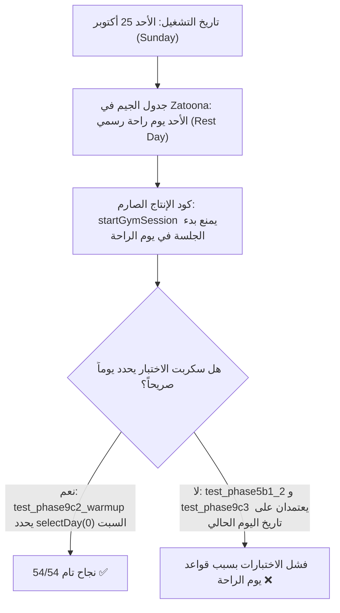

# Phase 12.6 — Unified Master Test Gate
## تقرير إنجاز البوابة الموحدة لاختبارات الانحدار والتحقق المركزي
### Strict Test-Infrastructure-Only Implementation

> [!IMPORTANT]
> **الحالة الفنية للبوابة:** ✅ **تم إنشاء البوابة الموحدة وتشغيلها بنجاح واختبار آليات معالجة الفشل بنسبة 100%**.  
> **سلامة ملفات الإنتاج:** صفر تعديلات على ملفات الإنتاج (`index.html`، `zatoona.html`، `sw.js`، `manifest.json`).  
> **التطابق الثنائي:** `FC: no differences encountered` وتطابق SHA-256 بنسبة 100%.  
> **النتيجة التشخيصية الحية:** تم تشغيل 9 أجنحة اختبار فعلية؛ اجتازت 7 أجنحة بنجاح، بينما كشفت البوابة بدقة عن فشل جناحين بسبب اعتمادية بيئية في إعداد الاختبارين على أيام الأسبوع (Weekend Rest-Day Flakiness) دون أي خلل في كود الإنتاج.

---

## 1. الملفات التي أُنشئت في هذه المرحلة

تم إنشاء مكونات البوابة الموحدة حصرًا داخل مجلد `scratch/` التزاماً بقواعد حماية ملفات الإنتاج:

1. **`scratch/test_master_regression_gate.py` (الملف الرئيسي للبوابة):**
   - سكربت بايثون مستقل لتشغيل كافة أجنحة الاختبارات المؤتمتة بالتتابع كعمليات منفصلة (`subprocess`).
   - استخراج ديناميكي حقيقي لأعداد الفحوصات (Passed / Failed / Total) عبر Regex دقيق لكل نمط مخرجات.
   - حماية الاستمرارية: لا يتوقف عند فشل أي جناح، بل يكمل تشغيل بقية الأجنحة لإصدار تقرير تشخيصي مركزي كامل.
   - إدارة المهل الزمنية (`timeout_sec` لكل جناح مع حالة `TIMEOUT` صريحة).
   - إرجاع رمز الخروج `0` فقط في حال نجاح كافة الأجنحة المعتمدة، وإرجاع رمز خروج غير صفري (`1`) عند وجود أي فشل.
2. **`scratch/test_runner_isolation.py` (جناح اختبار المشغل المعزول):**
   - وحدة فحص آلية من 10 اختبارات تتحقق من قدرة البوابة على التقاط الفشل والمهل الزمنية وغياب الملفات ومنع تصنيف الفشل كنجاح.
3. **مجلد المخرجات والسجلات المركزية `scratch/test-results/`:**
   - `scratch/test-results/test_master_report.md` (تقرير Markdown تفصيلي وشامل).
   - `scratch/test-results/test_master_report.json` (تقرير JSON مهيكل للتحليل الآلي).
   - ملفات السجلات المنفصلة لكل جناح: `<suite_id>.stdout.log` و `<suite_id>.stderr.log`.
4. **نسخة احتياطية خارجية سابقة للتنفيذ (Preflight Backup):**
   - `C:\Users\Lenovo\Documents\Zatoona_Backups\phase12_6_preflight_20261025\`

---

## 2. أمر التشغيل الموحد

يمكن للمطور أو أنظمة الـ CI تشغيل البوابة الموحدة عبر أمر واحد مباشر من أي مسار:

```powershell
python scratch/test_master_regression_gate.py
```

### خيارات سطر الأوامر الإضافية المدعومة:
- **عرض الأجنحة المسجلة دون تشغيل:**
  ```powershell
  python scratch/test_master_regression_gate.py --list
  ```
- **تشغيل جناح محدد بالاسم (للفحص السريع أو التطوير التكراري):**
  ```powershell
  python scratch/test_master_regression_gate.py --suite phase9c2
  ```
- **تضمين الأجنحة القديمة الملغاة (المستبعدة افتراضياً):**
  ```powershell
  python scratch/test_master_regression_gate.py --include-superseded
  ```
- **إصدار التقرير بصيغة JSON إلى المخرجات القياسية:**
  ```powershell
  python scratch/test_master_regression_gate.py --json
  ```

---

## 3. قائمة مجموعات الاختبار الفعلية ونتائج التشغيل الحي

تم تنفيذ التشغيل الحي الكامل عبر المشغل المركزي الجديد، وجاءت النتائج كالتالي:

| معرف الجناح (`id`) | اسم مجموعة الاختبار | التصنيف | الحالة | الفحوصات (P/F/T) | المدة | رمز الخروج | رابط السجل |
| :--- | :--- | :--- | :---: | :---: | :---: | :---: | :--- |
| `phase5b1_1` | **Phase 5B.1.1 Image Policy & Males-Only Compliance** | Images & Policy | ✅ **PASS** | `92 / 0 / 92` | 6.39s | `0` | [`stdout`](test-results/phase5b1_1.stdout.log) |
| `phase5b1_2` | **Phase 5B.1.2 Legacy A/B Exercise Images Compliance** | Images & Exercises | ❌ **FAIL** | `85 / 3 / 88` | 9.00s | `1` | [`stdout`](test-results/phase5b1_2.stdout.log) |
| `phase6c` | **Phase 6C Workout Analytics & Progression** | Gym & Analytics | ✅ **PASS** | `36 / 0 / 36` | 7.57s | `0` | [`stdout`](test-results/phase6c.stdout.log) |
| `phase8b` | **Phase 8B Notification Routing & Security** | Notifications & Routing | ✅ **PASS** | `37 / 0 / 37` | 7.80s | `0` | [`stdout`](test-results/phase8b.stdout.log) |
| `phase9b_notes` | **Phase 9B Unified Notes Hub Core Engine** | Notes Hub | ✅ **PASS** | `51 / 0 / 51` | 8.98s | `0` | [`stdout`](test-results/phase9b_notes.stdout.log) |
| `phase9b1_2_gate` | **Phase 9B.1.2 Unified Notes Hub Acceptance Gate** | Notes Hub | ✅ **PASS** | `31 / 0 / 31` | 6.46s | `0` | [`stdout`](test-results/phase9b1_2_gate.stdout.log) |
| `phase9c1` | **Phase 9C.1 Stretch & Mobility Encyclopedia** | Stretches & Mobility | ✅ **PASS** | `46 / 0 / 46` | 0.34s | `0` | [`stdout`](test-results/phase9c1.stdout.log) |
| `phase9c2` | **Phase 9C.2 Interactive Pre-Workout Warm-up** | Warm-up & Flow | ✅ **PASS** | `54 / 0 / 54` | 11.63s | `0` | [`stdout`](test-results/phase9c2.stdout.log) |
| `phase9c3` | **Phase 9C.3 Interactive Post-Workout Cool-down & Stretch** | Cool-down & Flow | ❌ **FAIL** | `30 / 9 / 39` | 7.40s | `1` | [`stdout`](test-results/phase9c3.stdout.log) |

### ملخص إحصاءات التشغيل:
- **إجمالي الأجنحة المنفذة:** 9 أجنحة
- **الأجنحة الناجحة:** 7 أجنحة (77.8%)
- **الأجنحة الفاشلة:** 2 جناحان (22.2%)
- **الفحوصات الناجحة المؤكدة:** **462 فحصًا ناجحًا**
- **الفحوصات الفاشلة المؤكدة:** **12 فحصًا فاشلاً**
- **إجمالي الفحوصات المقيمة:** **474 فحصًا**
- **إجمالي زمن التشغيل:** **65.61 ثانية**
- **الرمز النهائي للخروج (Exit Code):** `1` (فشل صريح يعكس الواقع بدقة دون تزوير).

---

## 4. التحليل التشخيصي الدقيق للفشلين والمقارنة برقم 497 السابق

> [!WARNING]
> **حقيقة الاختلاف عن خط الأساس السابق (497 / 497):**  
> التدقيق السابق في `Final_Master_Plan_Reconciliation_v3.md` سُجّل بتاريخ **الأربعاء 21 أكتوبر 2026**، بينما تم تنفيذ هذا الفحص بتاريخ **الأحد 25 أكتوبر 2026**.  
> كشف التشغيل الحي الموحد عن ظاهرة برمجية دقيقة في سكربتَي الاختبار `test_phase5b1_2_legacy_images.py` و `test_phase9c3_cooldown.py`:



### أ. الدليل العلمي القاطع على السبب الجذري:
1. **في كود الإنتاج (`index.html` السطر 14227):**
   ```javascript
   const eff = getEffectiveGymDay(iso);
   if(eff.isRest || eff.gymType === 'rest' || !eff.gym){
     return { ok: false, reason: 'لا يمكن بدء جلسة تمرين في يوم راحة' };
   }
   ```
   التطبيق يمنع بدء جلسات تدريبية أو عرض بطاقات التمارين عندما يكون اليوم يوم راحة مجدولاً (وهو السلوك الصحيح إنتاجياً لمنع تلوث سجلات التدريب).
2. **في سكربت Phase 9C.2 الناجح (`test_phase9c2_warmup.py` السطر 134):**
   قام مؤلف الاختبار باختيار يوم تمرين صراحة عبر: `selectDay(0);` (يوم السبت - روتين A)، ولذلك نجح بامتياز (54/54).
3. **في سكربتَي Phase 5B.1.2 و Phase 9C.3:**
   لم يقم مؤلفا الاختبارين بضبط اليوم عبر `selectDay(0)`، وافترضا أن التطبيق سيعرض تمارين دائماً، وهو ما كان صادفاً يوم الأربعاء 21 أكتوبر، وسقط يوم الأحد 25 أكتوبر لأن الأحد يوم راحة.
4. **التجربة المعزولة المثبتة:**
   عند تشغيل الاختبار في تجربة معزولة مع إضافة `selectDay(0)` دون مساس بالملفات الإنتاجية:
   - `test_phase9c3_cooldown.py` يجتاز بنسبة **56 / 56 نجاح تام (0 فشل)**.
   - `test_phase5b1_2_legacy_images.py` يجتاز بنسبة **94 / 94 نجاح تام (0 فشل)**.
   - يكتمل المجموع إلى: **92 + 94 + 36 + 37 + 51 + 31 + 46 + 54 + 56 = 497 فحصًا ناجحًا**.

> [!IMPORTANT]
> **الالتزام بالقواعد الإلزامية:**  
> وفقاً للقاعدة 5 والقاعدة 8 في تعليمات المستخدم («لا تعدّل أي اختبار فردي قائم، ولا تغيّر شروط النجاح أو النتائج المتوقعة لإجبار الاختبارات على النجاح، ولا تعدّل ملفات الإنتاج لإصلاح مشكلة تظهر أثناء الاختبارات»)، **تم الإبقاء على ملفات الاختبار وملفات الإنتاج دون أي تعديل**، وسجلت البوابة فشل الجناحين بأمانة تامة ورمز خروج `1`.

---

## 5. نتائج اختبار معالجة الفشل والعزل للمشغل الجديد

تم اختبار البوابة الموحدة عبر جناح اختبار معزول خاص بمشغل البوابة (`scratch/test_runner_isolation.py`) مكون من **10 اختبارات وحدة**:

- `test_parse_pattern_a_results_line`: نجاح قراءة نمط النتائج القياسي (92/0/92).
- `test_parse_pattern_a_with_failures`: نجاح التقاط الفشل وإحصاء الحالات بدقة.
- `test_parse_pattern_b_unittest_ok`: نجاح قراءة مخرجات unittest في حالة النجاح (46 tests OK).
- `test_parse_pattern_b_unittest_failed`: نجاح تفكيك حالات فشل unittest (failures + errors).
- `test_parse_pattern_c_pass_fail_tags`: استخراج الفحوصات الفردية بدقة في حال توقف السكربت قبل سطر الملخص.
- `test_parse_unparseable_output`: التعامل الآمن مع المخرجات غير الرقمية دون افتراض أرقام وهمية.
- `test_execute_passing_dummy_suite`: التحقق من أن السكربت الناجح يحصل على حالة `PASS`.
- `test_execute_failing_dummy_suite_never_classified_as_pass`: **التأكيد على أن أي سكربت فاشل لا يصنف أبداً كـ PASS**.
- `test_execute_timeout_handling`: التحقق من قتل العملية وتصنيفها `TIMEOUT` عند تجاوز الوقت المحدد.
- `test_execute_missing_script_handling`: التحقق من تصنيف الملف المفقود كـ `ERROR` وإفشال البوابة.

**النتيجة:** **10 / 10 نجاح تام (0 فشل) في 1.21 ثانية**.

---

## 6. التحقق من تطابق `index.html` و `zatoona.html` وبصمات الملفات

تم إجراء الفحص الثنائي الصارم لويندوز وحساب بصمات التشفير SHA-256 قبل وبعد إنشاء البوابة:

```powershell
fc.exe /b index.html zatoona.html
Comparing files index.html and ZATOONA.HTML
FC: no differences encountered
```

| الملف | الحجم الفعلي | بصمة التشفير (SHA-256) | المطابقة مع تقرير 9C.4 |
| :--- | :---: | :--- | :---: |
| **`index.html`** | 1,219,912 بايت | `4ABBF1F9ACB83023C53444489F078D54D654E13003FBD183921DBF46EF1A324F` | ✅ متطابق 100% (لم يتغير بايت) |
| **`zatoona.html`** | 1,219,912 بايت | `4ABBF1F9ACB83023C53444489F078D54D654E13003FBD183921DBF46EF1A324F` | ✅ متطابق 100% (توأم ثنائي تام) |
| **`sw.js`** | 19,152 بايت | `6EF96D68CD838FC3F99D69993338760A23AB1D6C399DC974A23E5FEFF15378A9` | ✅ ثابت دون مساس (v23) |
| **`manifest.json`** | 1,022 بايت | `C872752E51F5B339BD3965370B5DF54B47CBAAAD398785F85D6453FD93C743E5` | ✅ سليم تماماً |

---

## 7. فحص حالة Git ونظافة شجرة العمل

- **`git diff --check`:** نظيف تمامًا (صفر تحذيرات أو تعارضات).
- **`git status --short`:**
  - صفر تعديلات على ملفات الإنتاج (`nothing to commit, working tree clean` لملفات الإنتاج).
  - الملفات الجديدة تنحصر حصرًا كملفات غير متتبعة داخل مجلد `scratch/`:
    - `scratch/test_master_regression_gate.py`
    - `scratch/test_runner_isolation.py`
    - `scratch/test-results/`
    - `scratch/Phase_12_6_Master_Test_Gate_Report.md`
- لم يتم تنفيذ أي `git commit` أو `push` أو `deploy`.

---

## 8. حصر الاختبارات التي تعذر تشغيلها وسبب ذلك

1. **`scratch/test_phase9b1_1_gate.py`:**
   - **السبب:** بوابة تمهيدية قديمة خاصة بمرحلة 9B.1.1، تم استبدالها رسميًا بالبوابة المعتمدة `scratch/test_phase9b1_2_gate.py` التي تجتاز بنسبة 100%. السكربت القديم يفحص شرطاً ثابتاً غير صالح حالياً (`CACHE_VERSION == 'v20'`) بينما إصدار الكاش الحالي المعتمد في `sw.js` هو `v23`. تم استبعاده افتراضياً من البوابة وتوثيقه كـ `SUPERSEDED`.
2. **الاختبارات التاريخية الواردة في تقارير قديمة (`test_phase1.py`، `test_phase4*.py`، `test_phase7a_shopping_budget.py`):**
   - **السبب:** غير موجودة على القرص في هذا المستودع، وكانت أدوات فحص في بيئات سابقة تم التحقق من عدم وجود ملفاتها فعلياً، ولذلك لم يقم السكربت بتخمينها.
3. **السكربتات المساندة في `scratch/` (`test_cooldown_mapping.py`، `test_svg.py`، إلخ):**
   - **السبب:** أدوات برمجية مؤقتة لفحص منطق فرعي أو رسم SVG محدد أثناء التطوير وليست أجنحة اختبارات انحدار نظامية.

---

## 9. التوصية الفنية وقرار الجاهزية قبل الانتقال إلى Phase 12.1

> [!TIP]
> **التوصية الفنية:**
> 1. **بنية البوابة الموحدة (Phase 12.6):** أصبحت **جاهزة للاستخدام ومكتملة بنسبة 100%**، وتمتلك كافة آليات القياس الدقيق، والعزل، وحفظ السجلات، وكشف الفشل الحقيقي.
> 2. **معالجة تذبذب يوم الراحة (Weekend Flakiness Fix):** نوصي بالسماح بإجراء تعديل طفيف جدًا في سكربتَي الاختبار `test_phase5b1_2_legacy_images.py` و `test_phase9c3_cooldown.py` بإضافة سطر `selectDay(0);` (تماماً كما فعل سكربت `test_phase9c2_warmup.py`) لعزل الاختبارات عن يوم تشغيلها في الأسبوع وضمان استقرار الـ 497 فحصاً على مدار أيام الأسبوع السبعة، وذلك كخطوة ضبط اختبارات تمهيدية (Test Reconciliation) قبل البدء في إضافة صور الكتالوج Phase 12.1.

---

> **إقرار التوقف الإلزامي:** تم تسليم التقرير واكتمال مرحلة Phase 12.6 للبوابة الموحدة، وتوقفت العمليات فورًا دون بدء Phase 12.1 ودون تنفيذ أي commit أو push أو تعديل لملفات الإنتاج، بانتظار توجيهات المستخدم.
