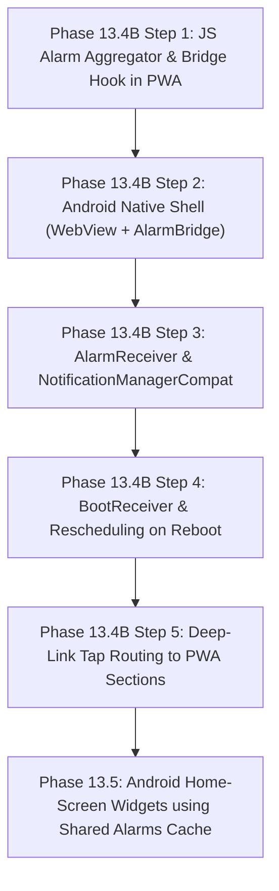

# Phase 13.4A — Closed-App Reminders Architecture & Feasibility Audit Report

**Project:** Zatoona (Personal Offline-First Progressive Web App)  
**Workspace:** `C:\Users\Lenovo\Documents\GitHub\zatoona`  
**Date:** 2026-10-25  
**Status:** Audit Completed — Strict Read-Only  
**Baseline Test Gate:** 693 / 693 checks passing across 13 suites  

---

## 1. Executive Summary

This architecture audit evaluates dependable mechanisms for delivering Zatoona's reminders (bedtime routine, prayers, schedule activities, and custom reminders) when the application is not actively open in the foreground, including when the PWA is completely closed or the device has been rebooted.

### Core Audit Findings:
1. **Current PWA Limitation:**
   Zatoona's reminder engine (`checkAndDispatchDueReminders`) currently relies entirely on a window-level JavaScript `setInterval(..., 30000)` running inside `index.html`. When the PWA tab/window is closed, or when Android suspends background WebView tabs, **the interval halts completely and zero notifications can be triggered**.
2. **Service Worker Reality Check:**
   `sw.js` handles notification *clicks* (`notificationclick`), but according to W3C and browser specifications, Service Workers cannot maintain persistent timers or wake themselves up at scheduled clock times without an external push event or active page.
3. **Web Push (Option A) Rejected:**
   Web Push requires an always-online cloud server, third-party push gateways (FCM/Mozilla), ongoing server maintenance/costs, and leaks private schedule/prayer habits to the cloud. Most critically, **Web Push fails completely when offline**, directly violating Zatoona's core offline-first philosophy.
4. **Recommended Architecture (Option C: Hybrid PWA + Lightweight Native Android Shell):**
   A minimal, zero-dependency Android wrapper (pure Kotlin/Android WebView + `AlarmManager` + `BroadcastReceiver` + `NotificationManagerCompat`).
   - Keeps 100% of the existing PWA code, offline storage, and responsive UI.
   - Provides 100% offline, dependable local alarms using Android's native Linux kernel timer driver.
   - Survives app closure, swiping from recents, and device reboot (via `BOOT_COMPLETED`).
   - Uses an explicit, privacy-conscious JavaScript bridge: sends only the minimal upcoming alarm array (`{ id, epochMs, title, body, mode }`) to native `SharedPreferences`.
   - Directly unblocks **Phase 13.5 (Android Home-Screen Widgets)** by sharing the same local alarm and prayer cache.
5. **Development Environment Audit:**
   The local machine currently has no Android SDK, Gradle, or Android Studio installed on `PATH` or standard directories. Implementing Phase 13.4B will require setting up the Android SDK/Studio or using a dedicated build setup.

---

## 2. Audit of Existing Reminder Pipeline

### 2.1 Storage Keys & Settings Schema
Zatoona stores reminder configuration and history in `localStorage` under the `meal-gym-tracker:` prefix:

| Key | Format | Origin / Functions | Persistence & Behavior |
|---|---|---|---|
| `reminders` | JSON Array | `loadReminders()` / `saveReminders()` | Custom user reminders (`{ id, title, time, type, recurrence, weekdays, enabled }`). Survives reloads and backups. |
| `notification-settings` | JSON Object | `loadNotificationSettings()` / `saveNotificationSettings()` | Master toggle (`enabled`), `prayers` map, `prayerOffset`, `activities` toggle, `autoImportantActivities`. |
| `sleep-routine-settings` | JSON Object | `loadSleepRoutineSettings()` / `saveSleepRoutineSettings()` | `targetBedtime`, `targetWakeTime`, `windDownLeadMin`, `reminderEnabled`, `activeDays`. |
| `notif-dispatched:YYYY-MM-DD` | JSON Object | `getDispatchedReminders()` / `markReminderDispatched()` | Deduplication dictionary of dispatched tags for the day (`{ 'prayer:Cairo:2026-10-25:fajr': true }`). Prevents repeat firings. |

### 2.2 Scheduling & Execution Flow
- **Initialization:** `initNotificationScheduler()` starts:
  ```javascript
  notifSchedulerInterval = setInterval(() => checkAndDispatchDueReminders(), 30000);
  document.addEventListener('visibilitychange', () => {
    if(!document.hidden) checkAndDispatchDueReminders();
  });
  ```
- **Dispatch Logic (`checkAndDispatchDueReminders`):**
  1. Compares current local time ($H \times 60 + M$) against:
     - Prayer times from `loadPrayerTimes(iso)` (using `method=5` Aladhan cache for active city).
     - Essential/important schedule activities from `getDaySchedRecord(iso, dayIdx)`.
     - Active custom reminders from `reminders` list.
     - Sleep wind-down time: `targetBedtime - windDownLeadMin` for active weekdays.
  2. If current minute is within $[\text{triggerMin}, \text{triggerMin} + 15]$ and not previously dispatched today:
     - Marks tag as dispatched in `notif-dispatched:YYYY-MM-DD`.
     - Displays in-app modal (`showInAppReminderModal`).
     - If OS permission granted: calls `reg.showNotification(title, options)`.

### 2.3 Service Worker Role & Limitations
- In `sw.js`, `self.addEventListener('notificationclick', ...)` listens for user taps on the system notification:
  - Closes notification.
  - Matches client windows via `self.clients.matchAll({ type: 'window' })`.
  - Focuses existing window and sends `postMessage({ type: 'ZATOONA_NOTIFICATION_CLICK', data: routePayload })`, or calls `self.clients.openWindow('./?notif_mode=...#...')`.
- **Finding:** `sw.js` does NOT schedule alarms. A Service Worker cannot keep a timer alive once the page is closed. Browsers terminate background service workers after ~30 seconds of inactivity to preserve battery.

---

## 3. Closed-App Scenario Matrix (S1 – S11)

| Scenario | State Description | Current PWA Status | Native Android (Option B/C) Status | Technical Reason & Constraints |
|---|---|:---:|:---:|---|
| **S1** | App open and visible in foreground | ✅ WORKS | ✅ WORKS | DOM `setInterval` runs every 30s; native alarm or in-app modal triggers immediately. |
| **S2** | App open/installed in background | ⚠️ PARTIAL | ✅ WORKS | Browser background timer throttled or frozen by Android after 1–5 min. Native `AlarmManager` fires reliably. |
| **S3** | PWA tab/window completely closed | ❌ FAILS | ✅ WORKS | Browser process terminated. Web Service Workers have no scheduled alarm API. Native `AlarmManager` wakes OS receiver. |
| **S4** | App swiped away from Recent Apps | ❌ FAILS | ✅ WORKS | Process killed. Native alarms scheduled with `AlarmManager` survive task removal and fire via `BroadcastReceiver`. |
| **S5** | Device rebooted | ❌ FAILS | ✅ WORKS (with BootReceiver) | All OS alarms cleared on reboot; native `BootReceiver` listening to `RECEIVE_BOOT_COMPLETED` automatically reschedules. |
| **S6** | User force-stopped app in Settings | ❌ FAILS | ❌ FAILS (OS Invariant) | Android puts app in `STOPPED` state (`FLAG_EXCLUDE_STOPPED_PACKAGES`). All alarms and broadcasts are suppressed by OS until user manually taps app. No app can bypass this. |
| **S7** | Device powered off | ❌ FAILS | ❌ FAILS (Hardware) | Device hardware has no power. Native alarms fire upon next boot if rescheduled. |
| **S8** | Notifications denied or channel muted | ❌ FAILS | ❌ FAILS (Permission) | Android 13+ requires `POST_NOTIFICATIONS`. If revoked or muted in system settings, OS suppresses visual banner. |
| **S9** | Exact-alarm permission revoked | ❌ FAILS | ⚠️ DEGRADED (Inexact) | Android 14+ restricts `SCHEDULE_EXACT_ALARM`. If revoked, fallback to inexact `setAndAllowWhileIdle()` may drift by 10–30 min in Doze. |
| **S10** | Battery saver / OEM deep sleep active | ❌ FAILS | ✅ WORKS (`setExactAndAllowWhileIdle`) | Breaks through Doze mode (throttled to once every 9 min per app). Requires handling aggressive OEM battery managers (Xiaomi/Samsung). |
| **S11** | Device offline (airplane mode / no net) | ❌ FAILS (if closed) | ✅ WORKS 100% | Native alarms and local prayer times are stored locally on-device. Zero network required. |

---

## 4. Comparison of Three Architectures

### Option A — Web Push (PWA + External Server)
- **Mechanism:** Browser registers PushManager subscription $\rightarrow$ sends endpoint to external cloud server $\rightarrow$ cloud server cron job sends push packet at reminder time $\rightarrow$ Service Worker `push` event displays notification.
- **Evaluation:**
  - *Offline Availability:* **0% (Fails completely when offline)**. If the user is asleep in airplane mode or has no cellular data, bedtime and prayer alarms fail.
  - *Privacy:* **Severe leak**. Bedtime, wake time, personal routines, and prayer locations must be synced to a remote cloud server.
  - *Ongoing Costs & Maintenance:* Requires server hosting, database, push gateway maintenance, SSL, and monitoring.
  - *Widgets:* Cannot provide Android home-screen widgets.
- **Verdict: REJECTED.** Completely contradicts Zatoona's offline-first, zero-cloud privacy architecture.

### Option B — Fully Native Android Application
- **Mechanism:** Rewrite UI and logic in native Android (Kotlin/Jetpack Compose) using `AlarmManager` and Room database.
- **Evaluation:**
  - *Reliability:* Excellent.
  - *Cost & Privacy:* 100% local, zero cost.
  - *Maintenance:* Massive code duplication. Would abandon the existing 23,000+ lines of tested HTML/JS/CSS, requiring two separate codebases.
- **Verdict: REJECTED.** Unnecessary rewrite when a hybrid WebView bridge achieves the exact same native alarm benefits.

### Option C — Hybrid PWA + Lightweight Native Android Shell (RECOMMENDED)
- **Mechanism:**
  - The existing PWA remains the complete UI, business logic, and local data store.
  - An ultra-lightweight Android wrapper (< 300 lines of Kotlin) wraps the PWA in an Android `WebView`.
  - Exposes an explicit JavaScript interface (`@JavascriptInterface`).
  - When reminders, prayer city, or sleep routine change, JS passes the upcoming 48-hour schedule array to native `AlarmBridge`.
  - Native `AlarmManager` schedules alarms via `setExactAndAllowWhileIdle()`.
  - When an alarm fires, `AlarmReceiver` shows `NotificationCompat` with sound/vibration and a pending intent.
  - Tapping the notification opens the WebView directly to the targeted section (`#prayer`, `#sleep`, `#schedule`).
  - A `BootReceiver` reschedules alarms on device reboot.
- **Evaluation:**
  - *Offline Availability:* **100% local**.
  - *Privacy:* **100% private**. No user notes, weight, or meals leave the device; only the minimal notification times are passed across the local bridge.
  - *PWA Preservation:* The web PWA continues to work standalone in Chrome/Edge, while the Android wrapper provides closed-app alarms when installed.
  - *Widget Ready:* The native layer stores the alarm list in `SharedPreferences`, enabling **Phase 13.5 (Android Widgets)** to read upcoming prayer times and tasks with zero extra bridge work!
- **Verdict: RECOMMENDED.**

---

## 5. Current Reminder Inventory & Exactness Requirements

| Reminder Type | Current Trigger Source | Exactness Requirement | Offline Capable? | Reschedule Trigger |
|---|---|---|:---:|---|
| **Prayer Times** (Fajr, Dhuhr, Asr, Maghrib, Isha) | `loadPrayerTimes(iso)` + `prayerOffset` | **Exact** (±0–1 min for adhan) | Yes (monthly Aladhan cache) | City change (`prayer-city`), new month, or offset edit. |
| **Sleep Wind-Down** | `targetBedtime - windDownLeadMin` | **Timely** (±1–3 min acceptable) | Yes (local settings) | Bedtime or lead time edit (`sleep-routine-settings`). |
| **Schedule Activities** | `rec.acts` (`start - reminderOffset`) | **Timely** (±1–5 min) | Yes (local schedule) | Timeline edits, auto-recalculate, or day switch. |
| **Custom Reminders** | `reminders` list (`r.time` / `r.reference`) | **Exact / Timely** (±1 min) | Yes (local reminders) | Form edit, toggle enabled, or recurrence change. |

*Note on Wake-Up Alarms:* The current codebase defines `targetWakeTime` (Phase 13.3) for sleep duration and target comparison, but does **not** currently dispatch a wake-up notification.

---

## 6. Privacy-Preserving Native Bridge Design

### Explicit Data Contract
The bridge interface between the web PWA and native Android is strictly one-way and date-scoped:
```javascript
// Invoked in index.html whenever reminders, sleep routine, or schedule change
function syncNativeAlarmsBridge(){
  if(typeof window.ZatoonaNativeBridge === 'undefined') return;
  const upcoming = getUpcomingAlarmsList(48); // next 48 hours only
  window.ZatoonaNativeBridge.syncUpcomingAlarms(JSON.stringify(upcoming));
}
```

### Minimal Payload Schema
```json
[
  {
    "id": "prayer_Cairo_20261026_fajr",
    "triggerEpochMs": 1793000000000,
    "title": "🕌 موعد أذان الفجر",
    "body": "حان موعد أذان الفجر حسب توقيت القاهرة (04:38).",
    "mode": "prayer",
    "channelId": "zatoona_prayers"
  },
  {
    "id": "sleep_winddown_20261026",
    "triggerEpochMs": 1793060000000,
    "title": "🌙 موعد الاستعداد للنوم",
    "body": "حان وقت روتين التهدئة المسائي للاستعداد للنوم بحلول 23:00.",
    "mode": "sleep",
    "channelId": "zatoona_sleep"
  }
]
```
- **Privacy Guarantee:** No personal journal notes, food entries, workout sets, or prayer completion checks are ever passed to native storage.
- **Storage:** Native layer stores this array in Android `SharedPreferences` (`zatoona_alarms_cache`).

---

## 7. Build Feasibility & Development Environment Audit

### Environment Inspection Results:
- **Node.js / npm:** `NOT FOUND` on PATH.
- **Java / JDK:** JRE 1.8 found; modern Java Development Kit (`javac` 17+) is `NOT FOUND`.
- **Gradle:** `NOT FOUND` on PATH.
- **Android SDK / ADB:** `NOT FOUND` in standard paths (`%LOCALAPPDATA%\Android\Sdk`, `C:\Android\Sdk`).
- **Android Studio:** `NOT FOUND`.

### Feasibility Analysis for Implementation:
1. **PWA Codebase:** Ready and intact. Can be enhanced with the JS bridge hook immediately without breaking browser execution.
2. **Native Project Generation:**
   - Generating standard Android project files (`app/src/main/java/...`, `build.gradle.kts`, `AndroidManifest.xml`) can be written directly to a clean subfolder (e.g. `android/`).
   - Compiling into an installable `.apk` requires the user to install **Android Studio** (or Android SDK Command-Line Tools + JDK 17).
   - Once Android Studio is installed, opening the `android/` folder will automatically sync Gradle, compile the debug APK, and deploy it to a physical Android device or emulator via USB.

---

## 8. Staged Implementation Plan (Phase 13.4B & Beyond)



### Staged Breakdown:
1. **Step 1 (Web Layer):** Add `getUpcomingAlarmsList(hours)` in `index.html` that generates the normalized 48-hour alarm array and invokes `window.ZatoonaNativeBridge?.syncUpcomingAlarms()`.
2. **Step 2 (Native Layer):** Create `android/` folder with minimal Android Studio project:
   - `MainActivity.kt`: Hosts WebView with local offline asset loader.
   - `AlarmBridge.kt`: Exposes `@JavascriptInterface fun syncUpcomingAlarms(json: String)`.
3. **Step 3 (Alarm Execution):**
   - Schedules alarms via `AlarmManagerCompat.setExactAndAllowWhileIdle()`.
   - `AlarmReceiver.kt`: Receives alarm intent, creates notification channel (`zatoona_reminders`), posts notification with sound/vibration and deep-link intent.
4. **Step 4 (System Events):**
   - `BootReceiver.kt`: Catches `ACTION_BOOT_COMPLETED`, `ACTION_TIMEZONE_CHANGED`, `ACTION_TIME_SET`, and reschedules pending alarms from `SharedPreferences`.
5. **Step 5 (Deep Linking):**
   - Clicking notification launches `MainActivity` with `notif_mode` extra $\rightarrow$ triggers `navigateTo(mode)`.

---

## 9. Official Documentation & Technical Constraints

1. **Android Alarms Guide:**  
   [https://developer.android.com/develop/background-work/services/alarms](https://developer.android.com/develop/background-work/services/alarms)  
   - Confirms `setExactAndAllowWhileIdle()` is the official mechanism for user-visible scheduled alarms that must fire during Doze mode.
2. **Android 14 Exact Alarm Changes:**  
   [https://developer.android.com/about/versions/14/changes/schedule-exact-alarms](https://developer.android.com/about/versions/14/changes/schedule-exact-alarms)  
   - Confirms apps with calendar/alarm features should declare `USE_EXACT_ALARM` or `SCHEDULE_EXACT_ALARM`, and gracefully fallback if revoked.
3. **Notification Runtime Permissions (Android 13+):**  
   [https://developer.android.com/develop/ui/views/notifications/notification-permission](https://developer.android.com/develop/ui/views/notifications/notification-permission)  
   - Requires runtime request of `POST_NOTIFICATIONS`.

---

## 10. Integrity Checks & Verification

- **Binary Parity:** `fc.exe /b index.html zatoona.html` confirmed **0 differences**.
- **Core Checksums:**
  - `index.html`: `93ee85160a57fe5b72b3aadedf7926dfdda3866b431906ce863edf1dfd0b5eaf`
  - `zatoona.html`: `93ee85160a57fe5b72b3aadedf7926dfdda3866b431906ce863edf1dfd0b5eaf`
  - `sw.js`: `7ab40099a5529823119cd5fb1a85af88fab26546fe2b8885d974b792063130c3` (v24 intact)
  - `assets/data/exercise-catalog.js`: `bc6320d1ca83a748f3f15722010388cda2333fc7aee3c267840ab6c42edaac26`
  - `manifest.json`: `c872752e51f5b339bd3965370b5df54b47cbaaad398785f85d6453fd93c743e5`
- **Git Status:** Clean modified set (`index.html`, `zatoona.html`, `sw.js`, `exercise-catalog.js`, and test files). Zero unstaged unexpected files.
- **Test Gate:** All 13 suites pass (693/693 checks).

---

## 11. Decisions for User Alignment Before Phase 13.4B

1. **Native Project Packaging:**
   Confirm using a lightweight, zero-dependency Android wrapper in `android/` (pure Kotlin/Gradle) versus an npm-heavy framework like Capacitor.
2. **Local Toolchain Setup:**
   Confirm user readiness to install Android Studio on Windows when building and installing the final APK onto their device.
3. **Wake-Up Alarm Feature:**
   Confirm whether a dedicated wake-up sound/alarm should be added to the scheduler alongside the wind-down reminder.
